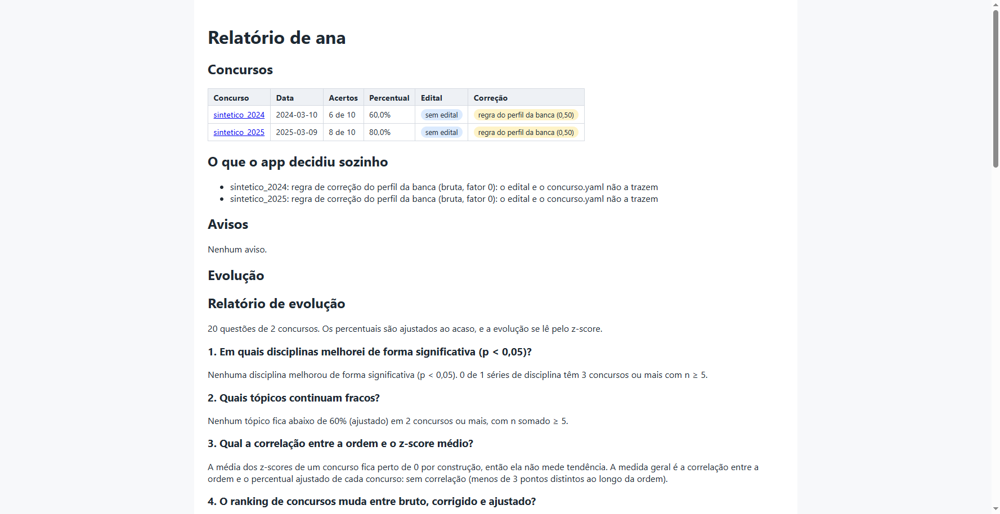

# Análise de Desempenho em Concursos

Ferramenta local que corrige suas provas de concurso e mostra **em quais disciplinas e tópicos do edital você perde pontos**, por concurso e entre concursos.

Tudo roda na sua máquina: nenhum arquivo é enviado para lugar nenhum. O único acesso à rede é opcional, quando você liga um LLM para ajudar a ler editais (veja [LLM opcional](#llm-opcional)).

## Começo rápido

Com o [uv](https://docs.astral.sh/uv/getting-started/installation/) instalado, crie uma pasta `provas/` com uma subpasta por concurso, copie para ela os arquivos que vieram da banca e rode, na pasta que contém `provas/`:

```bash
uvx --from <caminho deste repositório> concurso-analise
```

Para ter o comando no PATH: `uv tool install <caminho deste repositório>`. Depois, basta `concurso-analise`. O pacote ainda não está no PyPI.

Na primeira execução, um assistente faz 6 perguntas. Enter aceita o padrão entre colchetes:

```text
$ concurso-analise
[1/6] Seu nome [ana]: Ana
[2/6] Pasta de provas [provas]:
[3/6] Pasta de análises [analises]:
[4/6] Folha preenchida para calibrar a leitura (Enter para pular):
[5/6] LLM para ler editais de bancas desconhecidas (nenhum/openai/openrouter/gemini/ollama/anthropic) [nenhum]:
[6/6] Conferir o ambiente com o doctor no fim? (s/n) [s]:
Vou gravar:
  candidato: Ana
  pasta de provas: ~/meus-concursos/provas
  pasta de análises: ~/meus-concursos/analises
  LLM: nenhum
  leitura da folha: detecção automática ou perfil da banca
  em ~/meus-concursos/.concurso/config.toml e ~/.concurso/config.toml
Gravar? [S/n]
```

Em seguida, o `doctor` confere o ambiente e a análise mostra o progresso. Os avisos dizem o que o app decidiu sozinho:

```text
✓ uv: ~/.local/bin/uv
✓ Python: 3.12.3
✗ Tesseract: não encontrado no PATH; sem ele, edital e folha em imagem não são lidos
    correção: sudo apt install tesseract-ocr tesseract-ocr-por
✓ poppler: não necessário (os PDFs são lidos com pypdfium2)
✓ espaço em disco: 908272 MB livres em ~/meus-concursos/provas
✓ LLM: desligado (nenhuma chamada de rede)
INFO Analisando sintetico_2024
WARNING sintetico_2024: regra de correção não encontrada no edital nem no concurso.yaml; usando a do perfil da banca fgv (fator 0)
INFO Saídas de sintetico_2024 gravadas em analises/ana/sintetico_2024
INFO Analisando sintetico_2025
INFO Saídas de sintetico_2025 gravadas em analises/ana/sintetico_2025
INFO Relatório HTML gravado em analises/ana/index.html
relatório: ~/meus-concursos/analises/ana/index.html
```

No fim, o relatório abre no navegador (no WSL, no navegador do Windows):



Rodar de novo só reprocessa o que mudou. Sem mudanças, nenhum arquivo de `analises/` é tocado.

### Sem uv: Docker

A imagem já traz o Tesseract em português. A pasta montada em `/dados` é o projeto:

```bash
docker build -t concurso-analise .
docker run --rm -it --user "$(id -u):$(id -g)" -v "$PWD:/dados" concurso-analise
```

## Comandos

Sem subcomando, `concurso-analise` faz o onboarding (na primeira vez) e analisa o que mudou.

| Comando | O que faz |
|---|---|
| `init` | Refaz as perguntas do onboarding, com as respostas atuais como padrão. `--calibrate-sheet` e `--calibrate-answers` calibram a leitura da folha. |
| `add <pasta>` | Cadastra a pasta de um concurso: detecta o papel de cada arquivo, a banca e o status do gabarito, e pergunta só o que for ambíguo. |
| `add <arquivo> --candidate <nome>` | Copia uma folha ou um arquivo de respostas para o candidato. |
| `analyze [concurso]` | Analisa os concursos que mudaram, ou só o indicado. `--reuse-csv` aplica a correção manual da leitura da folha. |
| `status` | Situação de cada concurso: `completo`, `incompleto` ou `desatualizado`, e o status do gabarito. |
| `report` | Reabre o último relatório HTML. |
| `export --format csv\|parquet\|md` | Grava o consolidado do candidato, uma linha por questão. |
| `doctor` | Confere uv, Python, Tesseract, permissão de escrita, espaço em disco e a chave do LLM, com o comando de correção para o seu sistema. |
| `upgrade` | Mostra o comando que atualiza a ferramenta. Com `--run`, executa `uv tool upgrade concurso-analise`. |

Flags globais, antes do subcomando: `--yes` (aceita os padrões sem perguntar), `--quiet`, `--verbose`, `--dry-run` (mostra o que seria feito, sem gravar nada), `--force` (reprocessa tudo), `--candidate`, `--all-candidates`, `--no-open`, `--no-llm`, `--offline`, `--data-dir`, `--provas` e `--analises`.

Sem terminal interativo, com a variável `CI` ou com `--yes`, nada é perguntado: o app usa os padrões e os lista no log.

Códigos de saída: 0 sucesso, 1 problema nos seus dados ou na configuração, 2 problema no ambiente. Um erro aparece em até duas linhas, a causa e uma `dica:` com o que fazer. Os detalhes técnicos ficam em `~/.concurso/logs/concurso-analise.log`.

O comando antigo `concursos` continua funcionando, com aviso de obsoleto.

## Organizar as provas

```text
provas/
  tcu_25/
    edital.pdf, anexos, cadernos de prova, gabaritos
    candidatos/
      ana/
        folha.pdf            # ou respostas.txt, ou respostas.csv
      bruno/
        respostas.txt
```

1. Crie `provas/<concurso>/` e copie os arquivos com os nomes que vieram da banca: edital e anexos, cadernos de prova, gabaritos (preliminar ou definitivo; PDFs com vários cargos são aceitos) e, opcionalmente, o resultado oficial com a sua nota.
2. Coloque suas respostas em `candidatos/<seu nome>/`: a folha de resposta (PDF ou imagem), um `respostas.txt` ou um `respostas.csv`. `add <arquivo> --candidate <nome>` faz isso por você.
3. Rode `concurso-analise`. Uma pasta sem `concurso.yaml` aparece no `status` como incompleta; `add provas/<concurso>` a cadastra.

Um projeto pode ter vários candidatos. A análise usa o último candidato analisado; troque com `--candidate <nome>`, ou analise todos com `--all-candidates`, que gera também `analises/comparativo_candidatos.md`.

Bancas com perfil embutido: Cebraspe (certo/errado, um erro anula um acerto), FGV, FCC, Vunesp, IBFC, Idecan, SELECON e Quadrix. Uma banca sem perfil usa o genérico, e o que o edital não disser fica para você confirmar (veja [Problemas comuns](#problemas-comuns)).

O assistente `./scripts/novo_concurso.sh` guia a coleta, o cadastro e a análise de um concurso novo, passo a passo.

### Formato do `respostas.txt`

Use quando não tiver a folha de resposta. Escreva uma questão por linha:

```text
# comentários começam com #
1 A
02: C
3-E
4 -
```

- Múltipla escolha aceita as letras do concurso (de `A` a `D` ou a `E`); certo/errado (Cebraspe) aceita `C` ou `E`.
- `-` ou valor vazio indicam branco. Questões omitidas também contam como branco.
- Separadores aceitos: espaço, `:`, `;`, `,`, `.` e `-`. Zeros à esquerda são ignorados.
- Erros indicam o número da linha.

Um gabarito em texto usa o mesmo formato, com `X` ou `*` para questão anulada.

Um `respostas.csv` tem as colunas `questao` e `alternativa`, com separador `,` ou `;`, como o Excel ou o LibreOffice gravam.

## Problemas comuns

**"pasta de provas não encontrada".** Rode o comando na pasta que contém `provas/`, ou indique outra com `--provas <pasta>`. O assistente oferece criar a pasta, com um `LEIA-ME.txt` que explica o que pôr nela.

**Tesseract ausente.** Só é necessário para edital ou folha em imagem (PDF escaneado). O `doctor` mostra o comando para o seu sistema: `sudo apt install tesseract-ocr tesseract-ocr-por` no Ubuntu e no WSL, `brew install tesseract tesseract-lang` no macOS e `winget install UB-Mannheim.TesseractOCR` no Windows. Sem ele, o edital em imagem cai no modo mínimo, com aviso, e a imagem Docker já o traz.

**A folha de resposta não foi lida, ou foi lida errado.** Em ordem:

1. Abra `analises/<candidato>/<concurso>/respostas_extraidas.csv`. As leituras com `revisar = True` têm confiança baixa.
2. Corrija a coluna `alternativa_marcada` no Excel ou no LibreOffice e rode `concurso-analise analyze <concurso> --reuse-csv`. A revisão passa a valer no lugar da folha.
3. Se a sua folha tem um modelo que o app não conhece, calibre a leitura: `concurso-analise init --calibrate-sheet folha.png --calibrate-answers ABCD-`, com as respostas das 5 primeiras questões (`-` para branco).
4. Sem a folha, digite as respostas num `respostas.csv` ou `respostas.txt` na pasta do candidato.

**"edital_a_confirmar.yaml" apareceu na pasta do concurso.** O edital não trouxe algum campo que muda a nota (número de alternativas, desconto por erro, data da prova). Preencha os valores no arquivo e rode de novo; eles passam a valer com fonte `config`. O relatório marca cada concurso com a confiança da leitura do edital (alta, média, baixa ou mínima).

**Vários candidatos e nenhum escolhido.** A CLI pede `--candidate <nome>` ou `--all-candidates`.

**Mudei um limiar e nada mudou.** A análise só reprocessa o que mudou nos arquivos. Rode `concurso-analise --force`.

**O relatório não abriu.** O caminho do `index.html` aparece no fim da execução, e `concurso-analise report` o reabre. No WSL, o app usa o `wslview` (pacote `wslu`) ou o `explorer.exe`.

**O LLM não foi usado.** O `doctor` diz qual variável de ambiente definir com a chave. `--offline` e `--no-llm` o desligam de propósito.

**Eu usava a versão anterior (`concursos analisar`).** Na primeira execução, o `concurso-analise` migra o projeto para o layout com candidatos, sem reprocessar nada. Antes, copia tudo o que vai mudar para `~/.concurso/backup-<data>/`. `--dry-run` lista o que seria migrado.

## Saídas

Por concurso, em `analises/<candidato>/<concurso>/`:

| Arquivo | Conteúdo |
|---|---|
| `relatorio.md` e `relatorio.html` | Resumo, nota final pela regra do edital (com desconto por erro ou pesos), gráficos, tópicos mais fracos, questões para revisar, validação oficial |
| `respostas_extraidas.csv` | Todas as questões: alternativa marcada, estado, `confianca_ocr`, `revisar`, origem, arquivo, página |
| `desempenho_por_disciplina.csv`, `desempenho_por_topico.csv` | `concurso, prova, disciplina, topico, total, acertos, erros, percentual, em_branco, anuladas, nota_liquida` |
| `questoes.csv` | Por questão: disciplina, tópico sugerido e final, score, gabarito, resposta, resultado |
| `correcao.json` | Regra de correção e data da prova, com o trecho e a página de origem |
| `edital_estruturado.json` | Conteúdo programático do cargo e as regras do edital, cada valor com fonte, confiança, trecho, documento e página |
| `discrepancias_edital.csv`, `catalogo_edital.md` | Validação edital × prova × gabarito e catálogo de descobertas |
| `diff_gabarito.csv`, `historico/` | Só após a troca de gabarito preliminar por definitivo |
| `depuracao/*.png` | Bolhas detectadas na folha de resposta |

Por candidato, em `analises/<candidato>/`:

- `index.html`: o relatório com todos os concursos, o que o app decidiu sozinho, os avisos e a evolução;
- `consolidado/desempenho_geral.csv` e `consolidado/comparativo_concursos.md`: desempenho e nota final por concurso, tópicos e disciplinas abaixo do limiar em pelo menos dois concursos, concursos incompletos e validação com o resultado oficial;
- `consolidado/consolidado.parquet` e `consolidado/relatorio_evolucao.md`, com os gráficos de evolução.

O percentual é de mérito: anuladas contam como acerto, mas ficam fora do percentual.

## Revisão de tópicos

Com o edital cadastrado, cada questão recebe uma disciplina e um tópico sugeridos. A sugestão compara o texto da questão (na Cebraspe, o bloco "julgue os itens") com os tópicos do edital, por similaridade TF-IDF, e vem com um score.

Na primeira análise é criado `provas/<concurso>/revisao/questoes_revisado.csv`, com as sugestões, o score, um trecho do enunciado e as colunas `disciplina` e `topico` vazias. Preencha essas colunas só nas questões que quiser corrigir e rode de novo. A revisão tem prioridade sobre a sugestão. O relatório lista as sugestões com score baixo ainda não revisadas.

Se o conteúdo programático não puder ser extraído do edital, forneça um edital manual em YAML (veja [docs/modelo.md](docs/modelo.md#edital-manual)).

## Troca de gabarito preliminar para definitivo

Analise com o gabarito preliminar enquanto o definitivo não sai; o relatório mostra o selo **Gabarito preliminar (provisório)**. Quando o definitivo sair, coloque-o na pasta (ou sobrescreva o arquivo do preliminar) e rode de novo.

Se o definitivo casar com a prova configurada (mesma banca, cargo/tipo e faixa de itens), a análise:

- atualiza o `concurso.yaml`;
- move o preliminar para `ignorar` e registra o evento em `historico`;
- guarda as saídas anteriores em `analises/<candidato>/<concurso>/historico/`;
- gera `diff_gabarito.csv`, com as questões alteradas e anuladas, sua resposta e o acerto antes e depois;
- adiciona ao relatório a seção "Preliminar → Definitivo".

Em qualquer outro caso (outro cargo, arquivo desconhecido), o concurso fica `desatualizado` até você rodar `add` de novo.

## Configuração

A configuração do projeto fica em `.concurso/config.toml`, gravada pelo onboarding:

```toml
[pastas]
provas = "provas"
analises = "analises"

[analise]
limiar_confianca = 0.75     # leituras abaixo dele ficam com revisar = True
limiar_topico_baixo = 0.6   # define o desempenho baixo no comparativo
concurso_alvo = "tcu_25"    # opcional; o concurso que a nota ponderada e o gap para o corte analisam
```

Depois de mudar um limiar, rode com `--force`. A precedência é: flag, variável de ambiente (`CONCURSO_PROVAS`, `CONCURSO_ANALISES`, `CONCURSO_CANDIDATO`, `CONCURSO_HOME`), `config.toml`, padrão.

O `concurso.yaml` de cada pasta é gerado pelo `add` e pode ser editado à mão. Quando o edital não traz a regra de correção ou a data da prova, ou quando o concurso tem opções de cargo com pesos diferentes (CPNU), declare-as nele:

```yaml
data_prova: 2025-10-05         # prevalece sobre a data provável do edital
escolaridade: superior         # superior | medio; o notebook 04 recalcula tudo sem o nível médio
correcao:
  modelo: liquida              # bruta | liquida | ponderada
  fator_penalidade: 1          # acertos anulados por erro
  variantes: [B3-08-A, B3-10-A] # pesos lidos do quadro do edital, um por cargo
edital:
  arquivo: edital.pdf
  retificacoes: [ret_2.pdf, ret_3.pdf]  # na ordem de publicação; a mais recente vence campo a campo
```

O schema completo, a precedência e as fórmulas estão em [docs/modelo.md](docs/modelo.md).

A `.concurso/taxonomia.yaml` mapeia cada nome de disciplina para uma disciplina canônica e um bloco (geral ou específico), para comparar a mesma matéria entre editais. Um concurso com nome de disciplina inédito precisa de uma entrada nela; veja [Taxonomia de disciplinas](docs/modelo.md#taxonomia-de-disciplinas).

## Edital como fonte de verdade

A análise lê do edital do cargo, além do conteúdo programático, as regras que mudam a nota e a leitura dela: identificação, pesos, distribuição de questões, cortes (em pontos ou acertos, por bloco, no conjunto e por disciplina), cronograma, desempate e outras descobertas. Cada valor vem com a fonte e com trecho, documento e página, para conferir no PDF. A nota continua saindo do `correcao.json`; o edital é a expectativa contra a qual a prova é conferida.

Quando o edital não diz algo, o valor vem, nesta ordem, do LLM (se ligado), do perfil da banca, do padrão ou do `edital_a_confirmar.yaml`. O relatório lista o que o app decidiu sozinho.

**Como ler as discrepâncias** (`discrepancias_edital.csv`). As colunas são `item, esperado_edital, observado_prova, diferenca, severidade, acao_sugerida`:

- `error`: algo está errado na leitura ou na configuração, como total de questões divergente ou gabarito com letras além das alternativas do edital. Confira o PDF e o `concurso.yaml`.
- `warn`: confira à mão, como contagem por disciplina divergente ou peso realizado diferente do edital (vale o realizado).
- `info`: só registro.

Arquivo vazio, só com o cabeçalho, quer dizer que edital, prova e gabarito concordam.

**Como ler o catálogo** (`catalogo_edital.md`). Uma linha por informação procurada no edital: valor, trecho de origem, uso no projeto, impacto e status. "Não encontrado" quer dizer que o edital não declara a informação. O template está em [docs/modelo.md](docs/modelo.md).

## LLM opcional

Desligado por padrão. Ligado no onboarding (pergunta 5) ou com `init`, ele só preenche o número de alternativas, o desconto por erro e a data da prova quando o texto do edital não os trouxe. Só o texto do edital e dos anexos é enviado, nunca suas respostas ou seu nome, e o app pede sua concordância antes do primeiro uso. Cada valor precisa citar um trecho que exista no edital; sem isso, é descartado.

Provedores: OpenAI, OpenRouter, Gemini, Ollama (local, sem chave) e Anthropic. A chave vem de uma variável de ambiente; com o extra `llm` (`uv tool install '<repositório>[llm]'`), pode ficar no keyring do sistema. Ela nunca é gravada no `config.toml`.

## Análise evolutiva

Notebooks que leem as saídas de todos os concursos e respondem se o desempenho melhora com o tempo. A métrica padrão é o percentual ajustado ao acaso (um chute vale 0 em certo/errado e em múltipla escolha), e a evolução se lê pelo z-score de cada disciplina dentro do concurso. Todo percentual vem com o n: n < 5 é amostra insuficiente, e uma tendência precisa de 3 datas de prova distintas ou mais.

| Notebook | Pergunta |
|---|---|
| `00_carregamento` | A base consolidada está íntegra e comparável (data, regra de correção e taxonomia de cada concurso)? |
| `01_visao_geral` | Quanto dá para concluir com o n disponível, e quanto a regra de correção muda o ranking de concursos? |
| `02_evolucao_disciplina` | Estou melhorando em cada disciplina, com gerais e específicos separados? |
| `03_evolucao_topico` | Quais tópicos do edital foram cobrados e quais continuam fracos? |
| `04_insights` | Conclusões: melhoras significativas, fracos persistentes, correlação com o tempo, distância até a meta e sensibilidade ao nível médio. |
| `05_corte_e_peso` | Pela regra de cada edital, quanto falta para os cortes e em que disciplina, e quanto peso e desconto mexem no ranking. |

A partir do clone, instale o grupo de análise e rode todos os notebooks do zero, em ordem (ou só os indicados):

```bash
uv sync --group analise
./scripts/rodar_notebooks.sh
./scripts/rodar_notebooks.sh notebooks/04_insights.py
```

Os notebooks são scripts [jupytext](https://jupytext.readthedocs.io/) em `notebooks/NN_*.py`; o script gera o `.ipynb` ao lado, fora do git. Para editar no Jupyter, abra o `.py` com `uv run --group analise jupyter lab`.

## Privacidade

`provas/`, `analises/` e `.concurso/` ficam fora do git (`.gitignore`) e fora da imagem Docker (`.dockerignore`), por conterem dados pessoais (nome, CPF, notas). Nenhum arquivo é enviado para fora da máquina; o LLM, se ligado, só recebe texto do edital.

## Desenvolvimento

```bash
uv sync --all-groups
uv run pytest
uv run ruff check . && uv run ruff format --check .
uv run python scripts/smoke.py uvx --from "$PWD" concurso-analise   # ponta a ponta num projeto temporário
```

O pre-commit roda ruff e pytest antes de cada commit (`uv run pre-commit install`). O workflow de CI (`.github/workflows/ci.yml`) cobre Ubuntu, macOS e Windows com Python 3.11 e 3.12; o macOS e o Windows nativo ainda não foram verificados. As especificações estão em `docs/spec*.md`, e o modelo de domínio, em [docs/modelo.md](docs/modelo.md).
