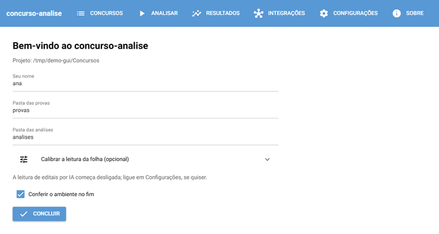
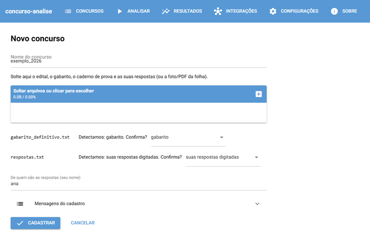
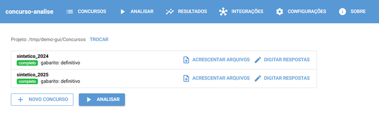
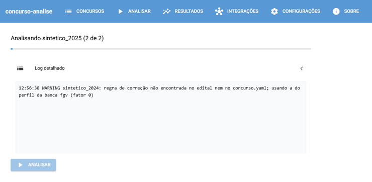
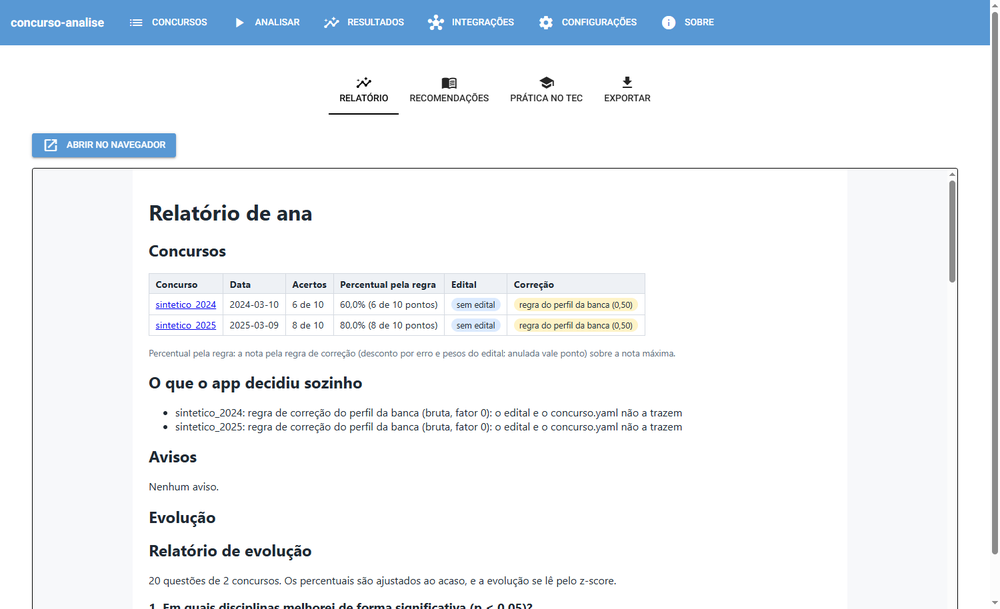
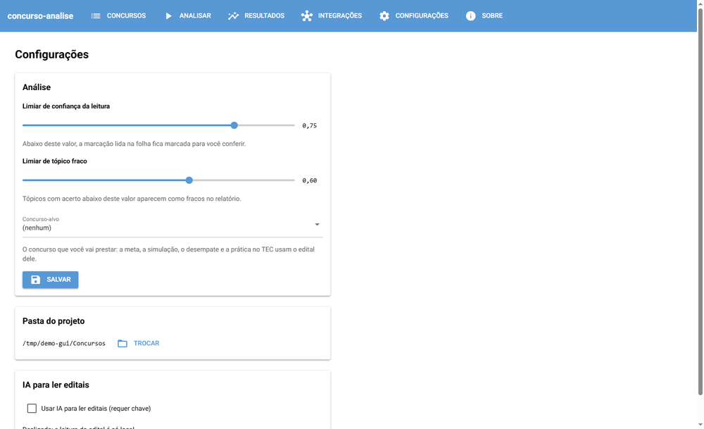

<a id="readme-top"></a>

[![Versão][versao-shield]][pyproject-url]
[![Python][python-shield]][python-url]
[![uv][uv-shield]][uv-url]
[![Plataformas][plataformas-shield]](#instalação-para-usuários-leigos)

<br />
<div align="center">
  <h3 align="center">Análise de Desempenho em Concursos</h3>

  <p align="center">
    Corrige suas provas de concurso e mostra em quais disciplinas e tópicos do edital você perde pontos, por concurso e entre concursos.
    <br />
    <a href="docs/modelo.md"><strong>Ler o modelo de domínio »</strong></a>
    <br />
    <br />
    <a href="#uso">Ver exemplo</a>
    &middot;
    <a href="https://github.com/LMafra/analise_concursos/issues/new?labels=bug">Reportar bug</a>
    &middot;
    <a href="https://github.com/LMafra/analise_concursos/issues/new?labels=enhancement">Sugerir funcionalidade</a>
  </p>
</div>

<!-- SUMÁRIO -->
<details>
  <summary>Sumário</summary>
  <ol>
    <li>
      <a href="#sobre-o-projeto">Sobre o projeto</a>
      <ul>
        <li><a href="#feito-com">Feito com</a></li>
      </ul>
    </li>
    <li>
      <a href="#primeiros-passos">Primeiros passos</a>
      <ul>
        <li><a href="#instalação-para-usuários-leigos">Instalação para usuários leigos</a></li>
      </ul>
    </li>
    <li>
      <a href="#uso">Uso</a>
      <ul>
        <li><a href="#usar-pela-janela">Usar pela janela</a></li>
        <li><a href="#como-ler-o-relatório">Como ler o relatório</a></li>
        <li><a href="#o-que-cada-arquivo-contém">O que cada arquivo contém</a></li>
        <li><a href="#dicionário-de-temas">Dicionário de temas</a></li>
        <li><a href="#estudar-com-seus-livros-open-notebook">Estudar com seus livros (open-notebook)</a></li>
        <li><a href="#encontrar-concursos">Encontrar concursos</a></li>
        <li><a href="#importar-do-tec">Importar do TEC</a></li>
        <li><a href="#privacidade">Privacidade</a></li>
      </ul>
    </li>
    <li><a href="#roadmap">Roadmap</a></li>
    <li>
      <a href="#desenvolvimento">Desenvolvimento</a>
      <ul>
        <li><a href="#pré-requisitos">Pré-requisitos</a></li>
        <li><a href="#instalação">Instalação</a></li>
        <li><a href="#primeira-execução">Primeira execução</a></li>
        <li><a href="#comandos">Comandos</a></li>
        <li><a href="#organizar-as-provas">Organizar as provas</a></li>
        <li><a href="#saídas">Saídas</a></li>
        <li><a href="#revisão-de-tópicos">Revisão de tópicos</a></li>
        <li><a href="#troca-de-gabarito-preliminar-para-definitivo">Troca de gabarito preliminar para definitivo</a></li>
        <li><a href="#configuração">Configuração</a></li>
        <li><a href="#edital-como-fonte-de-verdade">Edital como fonte de verdade</a></li>
        <li><a href="#ia-opcional">IA opcional</a></li>
        <li><a href="#open-notebook-e-pci-concursos-pelo-terminal">open-notebook e PCI Concursos pelo terminal</a></li>
        <li><a href="#análise-evolutiva">Análise evolutiva</a></li>
        <li><a href="#problemas-comuns">Problemas comuns</a></li>
        <li><a href="#build-local-do-executável">Build local do executável</a></li>
      </ul>
    </li>
    <li><a href="#contribuindo">Contribuindo</a></li>
    <li><a href="#licença">Licença</a></li>
    <li><a href="#contato">Contato</a></li>
    <li><a href="#agradecimentos">Agradecimentos</a></li>
  </ol>
</details>

<!-- SOBRE O PROJETO -->
## Sobre o projeto

![Relatório HTML de um projeto sintético com dois concursos][relatorio-screenshot]

Ferramenta local que corrige suas provas de concurso e mostra **em quais disciplinas e tópicos do edital você perde pontos**, por concurso e entre concursos.

* Lê a folha de resposta (PDF ou imagem), um `respostas.txt` ou um `respostas.csv` e corrige pela regra do edital, com desconto por erro e pesos.
* Classifica cada questão numa disciplina e num tópico do conteúdo programático do edital.
* Confere edital, prova e gabarito entre si, e cada valor lido do edital vem com trecho, documento e página.
* Acompanha a evolução entre concursos em notebooks de análise.
* Ajuda a estudar: guarda seus livros numa biblioteca pesquisável e responde perguntas com o trecho e a página de onde veio a resposta.
* Encontra concursos abertos e provas anteriores para treinar, e importa a sua prática no TEC Concursos.
* Tem uma janela para quem não usa terminal, com instalador para Windows, macOS e Linux que já traz tudo de que precisa (veja [Instalação para usuários leigos](#instalação-para-usuários-leigos)).

Tudo roda na sua máquina: nenhum arquivo é enviado para lugar nenhum. O acesso à internet é sempre opcional e pedido antes: a IA para ler editais, a busca de concursos no PCI Concursos (que só recebe termos de busca) e o download único da biblioteca de estudo (veja [Privacidade](#privacidade)).

Bancas que o app já conhece: Cebraspe (certo/errado, um erro anula um acerto), FGV, FCC, Vunesp, IBFC, Idecan, SELECON e Quadrix. Para outra banca, o app usa regras genéricas, e o que o edital não disser fica para você confirmar (veja [Problemas comuns](#problemas-comuns)).

### Feito com

* [![Python][python-badge]][python-url]
* [![pandas][pandas-badge]][pandas-url]
* [![scikit-learn][sklearn-badge]][sklearn-url]
* [![OpenCV][opencv-badge]][opencv-url]
* [![Tesseract][tesseract-badge]][tesseract-url]
* [![Plotly][plotly-badge]][plotly-url]
* [![Typer][typer-badge]][typer-url]
* [![NiceGUI][nicegui-badge]][nicegui-url]
* [![PyInstaller][pyinstaller-badge]][pyinstaller-url]
* [![Jupyter][jupyter-badge]][jupyter-url]
* [![uv][uv-badge]][uv-url]

<p align="right">(<a href="#readme-top">voltar ao topo</a>)</p>

<!-- PRIMEIROS PASSOS -->
## Primeiros passos

### Instalação para usuários leigos

Baixe o instalador do seu sistema na [página de versões](https://github.com/LMafra/analise_concursos/releases), em "Assets" da versão mais recente (enquanto o app está em teste, as versões aparecem como "Pre-release"). Ele já traz tudo de que o app precisa, inclusive o leitor de PDF escaneado: não é preciso instalar mais nada nem abrir o terminal.

| Sistema | Arquivo |
|---|---|
| Windows 10 ou 11, 64 bits | `concurso-analise-<versão>-windows-x64-setup.exe` |
| macOS em Mac com chip Apple (M1 em diante) | `concurso-analise-<versão>-macos-arm64.dmg` |
| Linux 64 bits, distribuições de 2019 em diante | `concurso-analise-<versão>-linux-x86_64.AppImage` |

No Windows, o instalador e os executáveis são assinados pela SignPath Foundation (veja [Por que o Windows avisa na primeira execução](#por-que-o-windows-avisa-na-primeira-execução)). No macOS, o app não tem assinatura, e o sistema desconfia dele na primeira vez. Os passos abaixo mostram como seguir.

**Windows**

1. Abra o `concurso-analise-<versão>-windows-x64-setup.exe`.
2. Se aparecer "O Windows protegeu o computador", confira se o editor é **SignPath Foundation**, clique em **Mais informações** e depois em **Executar assim mesmo**.
3. Siga o instalador. Ele instala só para o seu usuário e não pede senha de administrador. Se o computador não tiver o WebView2 (o componente da Microsoft que a janela usa), o instalador o instala sozinho. Se não conseguir (sem internet, por exemplo), o app abre no navegador e avisa, com o link para instalar depois.
4. Abra o **concurso-analise** pelo menu Iniciar.

Para desinstalar, use Configurações > Aplicativos.

**macOS**

1. Abra o `.dmg` e arraste o **concurso-analise** para a pasta Aplicativos.
2. Abra o app. Na primeira vez, o macOS avisa que não pode verificar o desenvolvedor: feche o aviso.
3. Vá a **Ajustes do Sistema > Privacidade e Segurança**, role até o aviso do concurso-analise e clique em **Abrir Mesmo Assim**. Confirme com a sua senha.

Das próximas vezes, o app abre direto.

**Linux**

1. Torne o arquivo executável: no gerenciador de arquivos, abra Propriedades > Permissões e marque "Permitir executar como programa".
2. Abra o arquivo com dois cliques. A tela abre no navegador padrão, e só o seu computador a acessa.

O arquivo já traz tudo de que o app precisa, inclusive a leitura de folhas escaneadas. Se ele não abrir, veja [AppImage no Linux](docs/detalhes-tecnicos.md#appimage-no-linux).

Para o app aparecer no menu de aplicativos, com ícone, use o [AppImageLauncher](https://github.com/TheAssassin/AppImageLauncher) ou o [Gear Lever](https://flathub.org/apps/it.mijorus.gearlever) (no Flathub): ao abrir o AppImage, eles oferecem integrá-lo ao sistema. Guarde o arquivo numa pasta onde você tenha permissão de escrita (por exemplo, `~/Aplicativos`), para que a atualização pelo app consiga substituí-lo.

Depois de instalar, veja [Usar pela janela](#usar-pela-janela). Para quem quer saber mais: [detalhes técnicos](docs/detalhes-tecnicos.md#instalação), inclusive como conferir o arquivo baixado.

#### Atualizar

Em **Sobre** (no menu ⋮ do canto da tela), clique em **Verificar atualizações**. Se houver versão nova, **Baixar e instalar** pede a sua confirmação e baixa a versão nova. A atualização é segura: se o arquivo estiver corrompido, o app avisa e não instala. No Windows, o instalador continua sozinho e reabre o app; no Linux, o arquivo é trocado no mesmo lugar, e o app oferece reabrir. Seus projetos e análises não mudam. A biblioteca de estudo, se você a preparou, é conferida no mesmo clique, e seus livros continuam lá.

O app não procura atualizações sozinho. Em **Configurações > Avançado**, você pode ligar o aviso de versão nova (no máximo uma consulta por dia, com o aviso no alto da tela) e escolher entre as versões testadas (padrão) e as de teste, que chegam antes e podem ter problemas. Quem tem a 0.5.0 ou anterior instala a primeira versão com o atualizador à mão, uma vez. Para quem quer saber mais: [detalhes técnicos](docs/detalhes-tecnicos.md#atualização).

#### Por que o Windows avisa na primeira execução

O Windows avisa sobre todo programa que ainda foi baixado por poucas pessoas, mesmo quando o arquivo é assinado. A assinatura não tira esse aviso; ela garante duas coisas que você pode conferir:

* **Quem publicou:** no aviso, depois de **Mais informações**, o editor aparece como **SignPath Foundation**. Nas propriedades do `.exe` (botão direito > Propriedades > Assinaturas Digitais), a assinatura aparece como válida.
* **Que o arquivo não mudou:** se alguém alterar o instalador depois da assinatura, o Windows mostra a assinatura como inválida, ou o editor como "desconhecido".

O aviso some sozinho à medida que mais pessoas baixam a mesma versão; não há como prometer que ele não apareça. Se o editor não for SignPath Foundation, ou se a assinatura estiver inválida, não instale: baixe de novo pela [página de versões](https://github.com/LMafra/analise_concursos/releases). Para quem quer saber mais: [detalhes técnicos](docs/detalhes-tecnicos.md#assinatura-no-windows).

#### Política de assinatura de código

Assinatura de código gratuita fornecida pela [SignPath.io](https://about.signpath.io/), com certificado da [SignPath Foundation](https://signpath.org/).

* **O que é assinado:** só os binários deste repositório: `concurso-analise.exe`, `concurso-analise-cli.exe` e o setup. As bibliotecas de terceiros que vêm junto (Python, Tesseract, WebView2) mantêm a assinatura de origem, quando têm.
* **Como:** cada release sai do workflow [`release.yml`](.github/workflows/release.yml), a partir de uma tag deste repositório; nenhum binário é assinado fora do CI.
* **Quem:** autores e revisores: [LMafra](https://github.com/LMafra). Aprovação de cada assinatura de release: [LMafra](https://github.com/LMafra).
* **Privacidade:** o programa não envia nada pela rede sem que você ligue a integração na configuração (IA, open-notebook, PCI Concursos ou o aviso de atualização). Veja [Privacidade](#privacidade).

<p align="right">(<a href="#readme-top">voltar ao topo</a>)</p>

<!-- USO -->
## Uso

### Usar pela janela

No Windows e no macOS, o app abre numa janela própria; no Linux, no navegador. Nos dois casos, a tela só é acessível no seu computador.

O menu do alto tem **Concursos**, **Estudar**, **Analisar**, **Resultados** e **Importar do TEC**. **Configurações** e **Sobre** ficam no menu ⋮, no canto.

**1. Pasta do projeto.** Na primeira vez, o app pergunta onde guardar suas provas e análises. O padrão é `Documentos/Concursos`, e o app lembra a pasta nas próximas vezes. Em seguida, ele faz três perguntas (seu nome e os nomes das pastas, com padrões que você pode aceitar) e, se você quiser, confere o computador.



**2. Novo concurso.** Em **Concursos**, clique em **Novo concurso** e solte na área azul os arquivos que vieram da banca: edital, gabarito, caderno de prova e as suas respostas (a foto ou o PDF da folha, ou um arquivo de texto). O app detecta o papel de cada arquivo e pede só a sua confirmação; se ele errou, escolha o papel certo na lista. Você não digita o nome do concurso: ele vem do edital, como "TCU 2025 — Auditor". Sem edital, o nome fica "a confirmar", e **Corrigir nome** troca.



Se a folha não puder ser lida, use **Digitar respostas** e marque a alternativa de cada questão.

**3. Concursos.** A aba **Meus concursos** mostra a situação de cada concurso (`completo`, `incompleto` ou `desatualizado`) e se o gabarito é preliminar ou definitivo. Num concurso incompleto, **Resolver** diz o que falta e oferece acrescentar arquivos ou digitar as respostas. **Conferir** mostra o tema que o app deu a cada questão e os dados que ele leu do edital; corrija o que estiver errado e clique em **Salvar e refazer a análise**. As abas **Encontrar concursos** e **Provas anteriores** estão em [Encontrar concursos](#encontrar-concursos).



**4. Analisar.** A barra avança por concurso. O **Log detalhado** mostra o que o app decidiu sozinho, por exemplo quando o edital não traz a regra de correção e ele usa a da banca.



**5. Resultados.** O relatório aparece na própria tela, e **Abrir no navegador** o abre em tamanho cheio. As outras abas são **Tópicos para estudar** (os temas em que você mais perde pontos, com **Procurar nos meus livros**), **Simulado focado** (questões de provas anteriores nesses temas), **Prática no TEC** e **Exportar**.



**6. Configurações.** Quando considerar uma leitura confiável e um tópico fraco, o concurso que você vai prestar (concurso-alvo), a pasta do projeto, **Disciplinas e temas** (veja [Dicionário de temas](#dicionário-de-temas)) e a IA. A IA começa desligada; se você a ligar, a chave de acesso fica no cofre de senhas do sistema, nunca num arquivo, e você escolhe para que ela serve: ler editais e, se quiser, responder perguntas com base nos seus livros.



**7. Sobre.** A versão, se o leitor de folhas e a biblioteca estão prontos, o registro de erros (para anexar a um relato de problema) e **Verificar atualizações**.

Com mais de um candidato no projeto, a tela de concursos mostra o seletor de candidato e a opção **todos**, que gera o comparativo.

No Linux, o menu tem **Fechar o app**: fechar só a aba do navegador deixa o app rodando.

### Como ler o relatório

Em **Resultados**, o relatório geral mostra todos os seus concursos. Ele começa pelo resumo e por cinco números: quantos concursos você fez, em quantas provas ficou acima do corte, o seu melhor desempenho, o ponto mais fraco e a tendência geral. Depois vêm as seções:

* **Como estou saindo:** uma linha por prova (cada opção de cargo conta como uma prova), com a nota pela regra do edital e um selo: **✓ Acima do corte**, **! No limite** (a até 2 pontos percentuais do corte, para cima ou para baixo), **✗ Abaixo do corte** ou **– Sem corte no edital**. A última coluna diz quanto faltou ou quanto sobrou. O nome do concurso abre o relatório dele.
* **Meus pontos fortes** e **Meus pontos a melhorar:** as disciplinas em que você vai bem e os tópicos abaixo do esperado, agrupados por disciplina, dos mais urgentes para os menos. "Descontado o chute" quer dizer que o app tira da nota o que você acertaria chutando; um tópico abaixo de zero rendeu menos do que o chute.
* **Estou evoluindo?:** uma frase com a resposta, a situação de cada disciplina e três gráficos, cada um com uma legenda que explica como lê-lo. O app só fala em melhora ou piora quando a diferença é grande o bastante para não ser acaso, e só com pelo menos 3 concursos com data.
* **O que fazer agora:** de 3 a 5 ações tiradas dos seus dados, como a disciplina para priorizar e o simulado focado.
* **Prazos dos editais**, **Simulado focado**, **Onde estudar** e **Prática no TEC**, quando você usa esses recursos.
* **Detalhes técnicos**, fechado no fim: como o app chegou nos números, as observações sobre os dados e as tabelas completas. Não é preciso abri-lo para usar o relatório.

O relatório de cada concurso segue a mesma ideia: o resumo da nota, o desempenho por disciplina, onde você mais errou e o que conferir (leituras da folha incertas e temas escolhidos pelo app), com os detalhes técnicos no fim. Os termos e as contas estão em [Métricas](docs/detalhes-tecnicos.md#métricas).

### O que cada arquivo contém

O app grava as análises na pasta do projeto. Os nomes dos arquivos não mudam entre versões; a tabela diz o que é cada um.

| Arquivo ou pasta | O que é |
|---|---|
| `provas/` | Suas provas: uma pasta por concurso, com o edital, a prova, o gabarito e as suas respostas |
| `analises/` | Suas análises: uma pasta por candidato |
| `.concurso/` | Configuração do projeto |
| `analises/<você>/index.html` | O relatório geral, com todos os concursos |
| `respostas.txt` | Suas respostas, digitadas |
| `respostas.csv` | Suas respostas (planilha) |
| `respostas_extraidas.csv` | Respostas lidas da folha |
| `questoes.csv` | Questões da prova, com o tema de cada uma |
| `relatorio.md` e `relatorio.html` | Relatório do concurso (texto e página) |
| `desempenho_por_disciplina.csv` | Desempenho por disciplina |
| `desempenho_por_topico.csv` | Desempenho por tópico |
| `edital_estruturado.json` | O que o app leu do edital |
| `discrepancias_edital.csv` | O que o app conferiu no edital |
| `catalogo_edital.md` | Descobertas no edital |
| `edital_a_confirmar.yaml` | Dados do edital a confirmar (a tela **Conferir** os edita) |
| `diff_gabarito.csv` | Mudanças do gabarito preliminar para o definitivo |
| `depuracao/` | Arquivos para investigar problemas |

Os arquivos com final `.csv` abrem no Excel ou no LibreOffice. O formato de cada um está em [Saídas](#saídas) e em [docs/modelo.md](docs/modelo.md).

### Dicionário de temas

Cada questão recebe um tema do conteúdo do edital, escolhido pelas palavras do enunciado. Quando a banca escreve de um jeito e o edital de outro, o tema pode sair errado: a questão fala de "acento grave", e o edital chama o tema de "Crase". O dicionário de temas ensina ao app essas palavras.

1. Em **Configurações > Disciplinas e temas**, abra a aba **Dicionário de temas**.
2. Clique em **Começar com o dicionário inicial**, ou em **Sugerir termos das minhas revisões**: o app propõe as palavras que se repetem nas questões que você já conferiu (em **Concursos > Conferir**) para um mesmo tema. Aceite as que fizerem sentido.
3. Clique em **Testar ganho**. O app compara, nas questões que você conferiu, quantas recebem o tema certo com e sem o dicionário.
4. Ligue **Usar o dicionário** e refaça a análise.

Se o dicionário piorar a sugestão de tema em alguma questão, a tela avisa e oferece desligá-lo. Desligado, a análise fica exatamente como antes. Na mesma tela, a aba **Disciplinas** junta os nomes que concursos diferentes dão à mesma disciplina, para comparar a sua evolução entre eles.

### Estudar com seus livros (open-notebook)

A tela **Estudar** guarda seus livros numa biblioteca pesquisável e responde perguntas com o trecho e a página de onde veio a resposta. Por trás, o app usa o [open-notebook](https://github.com/lfnovo/open-notebook), um programa livre de estudo com documentos, que roda no seu próprio computador; você não precisa instalá-lo nem configurá-lo.

1. Em **Estudar > Meus livros**, clique em **Preparar agora**. É um download único, de cerca de 420 MB no Windows e 360 MB no Linux, e você concorda com ele antes. Enquanto ele acontece, você já pode adicionar livros e buscar neles.
2. Clique em **Adicionar livros** e escolha os arquivos: PDF, EPUB, Word (DOCX) ou TXT, até 300 MB cada. Páginas escaneadas são lidas pelo leitor de imagens do app. Um livro grande fica pesquisável aos poucos, e fechar o app não perde o trabalho: ele continua de onde parou.
3. Em **Estudar > Perguntar**, escreva a pergunta e escolha onde procurar (todas as disciplinas ou uma só). A resposta lista os trechos encontrados, cada um com o arquivo e a página.

Com a IA ligada em Configurações e a opção **Responder perguntas com base nos meus livros** marcada, a IA escreve uma resposta a partir desses trechos, que continuam aparecendo embaixo para você conferir. Só os trechos encontrados vão para a IA, e só com essa opção marcada.

Em **Resultados > Tópicos para estudar**, **Procurar nos meus livros** abre a pergunta já filtrada pelo tema em que você perdeu pontos, e as recomendações de estudo passam a indicar os seus livros.

Seus livros não saem do computador. Se você já usa um open-notebook seu, ligue-o em **Configurações > Avançado > Usar meu próprio programa de estudo**. Para quem quer saber mais: [detalhes técnicos](docs/detalhes-tecnicos.md#open-notebook).

### Encontrar concursos

Em **Concursos**, as abas **Encontrar concursos** e **Provas anteriores** consultam o [PCI Concursos](https://www.pciconcursos.com.br/). A consulta fica desligada até você concordar com o aviso, que diz o que é enviado: só os termos de busca, nunca seu nome, CPF ou notas.

**Encontrar concursos.** Escolha o estado e, se quiser, a cidade, escreva o cargo e clique em **Buscar**. Cada resultado mostra o órgão, a região, os cargos e o fim das inscrições. Nele:

* **Acompanhar este concurso** o põe entre os concursos que você acompanha, e o relatório avisa quando as inscrições estão para fechar;
* **Adicionar ao meu projeto** cria o concurso na sua lista, com um clique; ele fica incompleto até você acrescentar o edital;
* **Ver página** abre a página do concurso no navegador.

**Lembrar estes filtros** guarda a busca para a próxima vez. O resultado fica guardado no computador por um dia; **Buscar de novo agora** consulta outra vez. O PCI é colaborativo e pode não ter todos os editais: confira sempre o edital no site do órgão ou da banca. Para quem quer saber mais: [detalhes técnicos](docs/detalhes-tecnicos.md#pci-concursos).

**Provas anteriores.** Escolha o seu concurso: o app mostra o termo que vai procurar (as primeiras palavras do cargo, com e sem a banca), e você pode trocá-lo. Cada prova encontrada pode virar um simulado, uma de cada vez ou com **Importar todas**. O PCI pede um captcha para baixar a prova, então o download é seu: o app abre a página no navegador, você baixa a prova e o gabarito, e o app os encontra na pasta de downloads e cadastra o simulado. **Cancelar** interrompe a espera, e uma prova que falha não para as outras.

Os simulados ficam fora da sua evolução entre concursos e geram o **Simulado focado** em Resultados: as questões dessas provas nos temas em que você mais perde pontos.

### Importar do TEC

A tela **Importar do TEC** traz as questões que você resolve no [TEC Concursos](https://www.tecconcursos.com.br/) para a análise, e cruza os seus erros lá com os temas em que você perde pontos nas provas. Há dois caminhos:

* **Planilha.** Exporte do TEC o seu histórico de questões em planilha (CSV ou Excel) e solte o arquivo na tela. O app mostra as colunas que reconheceu (disciplina, assunto, resultado, data) e as primeiras linhas; corrija o que estiver trocado e clique em **Importar e analisar**. O app lembra a escolha das colunas para a próxima planilha igual.
* **Captura dos erros.** A extensão do Chrome (ou o userscript do Firefox no Android) que vem com o app registra as questões que você erra enquanto resolve, e exporta um arquivo para importar na mesma tela. **Como conseguir** explica a instalação.

Um assunto do TEC que o app não sabe ligar a um tema do edital é perguntado na análise, uma vez. Depois da análise, **Ver prioridades** mostra os temas em que você erra nas provas e no TEC, e **Ver simulado com meus erros** abre uma lista com as questões que você mais errou, com o gabarito no fim.

### Privacidade

Tudo fica no seu computador: provas, notas, análises e livros. A janela do app só é acessível no próprio computador, e o app não manda estatísticas de uso nem se atualiza sem a sua confirmação.

O app só usa a internet quando você liga, e cada opção mostra antes o que sai do computador:

* **IA (opcional):** recebe o texto do edital para ajudar a ler as regras e, só se você marcar a opção, os trechos dos livros que respondem a uma pergunta. Nunca suas respostas ou seu nome.
* **Busca de concursos e provas anteriores:** o PCI Concursos recebe só os termos de busca.
* **Biblioteca de estudo:** um download único, quando você clica em **Preparar agora**.
* **Atualizações:** só quando você clica em **Verificar atualizações**, ou uma vez por dia se você ligar o aviso de versão nova.

<p align="right">(<a href="#readme-top">voltar ao topo</a>)</p>

<!-- ROADMAP -->
## Roadmap

- [x] Fase 1: correção da prova e desempenho por disciplina e tópico
- [x] Fase 2: análise evolutiva entre concursos
- [x] Fase 3: edital como fonte de verdade
- [x] Fase 4: generalização e portabilidade (onboarding, CLI, imagem de contêiner, perfis de banca)
- [x] Fase 5: janela (NiceGUI) e instaladores para Windows, macOS arm64 e Linux, com o Tesseract embutido
- [x] Fase 6: assinatura no Windows (SignPath), WebView2 no instalador, AppImage verificado, atualizador por manifesto assinado e novo visual da janela
- [x] Fase 7: estudar com os seus livros (open-notebook embutido), dicionário de temas, conferência na janela, nome do concurso pelo edital, busca de concursos e provas anteriores, e importação do TEC por planilha
- [ ] Checklist de máquina limpa da fase 6 e primeira release com o atualizador
- [ ] Escopo de cargo nos pesos e nas demais buscas do edital
- [ ] Precedência completa com o `concurso.yaml` (total de questões e pesos)

Veja [docs/pendencias.md](docs/pendencias.md) para o detalhe e a ordem sugerida de cada pendência.

<p align="right">(<a href="#readme-top">voltar ao topo</a>)</p>

<!-- DESENVOLVIMENTO -->
## Desenvolvimento

Esta parte é para quem usa o app pelo terminal, quer entender os arquivos que ele grava ou vai mexer no código. Quem usa só a janela não precisa de nada daqui.

### Pré-requisitos

Para usar pelo terminal, em vez do instalador:

* [uv](https://docs.astral.sh/uv/getting-started/installation/), que traz o Python 3.11 ou 3.12.
* [Tesseract](https://github.com/tesseract-ocr/tesseract) com o idioma português, só para edital ou folha em imagem (PDF escaneado). O `doctor` mostra o comando para o seu sistema:
  ```sh
  sudo apt install tesseract-ocr tesseract-ocr-por   # Ubuntu e WSL
  brew install tesseract tesseract-lang              # macOS
  winget install UB-Mannheim.TesseractOCR            # Windows
  ```
* Opcional: Docker, no lugar do uv e do Tesseract.

A CLI foi verificada no Linux/WSL e no container, e o executável Linux, num Debian 12 sem Python nem Tesseract. Os executáveis de Windows e macOS são gerados pelo workflow de release, que roda neles o mesmo teste de máquina limpa.

### Instalação

1. Clone o repositório:
   ```sh
   git clone git@github.com:LMafra/analise_concursos.git
   ```
2. Crie uma pasta `provas/` com uma subpasta por concurso, copie para ela os arquivos que vieram da banca e rode, na pasta que contém `provas/`:
   ```sh
   uvx --from <caminho do repositório> concurso-analise
   ```
3. Para ter o comando no PATH, instale-o. Depois, basta `concurso-analise`:
   ```sh
   uv tool install <caminho do repositório>
   ```

4. Para a janela também pelo terminal, instale com o extra `gui` e abra com `concurso-analise gui`:
   ```sh
   uv tool install '<caminho do repositório>[gui]'
   ```

O pacote ainda não está no PyPI.

#### Sem uv: Docker

A imagem já traz o Tesseract em português; os comandos estão em [Docker](docs/detalhes-tecnicos.md#docker).

### Primeira execução

Na primeira execução, um assistente faz 6 perguntas. Enter aceita o padrão entre colchetes:

```text
$ concurso-analise
[1/6] Seu nome [ana]: Ana
[2/6] Pasta de provas [provas]:
[3/6] Pasta de análises [analises]:
[4/6] Folha preenchida para calibrar a leitura (Enter para pular):
[5/6] LLM para ler editais de bancas desconhecidas (nenhum/openai/openrouter/gemini/ollama/anthropic) [nenhum]:
[6/6] Conferir o ambiente com o doctor no fim? (s/n) [s]:
Vou gravar:
  candidato: Ana
  pasta de provas: ~/meus-concursos/provas
  pasta de análises: ~/meus-concursos/analises
  LLM: nenhum
  leitura da folha: detecção automática ou perfil da banca
  em ~/meus-concursos/.concurso/config.toml e ~/.concurso/config.toml
Gravar? [S/n]
```

Em seguida, o `doctor` confere o ambiente e a análise mostra o progresso. Os avisos dizem o que o app decidiu sozinho:

```text
✓ uv: ~/.local/bin/uv
✓ Python: 3.12.3
✗ Tesseract: não encontrado no PATH; sem ele, edital e folha em imagem não são lidos
    correção: sudo apt install tesseract-ocr tesseract-ocr-por
✓ poppler: não necessário (os PDFs são lidos com pypdfium2)
✓ espaço em disco: 908272 MB livres em ~/meus-concursos/provas
✓ LLM: desligado (nenhuma chamada de rede)
INFO Analisando sintetico_2024
aviso: sintetico_2024: não encontrei a regra de correção no edital. Vou usar a regra padrão da FGV.
    dica: se estiver errada, ajuste em Concursos > Conferir > Dados do edital.
    detalhe: regra do perfil da banca fgv (fator 0); o edital e o concurso.yaml não a trazem
INFO Saídas de sintetico_2024 gravadas em analises/ana/sintetico_2024
INFO Analisando sintetico_2025
INFO Saídas de sintetico_2025 gravadas em analises/ana/sintetico_2025
INFO Relatório HTML gravado em analises/ana/index.html
relatório: ~/meus-concursos/analises/ana/index.html
```

No fim, o relatório abre no navegador (no WSL, no navegador do Windows). Rodar de novo só reprocessa o que mudou. Sem mudanças, nenhum arquivo de `analises/` é tocado.

### Comandos

Sem subcomando, `concurso-analise` faz o onboarding (na primeira vez) e analisa o que mudou.

| Comando | O que faz |
|---|---|
| `gui` | Abre a janela (no Linux, o navegador); `--project` escolhe a pasta e `--browser` força o navegador. Precisa do extra `gui`. |
| `init` | Refaz as perguntas do onboarding, com as respostas atuais como padrão. `--calibrate-sheet` e `--calibrate-answers` calibram a leitura da folha. |
| `add <pasta>` | Cadastra a pasta de um concurso: detecta o papel de cada arquivo, a banca e o status do gabarito, e pergunta só o que for ambíguo. |
| `add <arquivo> --candidate <nome>` | Copia uma folha ou um arquivo de respostas para o candidato. |
| `analyze [concurso]` | Analisa os concursos que mudaram, ou só o indicado. `--reuse-csv` aplica a correção manual da leitura da folha. |
| `status` | Situação de cada concurso: `completo`, `incompleto` ou `desatualizado`, e o status do gabarito. |
| `report` | Reabre o último relatório HTML. |
| `export --format csv\|parquet\|md` | Grava o consolidado do candidato, uma linha por questão. |
| `doctor` | Confere uv, Python, Tesseract, permissão de escrita, espaço em disco, a chave do LLM e a configuração do open-notebook, com o comando de correção para o seu sistema. |
| `upgrade` | No executável, procura a versão nova no GitHub (canal de `[atualizacao]`, ou `--canal stable`/`beta`); com `--run`, baixa, confere e instala. Fora dele, mostra o comando do uv; com `--run`, executa `uv tool upgrade concurso-analise`. |
| `notebook enable\|disable\|sync` | Liga, desliga ou envia agora as análises para um open-notebook seu (veja [open-notebook](docs/detalhes-tecnicos.md#open-notebook)). |
| `discover` | Busca no PCI Concursos os concursos com inscrições abertas ou prestes a abrir; `--register ID` acompanha um deles (veja [PCI Concursos](docs/detalhes-tecnicos.md#pci-concursos)). |
| `pci enable\|disable\|provas` | Liga ou desliga o PCI, ou lista as provas anteriores de um concurso e importa uma como simulado. |

Flags globais, antes do subcomando: `--yes` (aceita os padrões sem perguntar), `--quiet`, `--verbose`, `--dry-run` (mostra o que seria feito, sem gravar nada), `--force` (reprocessa tudo), `--candidate`, `--all-candidates`, `--no-open`, `--no-llm`, `--offline`, `--data-dir`, `--provas` e `--analises`.

Sem terminal interativo, com a variável `CI` ou com `--yes`, nada é perguntado: o app usa os padrões e os lista no log.

Códigos de saída: 0 sucesso, 1 problema nos seus dados ou na configuração, 2 problema no ambiente. Um erro aparece em até três linhas: `erro:` com o que aconteceu, `dica:` com o que fazer e, quando houver, `detalhe:` com o texto técnico. Um aviso segue o mesmo formato, com `aviso:`. O traceback fica em `~/.concurso/logs/concurso-analise.log`.

O comando antigo `concursos` continua funcionando, com aviso de obsoleto.

### Organizar as provas

```text
provas/
  tcu_25/
    edital.pdf, anexos, cadernos de prova, gabaritos
    candidatos/
      ana/
        folha.pdf            # ou respostas.txt, ou respostas.csv
      bruno/
        respostas.txt
```

1. Crie `provas/<concurso>/` e copie os arquivos com os nomes que vieram da banca: edital e anexos (sem edital, o concurso fica incompleto), cadernos de prova, gabaritos (preliminar ou definitivo; PDFs com vários cargos são aceitos) e, opcionalmente, o resultado oficial com a sua nota.
2. Coloque suas respostas em `candidatos/<seu nome>/`: a folha de resposta (PDF ou imagem), um `respostas.txt` ou um `respostas.csv`. `add <arquivo> --candidate <nome>` faz isso por você.
3. Rode `concurso-analise`. Uma pasta sem `concurso.yaml` aparece no `status` como incompleta; `add provas/<concurso>` a cadastra.

Um projeto pode ter vários candidatos. A análise usa o último candidato analisado; troque com `--candidate <nome>`, ou analise todos com `--all-candidates`, que gera também `analises/comparativo_candidatos.md`.

O assistente `./scripts/novo_concurso.sh` guia a coleta, o cadastro e a análise de um concurso novo, passo a passo.

#### Formato do `respostas.txt`

Use quando não tiver a folha de resposta. Escreva uma questão por linha:

```text
# comentários começam com #
1 A
02: C
3-E
4 -
```

- Múltipla escolha aceita as letras do concurso (de `A` a `D` ou a `E`); certo/errado (Cebraspe) aceita `C` ou `E`.
- `-` ou valor vazio indicam branco. Questões omitidas também contam como branco.
- Separadores aceitos: espaço, `:`, `;`, `,`, `.` e `-`. Zeros à esquerda são ignorados.
- Erros indicam o número da linha.

Um gabarito em texto usa o mesmo formato, com `X` ou `*` para questão anulada.

Um `respostas.csv` tem as colunas `questao` e `alternativa`, com separador `,` ou `;`, como o Excel ou o LibreOffice gravam.

### Saídas

Por concurso, em `analises/<candidato>/<concurso>/`:

| Arquivo | Conteúdo |
|---|---|
| `relatorio.md` e `relatorio.html` | Resumo, nota final pela regra do edital (com desconto por erro ou pesos), gráficos, tópicos mais fracos, questões para revisar, validação oficial |
| `respostas_extraidas.csv` | Todas as questões: alternativa marcada, estado, `confianca_ocr`, `revisar`, origem, arquivo, página |
| `desempenho_por_disciplina.csv`, `desempenho_por_topico.csv` | `concurso, prova, disciplina, topico, total, acertos, erros, percentual, em_branco, anuladas, nota_liquida` |
| `questoes.csv` | Por questão: disciplina, tópico sugerido e final, score, gabarito, resposta, resultado |
| `correcao.json` | Regra de correção e data da prova, com o trecho e a página de origem |
| `edital_estruturado.json` | Conteúdo programático do cargo e as regras do edital, cada valor com fonte, confiança, trecho, documento e página |
| `discrepancias_edital.csv`, `catalogo_edital.md` | Validação edital × prova × gabarito e catálogo de descobertas |
| `diff_gabarito.csv`, `historico/` | Só após a troca de gabarito preliminar por definitivo |
| `depuracao/*.png` | Bolhas detectadas na folha de resposta |

Por candidato, em `analises/<candidato>/`:

- `index.html`: o relatório com todos os concursos (veja [Como ler o relatório](#como-ler-o-relatório)); o que o app decidiu sozinho, os avisos e a evolução técnica ficam nos detalhes técnicos, no fim;
- `consolidado/desempenho_geral.csv` e `consolidado/comparativo_concursos.md`: desempenho e nota final por concurso, tópicos e disciplinas abaixo do limiar em pelo menos dois concursos, concursos incompletos e validação com o resultado oficial;
- `consolidado/consolidado.parquet` e `consolidado/relatorio_evolucao.md`, com os gráficos de evolução.

O percentual é de mérito: anuladas contam como acerto, mas ficam fora do percentual.

### Revisão de tópicos

Com o edital cadastrado, cada questão recebe uma disciplina e um tópico sugeridos. A sugestão compara o texto da questão (na Cebraspe, o bloco "julgue os itens") com os tópicos do edital, por similaridade TF-IDF, e vem com um score.

Na primeira análise é criado `provas/<concurso>/revisao/questoes_revisado.csv`, com as sugestões, o score, um trecho do enunciado e as colunas `disciplina` e `topico` vazias. Preencha essas colunas só nas questões que quiser corrigir e rode de novo. A revisão tem prioridade sobre a sugestão. O relatório lista as sugestões com score baixo ainda não revisadas.

Se o conteúdo programático não puder ser extraído do edital, forneça um edital manual em YAML (veja [docs/modelo.md](docs/modelo.md#edital-manual)).

### Troca de gabarito preliminar para definitivo

Analise com o gabarito preliminar enquanto o definitivo não sai; o relatório mostra o selo **Gabarito preliminar (provisório)**. Quando o definitivo sair, coloque-o na pasta (ou sobrescreva o arquivo do preliminar) e rode de novo.

Se o definitivo casar com a prova configurada (mesma banca, cargo/tipo e faixa de itens), a análise:

- atualiza o `concurso.yaml`;
- move o preliminar para `ignorar` e registra o evento em `historico`;
- guarda as saídas anteriores em `analises/<candidato>/<concurso>/historico/`;
- gera `diff_gabarito.csv`, com as questões alteradas e anuladas, sua resposta e o acerto antes e depois;
- adiciona ao relatório a seção "Gabarito preliminar → definitivo".

Em qualquer outro caso (outro cargo, arquivo desconhecido), o concurso fica `desatualizado` até você rodar `add` de novo.

### Configuração

A configuração do projeto fica em `.concurso/config.toml`, gravada pelo onboarding:

```toml
[pastas]
provas = "provas"
analises = "analises"

[analise]
limiar_confianca = 0.75     # leituras abaixo dele ficam com revisar = True
limiar_topico_baixo = 0.6   # define o desempenho baixo no comparativo
concurso_alvo = "tcu_25"    # opcional; o concurso que a nota ponderada e o gap para o corte analisam
```

Depois de mudar um limiar, rode com `--force`. A precedência é: flag, variável de ambiente (`CONCURSO_PROVAS`, `CONCURSO_ANALISES`, `CONCURSO_CANDIDATO`, `CONCURSO_HOME`), `config.toml`, padrão.

O `concurso.yaml` de cada pasta é gerado pelo `add` e pode ser editado à mão. Quando o edital não traz a regra de correção ou a data da prova, ou quando o concurso tem opções de cargo com pesos diferentes (CPNU), declare-as nele:

```yaml
data_prova: 2025-10-05         # prevalece sobre a data provável do edital
escolaridade: superior         # superior | medio; o notebook 04 recalcula tudo sem o nível médio
correcao:
  modelo: liquida              # bruta | liquida | ponderada
  fator_penalidade: 1          # acertos anulados por erro
  variantes: [B3-08-A, B3-10-A] # pesos lidos do quadro do edital, um por cargo
edital:
  arquivo: edital.pdf
  retificacoes: [ret_2.pdf, ret_3.pdf]  # na ordem de publicação; a mais recente vence campo a campo
```

O schema completo, a precedência e as fórmulas estão em [docs/modelo.md](docs/modelo.md).

A `.concurso/taxonomia.yaml` mapeia cada nome de disciplina para uma disciplina canônica e um bloco (geral ou específico), para comparar a mesma matéria entre editais. Um concurso com nome de disciplina inédito precisa de uma entrada nela; veja [Taxonomia de disciplinas](docs/modelo.md#taxonomia-de-disciplinas).

### Edital como fonte de verdade

A análise lê do edital do cargo, além do conteúdo programático, as regras que mudam a nota e a leitura dela: identificação, pesos, distribuição de questões, cortes (em pontos ou acertos, por bloco, no conjunto e por disciplina), cronograma, desempate e outras descobertas. Cada valor vem com a fonte e com trecho, documento e página, para conferir no PDF. A nota continua saindo do `correcao.json`; o edital é a expectativa contra a qual a prova é conferida.

Quando o edital não diz algo, o valor vem, nesta ordem, do LLM (se ligado), do perfil da banca, do padrão ou do `edital_a_confirmar.yaml`. Os detalhes técnicos do relatório listam o que o app decidiu sozinho.

**Como ler as discrepâncias** (`discrepancias_edital.csv`). As colunas são `item, esperado_edital, observado_prova, diferenca, severidade, acao_sugerida`:

- `error`: algo está errado na leitura ou na configuração, como total de questões divergente ou gabarito com letras além das alternativas do edital. Confira o PDF e o `concurso.yaml`.
- `warn`: confira à mão, como contagem por disciplina divergente ou peso realizado diferente do edital (vale o realizado).
- `info`: só registro.

Arquivo vazio, só com o cabeçalho, quer dizer que edital, prova e gabarito concordam.

**Como ler o catálogo** (`catalogo_edital.md`). Uma linha por informação procurada no edital: valor, trecho de origem, uso no projeto, impacto e status. "Não encontrado" quer dizer que o edital não declara a informação. O template está em [docs/modelo.md](docs/modelo.md).

### IA opcional

A IA que lê editais (um LLM) fica desligada por padrão. Ligada na janela, no onboarding (pergunta 5) ou com `init`, ela só preenche o número de alternativas, o desconto por erro e a data da prova quando o texto do edital não os trouxe. Só o texto do edital e dos anexos é enviado, nunca suas respostas ou seu nome, e o app pede sua concordância antes do primeiro uso. Cada valor precisa citar um trecho que exista no edital; sem isso, é descartado.

Provedores: OpenAI, OpenRouter, Gemini, Ollama (local, sem chave) e Anthropic. A chave vem de uma variável de ambiente; com o extra `llm` (`uv tool install '<repositório>[llm]'`), pode ficar no keyring do sistema. Ela nunca é gravada no `config.toml`.

### open-notebook e PCI Concursos pelo terminal

As duas integrações também funcionam pelo terminal: `notebook enable|disable|sync` liga, desliga e envia as análises para um open-notebook seu, e `pci enable|disable|provas` e `discover` buscam concursos abertos e provas anteriores no PCI Concursos. Os comandos, o que vai para cada serviço, onde fica o resultado guardado e os códigos de saída estão em [open-notebook](docs/detalhes-tecnicos.md#open-notebook) e [PCI Concursos](docs/detalhes-tecnicos.md#pci-concursos), nos detalhes técnicos.

### Recomendações de estudo: livros e legislação

Também opcionais. Com uma das duas fontes abaixo, a análise grava `analises/<candidato>/consolidado/recomendacoes_estudo.md` e a seção "Onde estudar" no `index.html`: para cada tópico fraco persistente, as normas que o próprio tópico cita e até 3 livros. Cada linha diz de onde veio (`legislação`, `open-notebook` ou `catálogo`). São sugestões e não mudam o tópico nem a disciplina das questões.

**Livros.** Mapeie as disciplinas da taxonomia para as categorias da estante do projeto `books` em `.concurso/biblioteca.yaml`:

```yaml
catalogo: ../books/Bookshelf/README.md
disciplinas:
  Banco de Dados: ["TI - Banco de Dados › SQL e Teoria", "TI - Banco de Dados › MongoDB"]
```

Sem rede, os livros vêm do catálogo. Com o open-notebook ligado e a estante enviada (`python3 scripts/sync_open_notebook.py --apply` no `books`), a busca de texto nos notebooks `Biblioteca — <categoria>` escolhe os livros, e o `notebook sync` vincula os livros das disciplinas de cada concurso ao notebook dele. Só o texto do tópico, que vem do edital, vai na busca.

**Legislação.** Mantenha um clone parcial do [ctresb/leis](https://github.com/ctresb/leis) e aponte para ele no `~/.concurso/config.toml`:

```bash
git clone --filter=blob:none --sparse https://github.com/ctresb/leis.git ~/projects/leis
cd ~/projects/leis
git sparse-checkout set federal/leis-ordinarias federal/leis-complementares federal/decretos \
  federal/emendas-constitucionais jurisprudencia/stf/sumulas-vinculantes jurisprudencia/outros-tribunais/tcu
```

```toml
[legislacao]
repositorio = "~/projects/leis"
```

O app só lê os arquivos, sem rede e sem `git`; atualize com `git pull`. Uma norma em versão não compilada (como a Lei 14.133 no repositório hoje) ou muito curta sai com aviso. Com o open-notebook ligado, as normas citadas nos editais vão para um notebook `Legislação`, uma vez cada, vinculadas aos concursos que as citam. O `doctor` confere o caminho.

### Prática no TEC Concursos

Também opcional. O projeto separado `tec-erros` (extensão do Chrome, userscript para o Firefox do Android e um `caderno.html` offline) registra as questões que você erra no TEC e exporta `tec-erros-<aparelho>-<data>.json`. Ligue a importação no `.concurso/config.toml`:

```toml
[pratica]
entrada_tec = "tec"       # pasta das exportações
# candidato = "ana"       # obrigatório se você roda com --all-candidates
# open_notebook = true    # manda o caderno de erros ao open-notebook
```

```bash
concurso-analise pratica import ~/Downloads/tec-erros-d3f9a1c2-2026-11-02.json
```

O comando copia o arquivo para `tec/` e roda a análise; a análise padrão também lê a pasta. Arquivos de aparelhos diferentes se juntam: errar a mesma questão no computador e no tablet conta duas vezes. A matéria do TEC vira disciplina pela `taxonomia.yaml`, e o assunto vira tópico do edital do `concurso_alvo`: num terminal, a pergunta sai uma vez por assunto; sem terminal, o assunto vai para `analises/<candidato>/pratica/revisao_aliases.csv` para você preencher. A análise grava em `analises/<candidato>/pratica/` os erros, os cadernos e o desempenho por disciplina, e o `index.html` ganha a seção "Prática no TEC", que cruza os tópicos fracos da prova com os erros repetidos no TEC. Normas citadas nos enunciados e comentários entram nas recomendações de estudo.

O enunciado e o comentário do professor são conteúdo do TEC: só vão ao open-notebook com `open_notebook = true`, e, se a instância usa um provedor de IA na nuvem, o chat dela os envia para lá.

### Análise evolutiva

Notebooks que leem as saídas de todos os concursos e respondem se o desempenho melhora com o tempo. A métrica padrão é o percentual ajustado ao acaso (um chute vale 0 em certo/errado e em múltipla escolha), e a evolução se lê pelo z-score de cada disciplina dentro do concurso. Todo percentual vem com o n: n < 5 é amostra insuficiente, e uma tendência precisa de 3 datas de prova distintas ou mais.

| Notebook | Pergunta |
|---|---|
| `00_carregamento` | A base consolidada está íntegra e comparável (data, regra de correção e taxonomia de cada concurso)? |
| `01_visao_geral` | Quanto dá para concluir com o n disponível, e quanto a regra de correção muda o ranking de concursos? |
| `02_evolucao_disciplina` | Estou melhorando em cada disciplina, com gerais e específicos separados? |
| `03_evolucao_topico` | Quais tópicos do edital foram cobrados e quais continuam fracos? |
| `04_insights` | Conclusões: melhoras significativas, fracos persistentes, correlação com o tempo, distância até a meta e sensibilidade ao nível médio. |
| `05_corte_e_peso` | Pela regra de cada edital, quanto falta para os cortes e em que disciplina, e quanto peso e desconto mexem no ranking. |

A partir do clone, instale o grupo de análise e rode todos os notebooks do zero, em ordem (ou só os indicados):

```sh
uv sync --group analise
./scripts/rodar_notebooks.sh
./scripts/rodar_notebooks.sh notebooks/04_insights.py
```

Os notebooks são scripts [jupytext](https://jupytext.readthedocs.io/) em `notebooks/NN_*.py`; o script gera o `.ipynb` ao lado, fora do git. Para editar no Jupyter, abra o `.py` com `uv run --group analise jupyter lab`.

### Problemas comuns

**"Não encontrei a pasta onde ficam suas provas".** Na janela, cadastre um concurso em **Concursos > Novo concurso**: o app cria as pastas. Pelo terminal, rode o comando na pasta que contém `provas/` ou indique outra com `--provas <pasta>`; o app nunca cria a pasta sozinho.

**Falta o componente que lê PDF escaneado.** O instalador já o traz. Sem ele, o edital escaneado não é lido, e o concurso segue sem o conteúdo do edital, com aviso; a folha de respostas é lida mesmo assim. Na versão de terminal, `concurso-analise doctor` mostra como instalar (veja os [pré-requisitos](#pré-requisitos)).

**A folha de resposta não foi lida, ou foi lida errado.** Na janela, use **Digitar respostas** no concurso e marque a alternativa de cada questão. O relatório do concurso lista em "O que conferir" as leituras incertas. Pelo terminal, há a correção da planilha lida e a calibração da folha: veja [Problemas comuns pelo terminal](docs/detalhes-tecnicos.md#problemas-comuns-pelo-terminal).

**O app diz que o edital não trouxe algumas informações.** Faltou algum dado que muda a nota (número de alternativas, desconto por erro, data da prova), e o app preencheu com um valor padrão. Confira e corrija em **Concursos > Conferir > Dados do edital**; o app refaz a análise.

**Vários candidatos e nenhum escolhido.** Na janela, escolha o candidato no seletor da tela de concursos. Pelo terminal, use `--candidate <nome>` ou `--all-candidates`.

**Mudei uma configuração e nada mudou.** A janela refaz a análise quando você salva uma conferência. Pelo terminal, a análise só reprocessa o que mudou nos arquivos: rode `concurso-analise --force`.

**O relatório não abriu.** Em **Resultados**, clique em **Abrir no navegador**. Pelo terminal, `concurso-analise report` o reabre.

**A IA não foi usada.** Confira em **Configurações > Inteligência artificial para ler editais** se ela está ligada e com a chave. `--offline` e `--no-llm` a desligam de propósito.

**Eu usava a versão anterior (`concursos analisar`).** Na primeira execução, o `concurso-analise` migra o projeto para o layout com candidatos, sem reprocessar nada. Antes, copia tudo o que vai mudar para `~/.concurso/backup-<data>/`. `--dry-run` lista o que seria migrado.

### Dados pessoais no repositório

`provas/`, `analises/` e `.concurso/` ficam fora do git (`.gitignore`) e fora da imagem Docker (`.dockerignore`), por conterem dados pessoais (nome, CPF, notas). O open-notebook próprio, se ligado, recebe os relatórios e CSVs da análise, com o candidato como pseudônimo. A janela é servida só em `127.0.0.1`, e o open-notebook embutido também escuta só em `127.0.0.1`, em portas escolhidas pelo app.

### Build local do executável

O executável é uma pasta do PyInstaller (`empacotamento/concurso-analise.spec`) com o Python, o Tesseract e o modelo `por` do `tessdata_fast`. Os scripts de `empacotamento/` são os mesmos do workflow de release (`.github/workflows/release.yml`); a saída vai para `dist/`, e o Tesseract baixado, para `empacotamento/construcao/`, ambos fora do git. A captura do TEC entra no pacote se você a gerar antes com `node tec-erros/scripts/build.mjs` (Node 22).

**Linux (AppImage).** O build roda no contêiner `manylinux_2_28`, para o executável valer em distribuições de 2019 em diante. Use um clone limpo, porque o contêiner recria o `.venv`:

```sh
git clone https://github.com/LMafra/analise_concursos.git /tmp/build-ca && cd /tmp/build-ca
docker run --rm -e APPIMAGE_EXTRACT_AND_RUN=1 -v "$PWD:/src" -w /src \
    quay.io/pypa/manylinux_2_28_x86_64 bash empacotamento/linux/construir.sh
sudo chown -R "$(id -u):$(id -g)" .
```

Confira num Debian 12 sem Python nem Tesseract, e depois com o onboarding e a análise de um projeto sintético:

```sh
docker run --rm -e APPIMAGE_EXTRACT_AND_RUN=1 -v "$PWD/dist:/dist:ro" debian:12 \
    sh -c '/dist/concurso-analise-*.AppImage --smoke && /dist/concurso-analise-*.AppImage doctor'
APPIMAGE_EXTRACT_AND_RUN=1 python3 scripts/smoke.py congelado dist/concurso-analise-*-linux-x86_64.AppImage
```

**Windows (instalador).** Precisa do [MSYS2](https://www.msys2.org/) em `C:\msys64`, do [Inno Setup 6](https://jrsoftware.org/isinfo.php) e do uv. No PowerShell, na raiz do repositório:

```powershell
.\empacotamento\tesseract\obter_windows.ps1 -Msys C:\msys64
uv sync --locked --no-dev --extra gui --extra llm --extra pci --group empacotamento
uv run --no-sync python empacotamento/coletar_licencas.py
uv run --no-sync pyinstaller --noconfirm --distpath dist --workpath build empacotamento/concurso-analise.spec
.\empacotamento\windows\obter_webview2.ps1
& "${env:ProgramFiles(x86)}\Inno Setup 6\ISCC.exe" /DVersao=0.6.0 /DVersaoNumerica=0.6.0.0 empacotamento\inno\concurso-analise.iss
.\scripts\smoke_maquina_limpa.ps1 -Instalador dist\concurso-analise-0.6.0-windows-x64-setup.exe -Relatorio smoke-windows.md
```

O último comando instala, confere o WebView2, o executável com o `PATH` sem Python nem Tesseract, o OCR e o tempo de partida, roda a análise sintética e desinstala. O build local sai sem assinatura; só o CI assina, pela SignPath. Antes de publicar uma versão, siga o checklist de máquina limpa de `docs/spec-fase6.md` (Windows Sandbox e VM Windows 10 sem WebView2).

**macOS arm64 (DMG).** Precisa do Homebrew e do uv:

```sh
bash empacotamento/tesseract/obter_macos.sh
uv sync --locked --no-dev --extra gui --extra llm --extra pci --group empacotamento
uv run --no-sync python empacotamento/coletar_licencas.py
uv run --no-sync pyinstaller --noconfirm --distpath dist --workpath build empacotamento/concurso-analise.spec
bash empacotamento/macos/criar_dmg.sh 0.5.0
env -i HOME="$HOME" PATH=/usr/bin:/bin /usr/bin/python3 scripts/smoke.py congelado \
    dist/concurso-analise.app/Contents/MacOS/concurso-analise-cli
```

Num build de desenvolvimento sem o Tesseract embutido, `CONCURSO_SMOKE_SEM_OCR=1` dispensa a conferência do OCR no `--smoke`.

**Release.** Uma tag `v*` dispara o `release.yml`: ele gera os instaladores, roda o teste de máquina limpa em cada sistema e cria a release como rascunho, com o `SHA256SUMS`, o manifesto de atualização assinado e o `RELATORIO-SMOKE.md` (o resultado do teste de cada sistema, montado por `scripts/relatorio_smoke.py`). A release só é publicada depois do checklist manual. O passo a passo, com a configuração da chave de atualização e da SignPath, está em [docs/release.md](docs/release.md).

<p align="right">(<a href="#readme-top">voltar ao topo</a>)</p>

<!-- CONTRIBUINDO -->
## Contribuindo

1. Crie uma branch a partir do `main` (`git checkout -b feature/minha-mudanca`)
2. Instale as dependências e os hooks:
   ```sh
   uv sync --all-groups
   uv run pre-commit install
   ```
3. Rode os testes, o lint e o teste ponta a ponta:
   ```sh
   uv run pytest
   uv run ruff check . && uv run ruff format --check .
   uv run python scripts/smoke.py uvx --from "$PWD" concurso-analise   # ponta a ponta num projeto temporário
   ```
4. Faça o commit (`git commit -m 'feat: minha mudança'`) e o push (`git push origin feature/minha-mudanca`)
5. Abra um pull request

O pre-commit roda ruff e pytest antes de cada commit. O workflow de CI (`.github/workflows/ci.yml`) cobre Ubuntu, macOS e Windows com Python 3.11 e 3.12. As especificações estão em `docs/spec*.md`, e o modelo de domínio, em [docs/modelo.md](docs/modelo.md). As regras para agentes estão em [AGENTS.md](AGENTS.md).

<p align="right">(<a href="#readme-top">voltar ao topo</a>)</p>

<!-- LICENÇA -->
## Licença

MIT. Veja [`LICENSE`](LICENSE). As licenças das bibliotecas e programas embutidos no executável (Tesseract, Leptonica, Python, NiceGUI e outras) vão na pasta `LICENSES/` dele.

<p align="right">(<a href="#readme-top">voltar ao topo</a>)</p>

<!-- CONTATO -->
## Contato

LMafra - chagas.lucas.mafra@gmail.com

Link do projeto: [https://github.com/LMafra/analise_concursos](https://github.com/LMafra/analise_concursos)

<p align="right">(<a href="#readme-top">voltar ao topo</a>)</p>

<!-- AGRADECIMENTOS -->
## Agradecimentos

* [Best-README-Template](https://github.com/othneildrew/Best-README-Template)
* [Tesseract OCR](https://github.com/tesseract-ocr/tesseract)
* [pypdfium2](https://github.com/pypdfium2-team/pypdfium2) e [pdfplumber](https://github.com/jsvine/pdfplumber)
* [jupytext](https://jupytext.readthedocs.io/) e [papermill](https://papermill.readthedocs.io/)
* [Shields.io](https://shields.io)

<p align="right">(<a href="#readme-top">voltar ao topo</a>)</p>

<!-- LINKS E IMAGENS -->
[versao-shield]: https://img.shields.io/badge/vers%C3%A3o-0.5.0-blue?style=for-the-badge
[pyproject-url]: pyproject.toml
[python-shield]: https://img.shields.io/badge/python-3.11%20%7C%203.12-3776AB?style=for-the-badge&logo=python&logoColor=white
[uv-shield]: https://img.shields.io/badge/uv-gerenciador-DE5FE9?style=for-the-badge&logo=uv&logoColor=white
[plataformas-shield]: https://img.shields.io/badge/plataformas-Windows%20%7C%20macOS%20%7C%20Linux-555?style=for-the-badge
[relatorio-screenshot]: docs/img/relatorio.png
[python-badge]: https://img.shields.io/badge/Python-3776AB?style=for-the-badge&logo=python&logoColor=white
[python-url]: https://www.python.org/
[pandas-badge]: https://img.shields.io/badge/pandas-150458?style=for-the-badge&logo=pandas&logoColor=white
[pandas-url]: https://pandas.pydata.org/
[sklearn-badge]: https://img.shields.io/badge/scikit--learn-F7931E?style=for-the-badge&logo=scikitlearn&logoColor=white
[sklearn-url]: https://scikit-learn.org/
[opencv-badge]: https://img.shields.io/badge/OpenCV-5C3EE8?style=for-the-badge&logo=opencv&logoColor=white
[opencv-url]: https://opencv.org/
[tesseract-badge]: https://img.shields.io/badge/Tesseract-OCR-3C8DBC?style=for-the-badge
[tesseract-url]: https://github.com/tesseract-ocr/tesseract
[plotly-badge]: https://img.shields.io/badge/Plotly-3F4F75?style=for-the-badge&logo=plotly&logoColor=white
[plotly-url]: https://plotly.com/python/
[typer-badge]: https://img.shields.io/badge/Typer-000000?style=for-the-badge&logo=typer&logoColor=white
[typer-url]: https://typer.tiangolo.com/
[nicegui-badge]: https://img.shields.io/badge/NiceGUI-5898D4?style=for-the-badge
[nicegui-url]: https://nicegui.io/
[pyinstaller-badge]: https://img.shields.io/badge/PyInstaller-1F4D7A?style=for-the-badge
[pyinstaller-url]: https://pyinstaller.org/
[jupyter-badge]: https://img.shields.io/badge/Jupyter-F37626?style=for-the-badge&logo=jupyter&logoColor=white
[jupyter-url]: https://jupyter.org/
[uv-badge]: https://img.shields.io/badge/uv-DE5FE9?style=for-the-badge&logo=uv&logoColor=white
[uv-url]: https://docs.astral.sh/uv/
