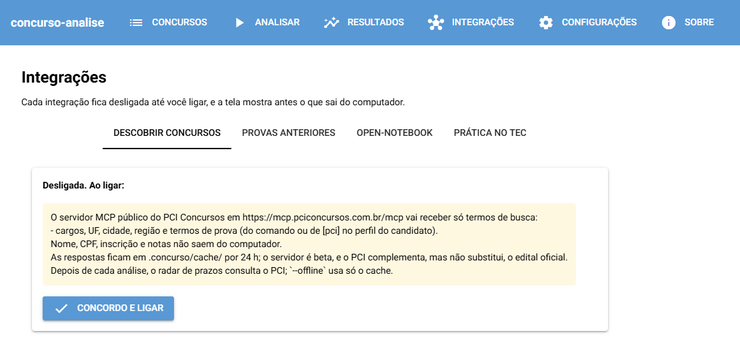

<a id="readme-top"></a>

<!-- BADGES -->
[![Versão][versao-shield]][pyproject-url]
[![Python][python-shield]][python-url]
[![uv][uv-shield]][uv-url]
[![Docker][docker-shield]](#sem-uv-docker)
[![Plataformas][plataformas-shield]](#instalação-para-usuários-leigos)

<!-- CABEÇALHO -->
<br />
<div align="center">
  <h3 align="center">Análise de Desempenho em Concursos</h3>

  <p align="center">
    Corrige suas provas de concurso e mostra em quais disciplinas e tópicos do edital você perde pontos, por concurso e entre concursos.
    <br />
    <a href="docs/modelo.md"><strong>Ler o modelo de domínio »</strong></a>
    <br />
    <br />
    <a href="#uso">Ver exemplo</a>
    &middot;
    <a href="https://github.com/LMafra/analise_concursos/issues/new?labels=bug">Reportar bug</a>
    &middot;
    <a href="https://github.com/LMafra/analise_concursos/issues/new?labels=enhancement">Sugerir funcionalidade</a>
  </p>
</div>

<!-- SUMÁRIO -->
<details>
  <summary>Sumário</summary>
  <ol>
    <li>
      <a href="#sobre-o-projeto">Sobre o projeto</a>
      <ul>
        <li><a href="#feito-com">Feito com</a></li>
      </ul>
    </li>
    <li>
      <a href="#primeiros-passos">Primeiros passos</a>
      <ul>
        <li><a href="#instalação-para-usuários-leigos">Instalação para usuários leigos</a></li>
        <li><a href="#pré-requisitos">Pré-requisitos</a></li>
        <li><a href="#instalação">Instalação</a></li>
      </ul>
    </li>
    <li>
      <a href="#uso">Uso</a>
      <ul>
        <li><a href="#usar-pela-janela">Usar pela janela</a></li>
        <li><a href="#primeira-execução">Primeira execução</a></li>
        <li><a href="#comandos">Comandos</a></li>
        <li><a href="#organizar-as-provas">Organizar as provas</a></li>
        <li><a href="#saídas">Saídas</a></li>
        <li><a href="#revisão-de-tópicos">Revisão de tópicos</a></li>
        <li><a href="#troca-de-gabarito-preliminar-para-definitivo">Troca de gabarito preliminar para definitivo</a></li>
        <li><a href="#configuração">Configuração</a></li>
        <li><a href="#edital-como-fonte-de-verdade">Edital como fonte de verdade</a></li>
        <li><a href="#llm-opcional">LLM opcional</a></li>
        <li><a href="#análise-evolutiva">Análise evolutiva</a></li>
        <li><a href="#problemas-comuns">Problemas comuns</a></li>
        <li><a href="#privacidade">Privacidade</a></li>
      </ul>
    </li>
    <li><a href="#roadmap">Roadmap</a></li>
    <li>
      <a href="#contribuindo">Contribuindo</a>
      <ul>
        <li><a href="#desenvolvimento-build-local-do-executável">Desenvolvimento: build local do executável</a></li>
      </ul>
    </li>
    <li><a href="#licença">Licença</a></li>
    <li><a href="#contato">Contato</a></li>
    <li><a href="#agradecimentos">Agradecimentos</a></li>
  </ol>
</details>

<!-- SOBRE O PROJETO -->
## Sobre o projeto

![Relatório HTML de um projeto sintético com dois concursos][relatorio-screenshot]

Ferramenta local que corrige suas provas de concurso e mostra **em quais disciplinas e tópicos do edital você perde pontos**, por concurso e entre concursos.

* Lê a folha de resposta (PDF ou imagem), um `respostas.txt` ou um `respostas.csv` e corrige pela regra do edital, com desconto por erro e pesos.
* Classifica cada questão numa disciplina e num tópico do conteúdo programático do edital.
* Confere edital, prova e gabarito entre si, e cada valor lido do edital vem com trecho, documento e página.
* Acompanha a evolução entre concursos em notebooks de análise.
* Tem uma janela para quem não usa terminal, com instalador para Windows, macOS e Linux que já traz tudo de que precisa (veja [Instalação para usuários leigos](#instalação-para-usuários-leigos)).

Tudo roda na sua máquina: nenhum arquivo é enviado para lugar nenhum. O único acesso à rede é opcional, quando você liga um LLM para ajudar a ler editais (veja [LLM opcional](#llm-opcional)), o open-notebook ou o PCI Concursos, que só recebe termos de busca (veja [Integração com o PCI Concursos](#integração-com-o-pci-concursos)).

Bancas com perfil embutido: Cebraspe (certo/errado, um erro anula um acerto), FGV, FCC, Vunesp, IBFC, Idecan, SELECON e Quadrix. Uma banca sem perfil usa o genérico, e o que o edital não disser fica para você confirmar (veja [Problemas comuns](#problemas-comuns)).

<p align="right">(<a href="#readme-top">voltar ao topo</a>)</p>

### Feito com

* [![Python][python-badge]][python-url]
* [![pandas][pandas-badge]][pandas-url]
* [![scikit-learn][sklearn-badge]][sklearn-url]
* [![OpenCV][opencv-badge]][opencv-url]
* [![Tesseract][tesseract-badge]][tesseract-url]
* [![Plotly][plotly-badge]][plotly-url]
* [![Typer][typer-badge]][typer-url]
* [![NiceGUI][nicegui-badge]][nicegui-url]
* [![PyInstaller][pyinstaller-badge]][pyinstaller-url]
* [![Jupyter][jupyter-badge]][jupyter-url]
* [![uv][uv-badge]][uv-url]

<p align="right">(<a href="#readme-top">voltar ao topo</a>)</p>

<!-- PRIMEIROS PASSOS -->
## Primeiros passos

### Instalação para usuários leigos

Baixe o instalador do seu sistema na [página da última versão](https://github.com/LMafra/analise_concursos/releases/latest), em "Assets". Ele já traz o Python e o Tesseract: não é preciso instalar mais nada nem abrir o terminal.

| Sistema | Arquivo |
|---|---|
| Windows 10 ou 11, 64 bits | `concurso-analise-<versão>-windows-x64-setup.exe` |
| macOS em Mac com chip Apple (M1 em diante) | `concurso-analise-<versão>-macos-arm64.dmg` |
| Linux 64 bits, distribuições de 2019 em diante | `concurso-analise-<versão>-linux-x86_64.AppImage` |

O app não tem assinatura digital paga, por isso o Windows e o macOS desconfiam dele na primeira vez. Os passos abaixo mostram como liberar.

**Windows**

1. Abra o `concurso-analise-<versão>-windows-x64-setup.exe`.
2. Se aparecer "O Windows protegeu o computador", clique em **Mais informações** e depois em **Executar assim mesmo**.
3. Siga o instalador. Ele instala só para o seu usuário e não pede senha de administrador. Se o computador não tiver o WebView2 (que a janela usa), o instalador oferece a página para baixá-lo; sem ele, o app abre no navegador.
4. Abra o **concurso-analise** pelo menu Iniciar.

Para desinstalar, use Configurações > Aplicativos.

**macOS**

1. Abra o `.dmg` e arraste o **concurso-analise** para a pasta Aplicativos.
2. Abra o app. Na primeira vez, o macOS avisa que não pode verificar o desenvolvedor: feche o aviso.
3. Vá a **Ajustes do Sistema > Privacidade e Segurança**, role até o aviso do concurso-analise e clique em **Abrir Mesmo Assim**. Confirme com a sua senha.

Das próximas vezes, o app abre direto.

**Linux**

1. Torne o arquivo executável: no gerenciador de arquivos, abra Propriedades > Permissões e marque "Permitir executar como programa".
2. Abra o arquivo com dois cliques. A tela abre no navegador padrão, num endereço que só o seu computador acessa (`127.0.0.1`).

Se ele não abrir, rode no terminal `APPIMAGE_EXTRACT_AND_RUN=1 ./concurso-analise-*.AppImage`, que dispensa o FUSE.

**Conferir o download (opcional).** A página da versão traz o `SHA256SUMS`, com a impressão digital de cada arquivo. No Windows, compare com a saída de `Get-FileHash .\concurso-analise-<versão>-windows-x64-setup.exe` no PowerShell; no Linux e no macOS, rode `sha256sum -c SHA256SUMS --ignore-missing` (no macOS, `shasum -a 256 -c SHA256SUMS --ignore-missing`) na pasta do download.

Depois de instalar, veja [Usar pela janela](#usar-pela-janela).

### Pré-requisitos

Para usar pelo terminal, em vez do instalador:

* [uv](https://docs.astral.sh/uv/getting-started/installation/), que traz o Python 3.11 ou 3.12.
* [Tesseract](https://github.com/tesseract-ocr/tesseract) com o idioma português, só para edital ou folha em imagem (PDF escaneado). O `doctor` mostra o comando para o seu sistema:
  ```sh
  sudo apt install tesseract-ocr tesseract-ocr-por   # Ubuntu e WSL
  brew install tesseract tesseract-lang              # macOS
  winget install UB-Mannheim.TesseractOCR            # Windows
  ```
* Opcional: Docker, no lugar do uv e do Tesseract.

A CLI foi verificada no Linux/WSL e no container, e o executável Linux, num Debian 12 sem Python nem Tesseract. Os executáveis de Windows e macOS são gerados pelo workflow de release, que roda neles o mesmo teste de máquina limpa.

### Instalação

1. Clone o repositório:
   ```sh
   git clone git@github.com:LMafra/analise_concursos.git
   ```
2. Crie uma pasta `provas/` com uma subpasta por concurso, copie para ela os arquivos que vieram da banca e rode, na pasta que contém `provas/`:
   ```sh
   uvx --from <caminho do repositório> concurso-analise
   ```
3. Para ter o comando no PATH, instale-o. Depois, basta `concurso-analise`:
   ```sh
   uv tool install <caminho do repositório>
   ```

4. Para a janela também pelo terminal, instale com o extra `gui` e abra com `concurso-analise gui`:
   ```sh
   uv tool install '<caminho do repositório>[gui]'
   ```

O pacote ainda não está no PyPI.

#### Sem uv: Docker

A imagem já traz o Tesseract em português. A pasta montada em `/dados` é o projeto:

```sh
docker build -t concurso-analise .
docker run --rm -it --user "$(id -u):$(id -g)" -v "$PWD:/dados" concurso-analise
```

<p align="right">(<a href="#readme-top">voltar ao topo</a>)</p>

<!-- USO -->
## Uso

### Usar pela janela

No Windows e no macOS, o app abre numa janela própria; no Linux, no navegador. Nos dois casos, a tela só é acessível no seu computador.

**1. Pasta do projeto.** Na primeira vez, o app pergunta onde guardar suas provas e análises. O padrão é `Documentos/Concursos`, e o app lembra a pasta nas próximas vezes. Em seguida, ele faz três perguntas (seu nome e os nomes das pastas, com padrões que você pode aceitar) e, se você quiser, confere o ambiente.


**2. Novo concurso.** Dê um nome ao concurso e solte na área azul os arquivos que vieram da banca: edital, gabarito, caderno de prova e as suas respostas (a foto ou o PDF da folha, ou um arquivo de texto). O app detecta o papel de cada arquivo e pede só a sua confirmação; se ele errou, escolha o papel certo na lista.


Se a folha não puder ser lida, use **Digitar respostas** e marque a alternativa de cada questão.

**3. Concursos.** A lista mostra a situação de cada concurso (`completo`, `incompleto` ou `desatualizado`) e se o gabarito é preliminar ou definitivo. Num concurso incompleto, **Resolver** diz o que falta e oferece acrescentar arquivos ou digitar as respostas.


**4. Analisar.** A barra avança por concurso. O **Log detalhado** mostra o que o app decidiu sozinho, por exemplo quando o edital não traz a regra de correção e ele usa a da banca.


**5. Resultados.** O relatório aparece na própria tela, e **Abrir no navegador** o abre em tamanho cheio. As outras abas trazem as recomendações de estudo, a prática no TEC e a exportação do consolidado.


**6. Configurações.** Os dois limiares da análise, o concurso que você vai prestar (`concurso-alvo`) e a pasta do projeto. A leitura de editais por IA começa desligada; se você a ligar, a chave fica no cofre de senhas do sistema, nunca num arquivo.


**7. Integrações.** Descobrir concursos e provas anteriores no PCI Concursos, sincronizar com o open-notebook e importar a prática no TEC. Cada integração fica desligada até você concordar, e a tela mostra antes o que sai do computador.



Com mais de um candidato no projeto, a tela de concursos mostra o seletor de candidato e a opção **todos**, que gera o comparativo. A tela **Sobre** mostra a versão e onde fica o log, para anexar a um relato de problema.

No Linux, o menu tem **Fechar o app**: fechar só a aba do navegador deixa o app rodando.

### Primeira execução

Na primeira execução, um assistente faz 6 perguntas. Enter aceita o padrão entre colchetes:

```text
$ concurso-analise
[1/6] Seu nome [ana]: Ana
[2/6] Pasta de provas [provas]:
[3/6] Pasta de análises [analises]:
[4/6] Folha preenchida para calibrar a leitura (Enter para pular):
[5/6] LLM para ler editais de bancas desconhecidas (nenhum/openai/openrouter/gemini/ollama/anthropic) [nenhum]:
[6/6] Conferir o ambiente com o doctor no fim? (s/n) [s]:
Vou gravar:
  candidato: Ana
  pasta de provas: ~/meus-concursos/provas
  pasta de análises: ~/meus-concursos/analises
  LLM: nenhum
  leitura da folha: detecção automática ou perfil da banca
  em ~/meus-concursos/.concurso/config.toml e ~/.concurso/config.toml
Gravar? [S/n]
```

Em seguida, o `doctor` confere o ambiente e a análise mostra o progresso. Os avisos dizem o que o app decidiu sozinho:

```text
✓ uv: ~/.local/bin/uv
✓ Python: 3.12.3
✗ Tesseract: não encontrado no PATH; sem ele, edital e folha em imagem não são lidos
    correção: sudo apt install tesseract-ocr tesseract-ocr-por
✓ poppler: não necessário (os PDFs são lidos com pypdfium2)
✓ espaço em disco: 908272 MB livres em ~/meus-concursos/provas
✓ LLM: desligado (nenhuma chamada de rede)
INFO Analisando sintetico_2024
WARNING sintetico_2024: regra de correção não encontrada no edital nem no concurso.yaml; usando a do perfil da banca fgv (fator 0)
INFO Saídas de sintetico_2024 gravadas em analises/ana/sintetico_2024
INFO Analisando sintetico_2025
INFO Saídas de sintetico_2025 gravadas em analises/ana/sintetico_2025
INFO Relatório HTML gravado em analises/ana/index.html
relatório: ~/meus-concursos/analises/ana/index.html
```

No fim, o relatório abre no navegador (no WSL, no navegador do Windows). Rodar de novo só reprocessa o que mudou. Sem mudanças, nenhum arquivo de `analises/` é tocado.

### Comandos

Sem subcomando, `concurso-analise` faz o onboarding (na primeira vez) e analisa o que mudou.

| Comando | O que faz |
|---|---|
| `gui` | Abre a janela (no Linux, o navegador); `--project` escolhe a pasta e `--browser` força o navegador. Precisa do extra `gui`. |
| `init` | Refaz as perguntas do onboarding, com as respostas atuais como padrão. `--calibrate-sheet` e `--calibrate-answers` calibram a leitura da folha. |
| `add <pasta>` | Cadastra a pasta de um concurso: detecta o papel de cada arquivo, a banca e o status do gabarito, e pergunta só o que for ambíguo. |
| `add <arquivo> --candidate <nome>` | Copia uma folha ou um arquivo de respostas para o candidato. |
| `analyze [concurso]` | Analisa os concursos que mudaram, ou só o indicado. `--reuse-csv` aplica a correção manual da leitura da folha. |
| `status` | Situação de cada concurso: `completo`, `incompleto` ou `desatualizado`, e o status do gabarito. |
| `report` | Reabre o último relatório HTML. |
| `export --format csv\|parquet\|md` | Grava o consolidado do candidato, uma linha por questão. |
| `doctor` | Confere uv, Python, Tesseract, permissão de escrita, espaço em disco, a chave do LLM e a configuração do open-notebook, com o comando de correção para o seu sistema. |
| `upgrade` | Mostra o comando que atualiza a ferramenta. Com `--run`, executa `uv tool upgrade concurso-analise`. |
| `notebook enable\|disable\|sync` | Liga, desliga ou roda a sincronização com o open-notebook (veja [Integração com open-notebook](#integração-com-open-notebook)). |
| `discover` | Busca no PCI Concursos os concursos com inscrições abertas ou prestes a abrir; `--register ID` acompanha um no radar de prazos (veja [Integração com o PCI Concursos](#integração-com-o-pci-concursos)). |
| `pci enable\|disable\|provas` | Liga ou desliga o PCI, ou lista as provas anteriores de um concurso e importa uma como simulado. |

Flags globais, antes do subcomando: `--yes` (aceita os padrões sem perguntar), `--quiet`, `--verbose`, `--dry-run` (mostra o que seria feito, sem gravar nada), `--force` (reprocessa tudo), `--candidate`, `--all-candidates`, `--no-open`, `--no-llm`, `--offline`, `--data-dir`, `--provas` e `--analises`.

Sem terminal interativo, com a variável `CI` ou com `--yes`, nada é perguntado: o app usa os padrões e os lista no log.

Códigos de saída: 0 sucesso, 1 problema nos seus dados ou na configuração, 2 problema no ambiente. Um erro aparece em até duas linhas, a causa e uma `dica:` com o que fazer. Os detalhes técnicos ficam em `~/.concurso/logs/concurso-analise.log`.

O comando antigo `concursos` continua funcionando, com aviso de obsoleto.

### Organizar as provas

```text
provas/
  tcu_25/
    edital.pdf, anexos, cadernos de prova, gabaritos
    candidatos/
      ana/
        folha.pdf            # ou respostas.txt, ou respostas.csv
      bruno/
        respostas.txt
```

1. Crie `provas/<concurso>/` e copie os arquivos com os nomes que vieram da banca: edital e anexos (sem edital, o concurso fica incompleto), cadernos de prova, gabaritos (preliminar ou definitivo; PDFs com vários cargos são aceitos) e, opcionalmente, o resultado oficial com a sua nota.
2. Coloque suas respostas em `candidatos/<seu nome>/`: a folha de resposta (PDF ou imagem), um `respostas.txt` ou um `respostas.csv`. `add <arquivo> --candidate <nome>` faz isso por você.
3. Rode `concurso-analise`. Uma pasta sem `concurso.yaml` aparece no `status` como incompleta; `add provas/<concurso>` a cadastra.

Um projeto pode ter vários candidatos. A análise usa o último candidato analisado; troque com `--candidate <nome>`, ou analise todos com `--all-candidates`, que gera também `analises/comparativo_candidatos.md`.

O assistente `./scripts/novo_concurso.sh` guia a coleta, o cadastro e a análise de um concurso novo, passo a passo.

#### Formato do `respostas.txt`

Use quando não tiver a folha de resposta. Escreva uma questão por linha:

```text
# comentários começam com #
1 A
02: C
3-E
4 -
```

- Múltipla escolha aceita as letras do concurso (de `A` a `D` ou a `E`); certo/errado (Cebraspe) aceita `C` ou `E`.
- `-` ou valor vazio indicam branco. Questões omitidas também contam como branco.
- Separadores aceitos: espaço, `:`, `;`, `,`, `.` e `-`. Zeros à esquerda são ignorados.
- Erros indicam o número da linha.

Um gabarito em texto usa o mesmo formato, com `X` ou `*` para questão anulada.

Um `respostas.csv` tem as colunas `questao` e `alternativa`, com separador `,` ou `;`, como o Excel ou o LibreOffice gravam.

### Saídas

Por concurso, em `analises/<candidato>/<concurso>/`:

| Arquivo | Conteúdo |
|---|---|
| `relatorio.md` e `relatorio.html` | Resumo, nota final pela regra do edital (com desconto por erro ou pesos), gráficos, tópicos mais fracos, questões para revisar, validação oficial |
| `respostas_extraidas.csv` | Todas as questões: alternativa marcada, estado, `confianca_ocr`, `revisar`, origem, arquivo, página |
| `desempenho_por_disciplina.csv`, `desempenho_por_topico.csv` | `concurso, prova, disciplina, topico, total, acertos, erros, percentual, em_branco, anuladas, nota_liquida` |
| `questoes.csv` | Por questão: disciplina, tópico sugerido e final, score, gabarito, resposta, resultado |
| `correcao.json` | Regra de correção e data da prova, com o trecho e a página de origem |
| `edital_estruturado.json` | Conteúdo programático do cargo e as regras do edital, cada valor com fonte, confiança, trecho, documento e página |
| `discrepancias_edital.csv`, `catalogo_edital.md` | Validação edital × prova × gabarito e catálogo de descobertas |
| `diff_gabarito.csv`, `historico/` | Só após a troca de gabarito preliminar por definitivo |
| `depuracao/*.png` | Bolhas detectadas na folha de resposta |

Por candidato, em `analises/<candidato>/`:

- `index.html`: o relatório com todos os concursos, o que o app decidiu sozinho, os avisos e a evolução;
- `consolidado/desempenho_geral.csv` e `consolidado/comparativo_concursos.md`: desempenho e nota final por concurso, tópicos e disciplinas abaixo do limiar em pelo menos dois concursos, concursos incompletos e validação com o resultado oficial;
- `consolidado/consolidado.parquet` e `consolidado/relatorio_evolucao.md`, com os gráficos de evolução.

O percentual é de mérito: anuladas contam como acerto, mas ficam fora do percentual.

### Revisão de tópicos

Com o edital cadastrado, cada questão recebe uma disciplina e um tópico sugeridos. A sugestão compara o texto da questão (na Cebraspe, o bloco "julgue os itens") com os tópicos do edital, por similaridade TF-IDF, e vem com um score.

Na primeira análise é criado `provas/<concurso>/revisao/questoes_revisado.csv`, com as sugestões, o score, um trecho do enunciado e as colunas `disciplina` e `topico` vazias. Preencha essas colunas só nas questões que quiser corrigir e rode de novo. A revisão tem prioridade sobre a sugestão. O relatório lista as sugestões com score baixo ainda não revisadas.

Se o conteúdo programático não puder ser extraído do edital, forneça um edital manual em YAML (veja [docs/modelo.md](docs/modelo.md#edital-manual)).

### Troca de gabarito preliminar para definitivo

Analise com o gabarito preliminar enquanto o definitivo não sai; o relatório mostra o selo **Gabarito preliminar (provisório)**. Quando o definitivo sair, coloque-o na pasta (ou sobrescreva o arquivo do preliminar) e rode de novo.

Se o definitivo casar com a prova configurada (mesma banca, cargo/tipo e faixa de itens), a análise:

- atualiza o `concurso.yaml`;
- move o preliminar para `ignorar` e registra o evento em `historico`;
- guarda as saídas anteriores em `analises/<candidato>/<concurso>/historico/`;
- gera `diff_gabarito.csv`, com as questões alteradas e anuladas, sua resposta e o acerto antes e depois;
- adiciona ao relatório a seção "Preliminar → Definitivo".

Em qualquer outro caso (outro cargo, arquivo desconhecido), o concurso fica `desatualizado` até você rodar `add` de novo.

### Configuração

A configuração do projeto fica em `.concurso/config.toml`, gravada pelo onboarding:

```toml
[pastas]
provas = "provas"
analises = "analises"

[analise]
limiar_confianca = 0.75     # leituras abaixo dele ficam com revisar = True
limiar_topico_baixo = 0.6   # define o desempenho baixo no comparativo
concurso_alvo = "tcu_25"    # opcional; o concurso que a nota ponderada e o gap para o corte analisam
```

Depois de mudar um limiar, rode com `--force`. A precedência é: flag, variável de ambiente (`CONCURSO_PROVAS`, `CONCURSO_ANALISES`, `CONCURSO_CANDIDATO`, `CONCURSO_HOME`), `config.toml`, padrão.

O `concurso.yaml` de cada pasta é gerado pelo `add` e pode ser editado à mão. Quando o edital não traz a regra de correção ou a data da prova, ou quando o concurso tem opções de cargo com pesos diferentes (CPNU), declare-as nele:

```yaml
data_prova: 2025-10-05         # prevalece sobre a data provável do edital
escolaridade: superior         # superior | medio; o notebook 04 recalcula tudo sem o nível médio
correcao:
  modelo: liquida              # bruta | liquida | ponderada
  fator_penalidade: 1          # acertos anulados por erro
  variantes: [B3-08-A, B3-10-A] # pesos lidos do quadro do edital, um por cargo
edital:
  arquivo: edital.pdf
  retificacoes: [ret_2.pdf, ret_3.pdf]  # na ordem de publicação; a mais recente vence campo a campo
```

O schema completo, a precedência e as fórmulas estão em [docs/modelo.md](docs/modelo.md).

A `.concurso/taxonomia.yaml` mapeia cada nome de disciplina para uma disciplina canônica e um bloco (geral ou específico), para comparar a mesma matéria entre editais. Um concurso com nome de disciplina inédito precisa de uma entrada nela; veja [Taxonomia de disciplinas](docs/modelo.md#taxonomia-de-disciplinas).

### Edital como fonte de verdade

A análise lê do edital do cargo, além do conteúdo programático, as regras que mudam a nota e a leitura dela: identificação, pesos, distribuição de questões, cortes (em pontos ou acertos, por bloco, no conjunto e por disciplina), cronograma, desempate e outras descobertas. Cada valor vem com a fonte e com trecho, documento e página, para conferir no PDF. A nota continua saindo do `correcao.json`; o edital é a expectativa contra a qual a prova é conferida.

Quando o edital não diz algo, o valor vem, nesta ordem, do LLM (se ligado), do perfil da banca, do padrão ou do `edital_a_confirmar.yaml`. O relatório lista o que o app decidiu sozinho.

**Como ler as discrepâncias** (`discrepancias_edital.csv`). As colunas são `item, esperado_edital, observado_prova, diferenca, severidade, acao_sugerida`:

- `error`: algo está errado na leitura ou na configuração, como total de questões divergente ou gabarito com letras além das alternativas do edital. Confira o PDF e o `concurso.yaml`.
- `warn`: confira à mão, como contagem por disciplina divergente ou peso realizado diferente do edital (vale o realizado).
- `info`: só registro.

Arquivo vazio, só com o cabeçalho, quer dizer que edital, prova e gabarito concordam.

**Como ler o catálogo** (`catalogo_edital.md`). Uma linha por informação procurada no edital: valor, trecho de origem, uso no projeto, impacto e status. "Não encontrado" quer dizer que o edital não declara a informação. O template está em [docs/modelo.md](docs/modelo.md).

### LLM opcional

Desligado por padrão. Ligado no onboarding (pergunta 5) ou com `init`, ele só preenche o número de alternativas, o desconto por erro e a data da prova quando o texto do edital não os trouxe. Só o texto do edital e dos anexos é enviado, nunca suas respostas ou seu nome, e o app pede sua concordância antes do primeiro uso. Cada valor precisa citar um trecho que exista no edital; sem isso, é descartado.

Provedores: OpenAI, OpenRouter, Gemini, Ollama (local, sem chave) e Anthropic. A chave vem de uma variável de ambiente; com o extra `llm` (`uv tool install '<repositório>[llm]'`), pode ficar no keyring do sistema. Ela nunca é gravada no `config.toml`.

### Integração com open-notebook

Opcional e desligada por padrão. Com uma instância local do [open-notebook](https://github.com/lfnovo/open-notebook) (testada com a 1.15), o app cria um notebook por concurso e um consolidado, envia os relatórios e CSVs como fontes e grava uma nota de resumo montada localmente, sem LLM. Assim você conversa com as suas análises no chat do open-notebook.

```sh
docker compose up -d                                   # na pasta do open-notebook
concurso-analise notebook enable                       # mostra o que vai e pede confirmação
concurso-analise notebook sync                         # envia agora; depois, toda análise sincroniza sozinha
concurso-analise notebook sync --concurso meu_concurso --all-candidates
concurso-analise notebook disable
```

- O candidato aparece como pseudônimo (`candidato 1`); para usar o nome, grave `incluir_nome = true` em `[open_notebook]` no `~/.concurso/config.toml`. CPF e inscrição não são enviados.
- Se a instância tem senha (`OPEN_NOTEBOOK_PASSWORD`), defina a mesma variável no seu ambiente; a senha nunca vai para o TOML.
- O chat do open-notebook usa o provedor de IA configurado nele. Se esse provedor é externo, o conteúdo das análises vai para ele quando você conversa.
- Reexecutar sem mudança não envia nada: o estado fica em `.concurso/open_notebook.json`. Um arquivo que mudou tem a fonte apagada e criada de novo. Fontes que você criou à mão no notebook nunca são apagadas.
- `notebook sync` sai com 0, 1 (falha parcial ou senha recusada) ou 2 (instância fora do ar). Depois de uma análise, uma falha só gera aviso. `--offline` e `--dry-run` não chamam a instância, e o `doctor` mostra a configuração sem consultá-la.

Os campos e o estado estão em [docs/modelo.md](docs/modelo.md); as decisões, em [docs/spec-open-notebook.md](docs/spec-open-notebook.md).

### Integração com o PCI Concursos

Opcional e desligada por padrão. O [PCI Concursos](https://www.pciconcursos.com.br/) tem um servidor MCP público e gratuito (`https://mcp.pciconcursos.com.br/mcp`, em beta). Com ele ligado, o app descobre concursos, acha provas anteriores para treinar e avisa dos prazos de inscrição. O PCI é um complemento colaborativo e pode não ter todos os editais: confira sempre o edital no site do órgão ou da banca.

```sh
uv tool install 'concurso-analise[pci]'        # o cliente MCP vem num extra
concurso-analise pci enable                     # mostra o que é enviado e pede confirmação
concurso-analise discover --cargo analista --cargo auditor --uf mg
concurso-analise discover --cidade campinas --uf sp --json
concurso-analise discover --cargo analista --register 296237   # acompanha no radar
concurso-analise add provas/camara_x --pci 296237              # vincula a pasta do concurso
concurso-analise pci provas meu_concurso                       # provas anteriores do mesmo cargo e banca
concurso-analise pci provas meu_concurso --download 20549582   # abre a página e importa o que você baixar
```

- **O que sai do computador:** só termos de busca (cargos, UF, cidade, região, termos de prova). Nome, CPF, inscrição e notas, não.
- **Cargos-alvo:** sem filtro, o `discover` e o radar usam os cargos do candidato, em `~/.concurso/candidatos/<slug>.toml`:

  ```toml
  [pci]
  cargos = ["auditor fiscal", "analista"]
  uf = "df"
  ```

  Sem eles, valem `cargos` e `uf` de `[pci_mcp]` no `~/.concurso/config.toml`; sem nenhum, a lista geral.
- **Radar de prazos:** depois de cada análise, o app grava `analises/<candidato>/radar_editais.md` e a seção "Editais que fecham em breve" no `index.html`, com os concursos dos seus cargos que fecham em até `dias_alerta` (15) dias ou que vão abrir, mais os que você registrou. O `status` e o `doctor` mostram o radar pelo cache, sem rede.
- **Provas anteriores viram simulados:** o PDF fica atrás de um captcha e o `robots.txt` do PCI proíbe baixá-lo por robô, então o download é seu: o `--download` abre a página no navegador, você clica nos arquivos, e o app importa da pasta de downloads (`pasta_downloads`; no WSL, a do Windows). O simulado vira uma pasta própria, `provas/<orgao>_<ano>_pci<id>/`, corrigida pelo perfil da banca da prova, com os tópicos do edital do seu concurso. Acrescente suas respostas com `add`; a data do simulado é a data em que você resolveu. Simulados ficam fora do consolidado e das tendências, a não ser com `incluir_simulados = true` em `[analise]` no `.concurso/config.toml`, e aparecem na seção "Simulados" do `index.html`.
- **Cache:** as respostas ficam em `.concurso/cache/pci_mcp.json` por `ttl_horas` (24); `--refresh` consulta de novo, e `--offline` usa o cache, mesmo vencido, com aviso. No máximo 20 consultas por execução.
- **Falhas:** num comando explícito, saem como `erro:`/`dica:` (código 2 com o servidor fora do ar, 1 com um filtro recusado). Depois da análise, uma falha só gera aviso.
- **No Cursor:** o `.cursor/mcp.json` do projeto registra o servidor, para o agente consultar o PCI direto.

```toml
# ~/.concurso/config.toml
[pci_mcp]
enabled = true
dias_alerta = 15
pasta_downloads = ""      # vazio: ~/Downloads (no WSL, a do usuário do Windows)
```

Os campos estão em [docs/modelo.md](docs/modelo.md); as decisões, em [docs/spec-pci-mcp.md](docs/spec-pci-mcp.md), e o que o servidor responde, em [docs/pesquisa-pci-mcp.md](docs/pesquisa-pci-mcp.md).

### Recomendações de estudo: livros e legislação

Também opcionais. Com uma das duas fontes abaixo, a análise grava `analises/<candidato>/consolidado/recomendacoes_estudo.md` e a seção "Recomendações de estudo" no `index.html`: para cada tópico fraco persistente, as normas que o próprio tópico cita e até 3 livros. Cada linha diz de onde veio (`legislação`, `open-notebook` ou `catálogo`). São sugestões e não mudam o tópico nem a disciplina das questões.

**Livros.** Mapeie as disciplinas da taxonomia para as categorias da estante do projeto `books` em `.concurso/biblioteca.yaml`:

```yaml
catalogo: ../books/Bookshelf/README.md
disciplinas:
  Banco de Dados: ["TI - Banco de Dados › SQL e Teoria", "TI - Banco de Dados › MongoDB"]
```

Sem rede, os livros vêm do catálogo. Com o open-notebook ligado e a estante enviada (`python3 scripts/sync_open_notebook.py --apply` no `books`), a busca de texto nos notebooks `Biblioteca — <categoria>` escolhe os livros, e o `notebook sync` vincula os livros das disciplinas de cada concurso ao notebook dele. Só o texto do tópico, que vem do edital, vai na busca.

**Legislação.** Mantenha um clone parcial do [ctresb/leis](https://github.com/ctresb/leis) e aponte para ele no `~/.concurso/config.toml`:

```bash
git clone --filter=blob:none --sparse https://github.com/ctresb/leis.git ~/projects/leis
cd ~/projects/leis
git sparse-checkout set federal/leis-ordinarias federal/leis-complementares federal/decretos \
  federal/emendas-constitucionais jurisprudencia/stf/sumulas-vinculantes jurisprudencia/outros-tribunais/tcu
```

```toml
[legislacao]
repositorio = "~/projects/leis"
```

O app só lê os arquivos, sem rede e sem `git`; atualize com `git pull`. Uma norma em versão não compilada (como a Lei 14.133 no repositório hoje) ou muito curta sai com aviso. Com o open-notebook ligado, as normas citadas nos editais vão para um notebook `Legislação`, uma vez cada, vinculadas aos concursos que as citam. O `doctor` confere o caminho.

### Prática no TEC Concursos

Também opcional. O projeto separado `tec-erros` (extensão do Chrome, userscript para o Firefox do Android e um `caderno.html` offline) registra as questões que você erra no TEC e exporta `tec-erros-<aparelho>-<data>.json`. Ligue a importação no `.concurso/config.toml`:

```toml
[pratica]
entrada_tec = "tec"       # pasta das exportações
# candidato = "ana"       # obrigatório se você roda com --all-candidates
# open_notebook = true    # manda o caderno de erros ao open-notebook
```

```bash
concurso-analise pratica import ~/Downloads/tec-erros-d3f9a1c2-2026-11-02.json
```

O comando copia o arquivo para `tec/` e roda a análise; a análise padrão também lê a pasta. Arquivos de aparelhos diferentes se juntam: errar a mesma questão no computador e no tablet conta duas vezes. A matéria do TEC vira disciplina pela `taxonomia.yaml`, e o assunto vira tópico do edital do `concurso_alvo`: num terminal, a pergunta sai uma vez por assunto; sem terminal, o assunto vai para `analises/<candidato>/pratica/revisao_aliases.csv` para você preencher. A análise grava em `analises/<candidato>/pratica/` os erros, os cadernos e o desempenho por disciplina, e o `index.html` ganha a seção "Prática no TEC", que cruza os tópicos fracos da prova com os erros repetidos no TEC. Normas citadas nos enunciados e comentários entram nas recomendações de estudo.

O enunciado e o comentário do professor são conteúdo do TEC: só vão ao open-notebook com `open_notebook = true`, e, se a instância usa um provedor de IA na nuvem, o chat dela os envia para lá.

### Análise evolutiva

Notebooks que leem as saídas de todos os concursos e respondem se o desempenho melhora com o tempo. A métrica padrão é o percentual ajustado ao acaso (um chute vale 0 em certo/errado e em múltipla escolha), e a evolução se lê pelo z-score de cada disciplina dentro do concurso. Todo percentual vem com o n: n < 5 é amostra insuficiente, e uma tendência precisa de 3 datas de prova distintas ou mais.

| Notebook | Pergunta |
|---|---|
| `00_carregamento` | A base consolidada está íntegra e comparável (data, regra de correção e taxonomia de cada concurso)? |
| `01_visao_geral` | Quanto dá para concluir com o n disponível, e quanto a regra de correção muda o ranking de concursos? |
| `02_evolucao_disciplina` | Estou melhorando em cada disciplina, com gerais e específicos separados? |
| `03_evolucao_topico` | Quais tópicos do edital foram cobrados e quais continuam fracos? |
| `04_insights` | Conclusões: melhoras significativas, fracos persistentes, correlação com o tempo, distância até a meta e sensibilidade ao nível médio. |
| `05_corte_e_peso` | Pela regra de cada edital, quanto falta para os cortes e em que disciplina, e quanto peso e desconto mexem no ranking. |

A partir do clone, instale o grupo de análise e rode todos os notebooks do zero, em ordem (ou só os indicados):

```sh
uv sync --group analise
./scripts/rodar_notebooks.sh
./scripts/rodar_notebooks.sh notebooks/04_insights.py
```

Os notebooks são scripts [jupytext](https://jupytext.readthedocs.io/) em `notebooks/NN_*.py`; o script gera o `.ipynb` ao lado, fora do git. Para editar no Jupyter, abra o `.py` com `uv run --group analise jupyter lab`.

### Problemas comuns

**"pasta de provas não encontrada".** Rode o comando na pasta que contém `provas/`, ou indique outra com `--provas <pasta>`. O assistente oferece criar a pasta, com um `LEIA-ME.txt` que explica o que pôr nela.

**Tesseract ausente.** Só é necessário para edital ou folha em imagem (PDF escaneado); veja os [pré-requisitos](#pré-requisitos). Sem ele, o edital em imagem cai no modo mínimo, com aviso, e a imagem Docker já o traz.

**A folha de resposta não foi lida, ou foi lida errado.** Em ordem:

1. Abra `analises/<candidato>/<concurso>/respostas_extraidas.csv`. As leituras com `revisar = True` têm confiança baixa.
2. Corrija a coluna `alternativa_marcada` no Excel ou no LibreOffice e rode `concurso-analise analyze <concurso> --reuse-csv`. A revisão passa a valer no lugar da folha.
3. Se a sua folha tem um modelo que o app não conhece, calibre a leitura: `concurso-analise init --calibrate-sheet folha.png --calibrate-answers ABCD-`, com as respostas das 5 primeiras questões (`-` para branco).
4. Sem a folha, digite as respostas num `respostas.csv` ou `respostas.txt` na pasta do candidato.

**"edital_a_confirmar.yaml" apareceu na pasta do concurso.** O edital não trouxe algum campo que muda a nota (número de alternativas, desconto por erro, data da prova). Preencha os valores no arquivo e rode de novo; eles passam a valer com fonte `config`. O relatório marca cada concurso com a confiança da leitura do edital (alta, média, baixa ou mínima).

**Vários candidatos e nenhum escolhido.** A CLI pede `--candidate <nome>` ou `--all-candidates`.

**Mudei um limiar e nada mudou.** A análise só reprocessa o que mudou nos arquivos. Rode `concurso-analise --force`.

**O relatório não abriu.** O caminho do `index.html` aparece no fim da execução, e `concurso-analise report` o reabre. No WSL, o app usa o `wslview` (pacote `wslu`) ou o `explorer.exe`.

**O LLM não foi usado.** O `doctor` diz qual variável de ambiente definir com a chave. `--offline` e `--no-llm` o desligam de propósito.

**Eu usava a versão anterior (`concursos analisar`).** Na primeira execução, o `concurso-analise` migra o projeto para o layout com candidatos, sem reprocessar nada. Antes, copia tudo o que vai mudar para `~/.concurso/backup-<data>/`. `--dry-run` lista o que seria migrado.

### Privacidade

`provas/`, `analises/` e `.concurso/` ficam fora do git (`.gitignore`) e fora da imagem Docker (`.dockerignore`), por conterem dados pessoais (nome, CPF, notas). Nenhum arquivo é enviado para fora da máquina; o LLM, se ligado, só recebe texto do edital. O open-notebook, se ligado, recebe os relatórios e CSVs da análise, com o candidato como pseudônimo. O PCI Concursos, se ligado, só recebe termos de busca.

A janela do app é servida só em `127.0.0.1`: nenhum outro computador da rede a acessa. O executável não manda telemetria nem se atualiza sozinho.

<p align="right">(<a href="#readme-top">voltar ao topo</a>)</p>

<!-- ROADMAP -->
## Roadmap

- [x] Fase 1: correção da prova e desempenho por disciplina e tópico
- [x] Fase 2: análise evolutiva entre concursos
- [x] Fase 3: edital como fonte de verdade
- [x] Fase 4: generalização e portabilidade (onboarding, CLI, Docker, perfis de banca)
- [x] Fase 5: janela (NiceGUI) e instaladores para Windows, macOS arm64 e Linux, com o Tesseract embutido
- [ ] Escopo de cargo nos pesos e nas demais buscas do edital
- [ ] Precedência completa com o `concurso.yaml` (total de questões e pesos)
- [ ] Nome oficial e cargo nas discrepâncias e no notebook 05
- [ ] Verificação da CLI no macOS e no Windows nativo
- [ ] Assinatura de código no Windows e no macOS
- [ ] Publicação no PyPI

Veja [docs/pendencias.md](docs/pendencias.md) para o detalhe e a ordem sugerida de cada pendência.

<p align="right">(<a href="#readme-top">voltar ao topo</a>)</p>

<!-- CONTRIBUINDO -->
## Contribuindo

1. Crie uma branch a partir do `main` (`git checkout -b feature/minha-mudanca`)
2. Instale as dependências e os hooks:
   ```sh
   uv sync --all-groups
   uv run pre-commit install
   ```
3. Rode os testes, o lint e o teste ponta a ponta:
   ```sh
   uv run pytest
   uv run ruff check . && uv run ruff format --check .
   uv run python scripts/smoke.py uvx --from "$PWD" concurso-analise   # ponta a ponta num projeto temporário
   ```
4. Faça o commit (`git commit -m 'feat: minha mudança'`) e o push (`git push origin feature/minha-mudanca`)
5. Abra um pull request

O pre-commit roda ruff e pytest antes de cada commit. O workflow de CI (`.github/workflows/ci.yml`) cobre Ubuntu, macOS e Windows com Python 3.11 e 3.12. As especificações estão em `docs/spec*.md`, e o modelo de domínio, em [docs/modelo.md](docs/modelo.md). As regras para agentes estão em [AGENTS.md](AGENTS.md).

### Desenvolvimento: build local do executável

O executável é uma pasta do PyInstaller (`empacotamento/concurso-analise.spec`) com o Python, o Tesseract e o modelo `por` do `tessdata_fast`. Os scripts de `empacotamento/` são os mesmos do workflow de release (`.github/workflows/release.yml`); a saída vai para `dist/`, e o Tesseract baixado, para `empacotamento/construcao/`, ambos fora do git. A captura do TEC entra no pacote se você a gerar antes com `node tec-erros/scripts/build.mjs` (Node 22).

**Linux (AppImage).** O build roda no contêiner `manylinux_2_28`, para o executável valer em distribuições de 2019 em diante. Use um clone limpo, porque o contêiner recria o `.venv`:

```sh
git clone https://github.com/LMafra/analise_concursos.git /tmp/build-ca && cd /tmp/build-ca
docker run --rm -e APPIMAGE_EXTRACT_AND_RUN=1 -v "$PWD:/src" -w /src \
    quay.io/pypa/manylinux_2_28_x86_64 bash empacotamento/linux/construir.sh
sudo chown -R "$(id -u):$(id -g)" .
```

Confira num Debian 12 sem Python nem Tesseract, e depois com o onboarding e a análise de um projeto sintético:

```sh
docker run --rm -e APPIMAGE_EXTRACT_AND_RUN=1 -v "$PWD/dist:/dist:ro" debian:12 \
    sh -c '/dist/concurso-analise-*.AppImage --smoke && /dist/concurso-analise-*.AppImage doctor'
APPIMAGE_EXTRACT_AND_RUN=1 python3 scripts/smoke.py congelado dist/concurso-analise-*-linux-x86_64.AppImage
```

**Windows (instalador).** Precisa do [MSYS2](https://www.msys2.org/) em `C:\msys64`, do [Inno Setup 6](https://jrsoftware.org/isinfo.php) e do uv. No PowerShell, na raiz do repositório:

```powershell
.\empacotamento\tesseract\obter_windows.ps1 -Msys C:\msys64
uv sync --locked --no-dev --extra gui --extra llm --extra pci --group empacotamento
uv run --no-sync python empacotamento/coletar_licencas.py
uv run --no-sync pyinstaller --noconfirm --distpath dist --workpath build empacotamento/concurso-analise.spec
& "${env:ProgramFiles(x86)}\Inno Setup 6\ISCC.exe" /DVersao=0.5.0 empacotamento\inno\concurso-analise.iss
.\scripts\smoke_maquina_limpa.ps1 -Instalador dist\concurso-analise-0.5.0-windows-x64-setup.exe
```

O último comando instala, confere o executável com o `PATH` sem Python nem Tesseract, roda a análise sintética e desinstala. Antes de publicar uma versão, repita a instalação à mão no Windows Sandbox (veja `.scratch/gui-leigo/issues/07-executavel-windows.md`).

**macOS arm64 (DMG).** Precisa do Homebrew e do uv:

```sh
bash empacotamento/tesseract/obter_macos.sh
uv sync --locked --no-dev --extra gui --extra llm --extra pci --group empacotamento
uv run --no-sync python empacotamento/coletar_licencas.py
uv run --no-sync pyinstaller --noconfirm --distpath dist --workpath build empacotamento/concurso-analise.spec
bash empacotamento/macos/criar_dmg.sh 0.5.0
env -i HOME="$HOME" PATH=/usr/bin:/bin /usr/bin/python3 scripts/smoke.py congelado \
    dist/concurso-analise.app/Contents/MacOS/concurso-analise-cli
```

Num build de desenvolvimento sem o Tesseract embutido, `CONCURSO_SMOKE_SEM_OCR=1` dispensa a conferência do OCR no `--smoke`.

**Release.** Uma tag `v*` dispara o `release.yml`: ele gera os três instaladores, roda o teste de máquina limpa em cada sistema e cria a release como rascunho, com o `SHA256SUMS`. A release só é publicada depois da conferência manual no Windows Sandbox.

<p align="right">(<a href="#readme-top">voltar ao topo</a>)</p>

<!-- LICENÇA -->
## Licença

Sem licença definida: todos os direitos reservados ao autor.

<p align="right">(<a href="#readme-top">voltar ao topo</a>)</p>

<!-- CONTATO -->
## Contato

LMafra - chagas.lucas.mafra@gmail.com

Link do projeto: [https://github.com/LMafra/analise_concursos](https://github.com/LMafra/analise_concursos)

<p align="right">(<a href="#readme-top">voltar ao topo</a>)</p>

<!-- AGRADECIMENTOS -->
## Agradecimentos

* [Best-README-Template](https://github.com/othneildrew/Best-README-Template)
* [Tesseract OCR](https://github.com/tesseract-ocr/tesseract)
* [pypdfium2](https://github.com/pypdfium2-team/pypdfium2) e [pdfplumber](https://github.com/jsvine/pdfplumber)
* [jupytext](https://jupytext.readthedocs.io/) e [papermill](https://papermill.readthedocs.io/)
* [Shields.io](https://shields.io)

<p align="right">(<a href="#readme-top">voltar ao topo</a>)</p>

<!-- LINKS E IMAGENS -->
[versao-shield]: https://img.shields.io/badge/vers%C3%A3o-0.5.0-blue?style=for-the-badge
[pyproject-url]: pyproject.toml
[python-shield]: https://img.shields.io/badge/python-3.11%20%7C%203.12-3776AB?style=for-the-badge&logo=python&logoColor=white
[uv-shield]: https://img.shields.io/badge/uv-gerenciador-DE5FE9?style=for-the-badge&logo=uv&logoColor=white
[docker-shield]: https://img.shields.io/badge/docker-dispon%C3%ADvel-2496ED?style=for-the-badge&logo=docker&logoColor=white
[plataformas-shield]: https://img.shields.io/badge/plataformas-Windows%20%7C%20macOS%20%7C%20Linux-555?style=for-the-badge
[relatorio-screenshot]: docs/img/relatorio.png
[python-badge]: https://img.shields.io/badge/Python-3776AB?style=for-the-badge&logo=python&logoColor=white
[python-url]: https://www.python.org/
[pandas-badge]: https://img.shields.io/badge/pandas-150458?style=for-the-badge&logo=pandas&logoColor=white
[pandas-url]: https://pandas.pydata.org/
[sklearn-badge]: https://img.shields.io/badge/scikit--learn-F7931E?style=for-the-badge&logo=scikitlearn&logoColor=white
[sklearn-url]: https://scikit-learn.org/
[opencv-badge]: https://img.shields.io/badge/OpenCV-5C3EE8?style=for-the-badge&logo=opencv&logoColor=white
[opencv-url]: https://opencv.org/
[tesseract-badge]: https://img.shields.io/badge/Tesseract-OCR-3C8DBC?style=for-the-badge
[tesseract-url]: https://github.com/tesseract-ocr/tesseract
[plotly-badge]: https://img.shields.io/badge/Plotly-3F4F75?style=for-the-badge&logo=plotly&logoColor=white
[plotly-url]: https://plotly.com/python/
[typer-badge]: https://img.shields.io/badge/Typer-000000?style=for-the-badge&logo=typer&logoColor=white
[typer-url]: https://typer.tiangolo.com/
[nicegui-badge]: https://img.shields.io/badge/NiceGUI-5898D4?style=for-the-badge
[nicegui-url]: https://nicegui.io/
[pyinstaller-badge]: https://img.shields.io/badge/PyInstaller-1F4D7A?style=for-the-badge
[pyinstaller-url]: https://pyinstaller.org/
[jupyter-badge]: https://img.shields.io/badge/Jupyter-F37626?style=for-the-badge&logo=jupyter&logoColor=white
[jupyter-url]: https://jupyter.org/
[uv-badge]: https://img.shields.io/badge/uv-DE5FE9?style=for-the-badge&logo=uv&logoColor=white
[uv-url]: https://docs.astral.sh/uv/
