# Arquitetura da plataforma Gabarito Vivo (as-is)

| Campo | Valor |
|---|---|
| Versão do código | baseline métricas `7016502`; programa CC/ciclos/fachada aplicado após |
| Versão do pacote | `0.7.0b3` (`pyproject.toml`) |
| Data de geração | 2026-11-22 (atualizado no programa amarelo→verde) |
| Escopo | Código como está; planejado sem implementação → gaps |
| Granularidade F | Quase função-a-função em `src/concursos/` (AST) |
| Baseline vermelho | [`docs/arquitetura/vermelho-baseline.md`](arquitetura/vermelho-baseline.md) + [`metricas-7016502/`](arquitetura/metricas-7016502/) |

## Sumário executivo

Gabarito Vivo (pacote `concurso-analise`, módulo `concursos`, comando `gabarito-vivo`) corrige provas de concurso, analisa evolução, e integra open-notebook (RAG local), PCI Concursos (MCP), TEC (`pratica`), LLM opcional. Camadas: CLI (Typer), GUI (NiceGUI), `aplicacao/`, `pipeline/`/`analytics/`, integrações, relatórios HTML/MD/CSV/parquet, empacotamento, extensão `tec-erros/` (repo mesmo, JS). Integrações de rede são opt-in.

**Estado estrutural (pós programa vermelho→verde):** 0 funções com CC > 15; ciclos AST `topicos`↔`dicionario_topicos` e `pratica_tec`↔`tec_estatisticas` quebrados; fachada `pipeline/__init__.py` com eferência direta ≤ 12; MI ≥ 30 nos 4 módulos que estavam em 0.00; gate CI em `scripts/verificar_arquitetura.py` + `import-linter`.

**Riscos remanescentes:** (1) `pipeline/nucleo.py` ainda concentra a orquestração (etapas em `pipeline/etapas/` e pasta temporária por concurso); (2) inventário F/P do mapa ainda aponta linhas do baseline `d082853`/`7016502` — regenerar AST se precisar de linha a linha atual.

## Sumário

1. [Sumário executivo](#sumário-executivo)
2. [Tabela de saúde](#tabela-de-saúde)
3. [Inventário de funcionalidades](#2-inventário-de-funcionalidades)
4. [Diagramas UML](#3-diagramas-uml)
5. [Catálogo de processos](#4-catálogo-de-processos)
6. [Complexidade ciclomática de código](#5-complexidade-ciclomática-de-código)
7. [Métricas estruturais](#6-métricas-estruturais)
8. [Gaps do sistema](#7-gaps-do-sistema)
9. [Recomendações priorizadas](#8-recomendações-priorizadas)
10. [Apêndices](#9-apêndices)

## Tabela de saúde

| Dimensão | Saúde | Justificativa |
|---|---|---|
| Funcionalidades | verde | Comando e distribuição `gabarito-vivo`; pasta `.gabarito-vivo/`; cancelamento cooperativo; busca e exclusão com desfazer |
| Testes | verde | Cobertura ≥ **90.8867%** (piso do gate); 2 módulos <60%; job CI `arquitetura` gera `coverage.json` |
| Complexidade | verde | **0** funções CC > 15; MI ≥ 30 em `regras_edital` / `concurso_config` / `pratica_tec` / `relatorio_html`; limiares em `docs/arquitetura/limiares.toml` |
| Acoplamento | verde | Fachada `pipeline` eferência direta ≤ 12; ciclos AST proibidos quebrados; `import-linter` + `verificar_arquitetura.py` |
| Dependências externas | verde | Ranges no pyproject + `uv.lock`; job CI `cve` (`pip-audit` + `cve-ignorados.toml`); Dependabot uv/actions |
| Config | verde | `concurso.yaml`/`[analise]`/taxonomia/`[llm]`/`candidato.yaml` com schema rígido (padrão PCI) |
| Documentação | verde | Specs + `modelo.md` + `AGENTS.md` + ADRs; README com `pratica`/`estudo`/`livros`/`dicionario` e rotas `/conferir`/`/disciplinas` |
| Gaps abertos | verde | Todos os G-### do §7 fechados nesta leva (amarelo→verde) |

---
## 2. Inventário de funcionalidades

Fonte: `python scripts/inventario_funcoes.py` (AST). Estado default `estável` salvo onde marcado. Colunas Tipo/Entrada/Saída enriquecidas só nas superfícies abaixo; demais: contrato não inferido (só AST).

### 2.0 Contagem por camada (AST)

Atual (pós vermelho→verde): **2031** funções (`scripts/inventario_funcoes.py`); contagem bruta por pasta em [`docs/arquitetura/inventario-contagem.json`](arquitetura/inventario-contagem.json). A tabela F-#### abaixo ainda é o snapshot do baseline (`7016502` / `d082853`) e não re-numera a cada PR.

| Camada (baseline) | Funções |
|---|---|
| raiz | 430 |
| pipeline/analytics | 272 |
| aplicacao | 265 |
| GUI | 264 |
| integracoes | 159 |
| pipeline | 132 |
| relatorios | 104 |
| livros | 70 |
| estudo | 69 |
| CLI | 44 |
| empacotamento | 34 |
| config | 16 |
| perfis | 15 |
| **Total (baseline)** | **1874** |

### 2.1 Superfícies de entrada (enriquecidas)

#### CLI (`gabarito-vivo`)

Fonte: inspeção [`src/concursos/cli/comandos.py`](../src/concursos/cli/comandos.py). Teste: parcial (`tests/test_cli*.py` / `tests/test_aplicacao_*`). README: parcial.

| ID | Funcionalidade | Onde vive | Tipo | Entrada | Saída | Depende de | Estado | Teste | README |
|---|---|---|---|---|---|---|---|---|---|
| F-CLI-001 | Comando padrão (onboarding ou analisar) | `cli/comandos.py:principal` | comando | flags globais | análises / wizard | `aplicacao.inicio`, `aplicacao.analise` | estável | parcial | sim |
| F-CLI-002 | `init` | `cli/comandos.py:init` | comando | `--doctor`, calibração | projeto + config | `executar_onboarding` | estável | parcial | sim |
| F-CLI-003 | `analyze` | `cli/comandos.py:analyze` | comando | concurso?, `--reuse-csv` | `analises/` | `analise.analisar` | estável | parcial | parcial (nome) |
| F-CLI-004 | `report` | `cli/comandos.py:report` | comando | `--candidate` | HTML/MD | `analise.relatorio` | estável | parcial | sim |
| F-CLI-005 | `export` | `cli/comandos.py:export` | comando | `--format` | `export/` | `analise.exportar` | estável | parcial | não |
| F-CLI-006 | `add` | `cli/comandos.py:add` | comando | caminho, `--pci` | `provas/` | `cadastro.*` | estável | parcial | sim |
| F-CLI-007 | `discover` | `cli/comandos.py:discover` | comando | cargo/UF/… | tabela / interesses | `integracoes.descobrir` | estável | parcial | sim |
| F-CLI-008 | `status` | `cli/comandos.py:status` | comando | `--provas` | situação + radar | `analise.situacoes` | estável | parcial | sim |
| F-CLI-009 | `doctor` | `cli/comandos.py:doctor` | comando | — | diagnóstico | `projeto.diagnosticar` | estável | parcial | sim |
| F-CLI-010 | `gui` | `cli/comandos.py:gui` | comando | `--project`, `--browser` | UI | `gui.app.executar` | estável | parcial | sim |
| F-CLI-011 | `upgrade` | `cli/comandos.py:upgrade` | comando | `--run`, `--canal` | update | `atualizador` | estável | parcial | sim |
| F-CLI-012 | `pci enable/disable/provas` | `cli/comandos.py` | comando | URL / flags | config / simulados | `integracoes.*` | estável | parcial | parcial |
| F-CLI-013 | `notebook enable/disable/sync` | `cli/comandos.py` | comando | URL | sync | `integracoes.*` | estável | parcial | não |
| F-CLI-014 | `pratica import/repetir/explicar/pci` | `cli/comandos.py` | comando | arquivo / assunto | `pratica/` | `analise`/`tec_*` | estável | parcial | não |
| F-CLI-015 | `estudo preparar/status` | `cli/comandos.py` | comando | `--arquivo` | pacote estudo | `estudo.*` | beta | parcial | não |
| F-CLI-016 | `livros add/list/remove/ask` | `cli/comandos.py` | comando | caminhos / pergunta | biblioteca | `estudo.*` | beta | parcial | não |
| F-CLI-017 | `dicionario iniciar/sugerir/avaliar` | `cli/comandos.py` | comando | flags | taxonomia_topicos | `dicionario.*` | beta | parcial | não |
| F-CLI-018 | Legado `adicionar`/`analisar` | `cli/legado.py` | comando | argparse | idem | pipeline direto | deprecated | não | não |

Flags globais: `--yes`, `--quiet`, `--verbose`, `--dry-run`, `--force`, `--candidate`, `--all-candidates`, `--no-open`, `--no-llm`, `--offline`, `--data-dir`, `--provas`, `--analises`.

#### GUI (NiceGUI `ui.sub_pages`)

Fonte: [`src/concursos/gui/app.py`](../src/concursos/gui/app.py) `ROTAS`.

| ID | Funcionalidade | Onde vive | Tipo | Entrada | Saída | Depende de | Estado | Teste | README |
|---|---|---|---|---|---|---|---|---|---|
| F-GUI-001 | Minhas Provas `/` | `gui/paginas/concursos.py` | rota | projeto | lista/status | `analise.situacoes` | em rebrand | parcial | sim |
| F-GUI-002 | Aba TEC `/?aba=tec` | `gui/paginas/tec.py` | rota | export TEC | prática | `pratica`/`tec_*` | beta | parcial | parcial |
| F-GUI-003 | Onboarding `/inicio` | `gui/paginas/inicio.py` | rota | formulário | projeto | `inicio.*` | estável | parcial | sim |
| F-GUI-004 | Novo concurso `/novo` | `gui/paginas/novo_concurso.py` | rota | arquivos | pasta provas | `cadastro.*` | estável | parcial | sim |
| F-GUI-005 | Respostas `/respostas` | `gui/paginas/respostas.py` | rota | digitação | CSV | `cadastro.folha_manual` | estável | parcial | não |
| F-GUI-006 | Análise `/analise` | `gui/paginas/analise.py` | rota | opções | progresso | `analise.analisar` | estável | parcial | sim |
| F-GUI-007 | Resultados `/resultados` | `gui/paginas/resultados.py` | rota | candidato | painéis | `resultados.*` | estável | parcial | sim |
| F-GUI-008 | Estudar `/estudar` | `gui/paginas/estudar.py` | rota | abas | livros/perguntas | `estudo.*` | beta | parcial | parcial |
| F-GUI-009 | Concursos/radar `/concursos` | `gui/paginas/radar.py`+`encontrar.py` | rota | PCI | descoberta | `integracoes.*` | estável | parcial | sim |
| F-GUI-010 | Projeto `/projeto` | `gui/paginas/projeto.py` | rota | pasta | chdir | `estado`/`preferencias` | estável | parcial | sim |
| F-GUI-011 | Configurações `/configuracoes` | `gui/paginas/configuracoes.py` | rota | seções | TOML | prefs/IA/estudo | estável | parcial | sim |
| F-GUI-012 | Conferir `/conferir` | `gui/paginas/conferir.py` | rota | tópicos/campos | YAML + reanálise | `conferencia.*` | estável | parcial | não |
| F-GUI-013 | Disciplinas/temas `/disciplinas` | `gui/paginas/disciplinas_e_temas.py` | rota | taxonomia | YAML | `conferencia`/`dicionario` | beta | parcial | não |
| F-GUI-014 | Sobre `/sobre` | `gui/paginas/sobre.py` | rota | — | versão/update | `sobre`/`atualizador` | estável | parcial | sim |

Redirects: `/tec`, `/descobrir`, `/integracoes` → rotas novas.

#### Pipeline de análise

| ID | Funcionalidade | Onde vive | Tipo | Entrada | Saída | Depende de | Estado | Teste | README |
|---|---|---|---|---|---|---|---|---|---|
| F-PIP-001 | Orquestrar todos | `pipeline.analisar_todos` | processo | provas/ | analises/ | status, manifesto | estável | sim | sim |
| F-PIP-002 | Analisar concurso | `pipeline.analisar_concurso` | processo | `ConcursoConfig` | CSVs/JSON/MD | folha, correção, tópicos | estável | sim | sim |
| F-PIP-003 | Ler folha OCR | `folha.ler_folha` | processo | PDF/imagem | marcações | perfis OCR | estável | sim | sim |
| F-PIP-004 | Corrigir itens | `correcao.corrigir` | processo | respostas+gabarito | `questoes.csv` | modelo pontuação | estável | sim | sim |
| F-PIP-005 | Classificar tópicos TF-IDF | `topicos.sugerir_topicos` | processo | textos+edital | tópicos | sklearn | estável | sim | parcial |
| F-PIP-006 | Regras edital | `analytics.regras_edital.extrair_regras` | processo | PDF edital | `edital_estruturado.json` | heurística (+LLM) | estável | sim | sim |
| F-PIP-007 | Consolidar | `consolidado` / `analytics.consolidado` | processo | concursos | parquet/CSV | pandas | estável | sim | sim |
| F-PIP-008 | Painel HTML | `relatorio_html` + `painel.montar_painel` | processo | consolidado | `index.html` | insights | estável | parcial | sim |

#### Integrações

| ID | Funcionalidade | Onde vive | Tipo | Entrada | Saída | Depende de | Estado | Teste | README |
|---|---|---|---|---|---|---|---|---|---|
| F-INT-001 | open-notebook HTTP | `integracoes/open_notebook.py` | integração | Bearer/URL | notebooks/sources | opt-in consent | estável | parcial | parcial |
| F-INT-002 | Sync pós-análise | `sincronizacao_notebook.sincronizar_candidato` | processo | artefatos | sources/notes | F-INT-001 | estável | parcial | parcial |
| F-INT-003 | PCI MCP | `integracoes/pci_mcp.py` | integração | tools MCP | `ConcursoPci` | `enabled` | estável | parcial | sim |
| F-INT-004 | Radar prazos | `radar_pci` | processo | interesses | `radar_editais.*` | PCI | estável | parcial | sim |
| F-INT-005 | Simulado PCI | `simulado_pci` / `pagina_pci` | processo | HTML prova | pasta simulado | PCI+downloads user | estável | parcial | parcial |
| F-INT-006 | TEC import JSON/planilha | `pratica_tec` / `planilha_tec` | processo | export v1 | `pratica/` | contrato tec-erros | estável | sim | parcial |
| F-INT-007 | LLM edital | `llm` + `edital_llm` | integração | chat API | campos com trecho | consent+chave | estável | parcial | parcial |
| F-INT-008 | Estudo gerenciado | `estudo/supervisor` + `aplicacao/estudo` | processo | pacote estudo | Surreal local | opt-in | beta | parcial | parcial |

#### Empacotamento e tec-erros

| ID | Funcionalidade | Onde vive | Tipo | Entrada | Saída | Depende de | Estado | Teste | README |
|---|---|---|---|---|---|---|---|---|---|
| F-PKG-001 | PyInstaller onedir | `empacotamento/concurso-analise.spec` | build | uv sync | dist | hook Tesseract | estável | smoke | sim |
| F-PKG-002 | Updater Ed25519 | `atualizador.py` | processo | manifesto GitHub | binário | clique/confirm | estável | parcial | sim |
| F-TEC-001 | Extensão Chrome MV3 | `tec-erros/extensao-chrome/` | extensão | DOM TEC | JSON v1 | storage | estável | contrato | sim |
| F-TEC-002 | Userscript + caderno | `tec-erros/userscript/`, `caderno/` | extensão | DOM | JSON/estado | — | estável | contrato | sim |

### 2.2 Inventário AST completo (F-0001…)

IDs estáveis pela ordem path+AST. Não renumerar. Privado=`_` prefixo (exceto dunder).

<!-- gerado por scripts/inventario_funcoes.py; 1874 funções -->
| ID | Função | Onde vive | Camada | Tipo | Privado |
|---|---|---|---|---|---|
| F-0001 | `agregar` | `agregacao.py:25` | raiz | def | não |
| F-0002 | `percentual_de_merito` | `agregacao.py:57` | raiz | def | não |
| F-0003 | `_verificar_fechamento` | `agregacao.py:64` | raiz | def | sim |
| F-0004 | `gerar_catalogo` | `analytics/catalogo_edital.py:26` | pipeline/analytics | def | não |
| F-0005 | `gravar_catalogo` | `analytics/catalogo_edital.py:71` | pipeline/analytics | def | não |
| F-0006 | `_valor` | `analytics/catalogo_edital.py:75` | pipeline/analytics | def | sim |
| F-0007 | `texto_do_valor` | `analytics/catalogo_edital.py:81` | pipeline/analytics | def | não |
| F-0008 | `_trecho` | `analytics/catalogo_edital.py:88` | pipeline/analytics | def | sim |
| F-0009 | `_no_edital` | `analytics/catalogo_edital.py:95` | pipeline/analytics | def | sim |
| F-0010 | `_encurtar` | `analytics/catalogo_edital.py:101` | pipeline/analytics | def | sim |
| F-0011 | `_celula` | `analytics/catalogo_edital.py:105` | pipeline/analytics | def | sim |
| F-0012 | `construir_consolidado` | `analytics/consolidado.py:87` | relatorios | def | não |
| F-0013 | `carregar_consolidado` | `analytics/consolidado.py:106` | relatorios | def | não |
| F-0014 | `concursos_analisados` | `analytics/consolidado.py:129` | relatorios | def | não |
| F-0015 | `eh_simulado` | `analytics/consolidado.py:147` | relatorios | def | não |
| F-0016 | `contar_questoes` | `analytics/consolidado.py:151` | relatorios | def | não |
| F-0017 | `topicos_do_edital` | `analytics/consolidado.py:165` | relatorios | def | não |
| F-0018 | `validar_schema` | `analytics/consolidado.py:178` | relatorios | def | não |
| F-0019 | `avisos_do_consolidado` | `analytics/consolidado.py:197` | relatorios | def | não |
| F-0020 | `perfil_por_concurso` | `analytics/consolidado.py:225` | relatorios | def | não |
| F-0021 | `disciplinas_por_quantidade_de_concursos` | `analytics/consolidado.py:245` | relatorios | def | não |
| F-0022 | `perfil_de_n` | `analytics/consolidado.py:261` | relatorios | def | não |
| F-0023 | `n_por_topico` | `analytics/consolidado.py:280` | relatorios | def | não |
| F-0024 | `topicos_por_n` | `analytics/consolidado.py:291` | relatorios | def | não |
| F-0025 | `colunas_de_peso` | `analytics/consolidado.py:299` | relatorios | def | não |
| F-0026 | `_questoes_do_concurso` | `analytics/consolidado.py:303` | relatorios | def | sim |
| F-0027 | `_ordem` | `analytics/consolidado.py:335` | relatorios | def | sim |
| F-0028 | `_tamanho_dos_topicos` | `analytics/consolidado.py:341` | relatorios | def | sim |
| F-0029 | `_por_concurso` | `analytics/consolidado.py:345` | relatorios | def | sim |
| F-0030 | `_entradas` | `analytics/consolidado.py:349` | relatorios | def | sim |
| F-0031 | `_alguma_mais_nova` | `analytics/consolidado.py:361` | relatorios | def | sim |
| F-0032 | `regras_por_concurso` | `analytics/consolidado.py:366` | relatorios | def | não |
| F-0033 | `cortes_por_concurso` | `analytics/consolidado.py:377` | relatorios | def | não |
| F-0034 | `raiz_das_analises` | `analytics/consolidado.py:382` | relatorios | def | não |
| F-0035 | `pasta_consolidado` | `analytics/consolidado.py:386` | relatorios | def | não |
| F-0036 | `_real` | `analytics/consolidado.py:391` | relatorios | def | sim |
| F-0037 | `ConfiguracaoCorrecao.peso_de` | `analytics/correcao.py:65` | pipeline | def | não |
| F-0038 | `aplicar_correcao` | `analytics/correcao.py:78` | pipeline | def | não |
| F-0039 | `nota_normalizada` | `analytics/correcao.py:99` | pipeline | def | não |
| F-0040 | `NotaFinal.texto` | `analytics/correcao.py:112` | pipeline | def | não |
| F-0041 | `NotaFinal.rotulado` | `analytics/correcao.py:120` | pipeline | def | não |
| F-0042 | `NotaFinal.percentual` | `analytics/correcao.py:124` | pipeline | def | não |
| F-0043 | `notas_finais` | `analytics/correcao.py:128` | pipeline | def | não |
| F-0044 | `notas_pela_regra` | `analytics/correcao.py:142` | pipeline | def | não |
| F-0045 | `notas_finais_gravadas` | `analytics/correcao.py:158` | pipeline | def | não |
| F-0046 | `notas_pela_regra_gravadas` | `analytics/correcao.py:165` | pipeline | def | não |
| F-0047 | `_questoes_gravadas` | `analytics/correcao.py:171` | pipeline | def | sim |
| F-0048 | `TextoCorrido.de` | `analytics/correcao.py:280` | pipeline | def | não |
| F-0049 | `TextoCorrido.pagina` | `analytics/correcao.py:288` | pipeline | def | não |
| F-0050 | `TextoCorrido.trecho` | `analytics/correcao.py:291` | pipeline | def | não |
| F-0051 | `extrair_fator_correcao` | `analytics/correcao.py:305` | pipeline | def | não |
| F-0052 | `extrair_data_prova` | `analytics/correcao.py:345` | pipeline | def | não |
| F-0053 | `data_valida` | `analytics/correcao.py:358` | pipeline | def | não |
| F-0054 | `mencao_penalidade` | `analytics/correcao.py:365` | pipeline | def | não |
| F-0055 | `resolver_correcao` | `analytics/correcao.py:370` | pipeline | def | não |
| F-0056 | `gravar_correcao` | `analytics/correcao.py:392` | pipeline | def | não |
| F-0057 | `ler_correcao` | `analytics/correcao.py:399` | pipeline | def | não |
| F-0058 | `_resolver_data_prova` | `analytics/correcao.py:416` | pipeline | def | sim |
| F-0059 | `_resolver_regra` | `analytics/correcao.py:435` | pipeline | def | sim |
| F-0060 | `penalidade_do_perfil` | `analytics/correcao.py:471` | pipeline | def | não |
| F-0061 | `_resolver_variante` | `analytics/correcao.py:488` | pipeline | def | sim |
| F-0062 | `_completar` | `analytics/correcao.py:525` | pipeline | def | sim |
| F-0063 | `_extrair_dos_documentos` | `analytics/correcao.py:537` | pipeline | def | sim |
| F-0064 | `extrair_quadro_de_pesos` | `analytics/correcao.py:546` | pipeline | def | não |
| F-0065 | `_faixas_dos_eixos` | `analytics/correcao.py:585` | pipeline | def | sim |
| F-0066 | `_primeiro_em` | `analytics/correcao.py:593` | pipeline | def | sim |
| F-0067 | `_pesos_por_parte` | `analytics/correcao.py:597` | pipeline | def | sim |
| F-0068 | `_avisar_default` | `analytics/correcao.py:612` | pipeline | def | sim |
| F-0069 | `_avisar_divergencia_da_configuracao` | `analytics/correcao.py:632` | pipeline | def | sim |
| F-0070 | `_avisar_contradicao_com_pontuacao` | `analytics/correcao.py:652` | pipeline | def | sim |
| F-0071 | `_primeiro_definido` | `analytics/correcao.py:665` | pipeline | def | sim |
| F-0072 | `_primeiro_match` | `analytics/correcao.py:669` | pipeline | def | sim |
| F-0073 | `_valor_do_primeiro_padrao` | `analytics/correcao.py:673` | pipeline | def | sim |
| F-0074 | `slug` | `analytics/dicionario_topicos.py:42` | pipeline/analytics | def | não |
| F-0075 | `_norm` | `analytics/dicionario_topicos.py:46` | pipeline/analytics | def | sim |
| F-0076 | `EntradaTema.marca` | `analytics/dicionario_topicos.py:60` | pipeline/analytics | def | não |
| F-0077 | `EntradaTema.termos_e_expressoes` | `analytics/dicionario_topicos.py:64` | pipeline/analytics | def | não |
| F-0078 | `Dicionario.sem_origem` | `analytics/dicionario_topicos.py:73` | pipeline/analytics | def | não |
| F-0079 | `_lista` | `analytics/dicionario_topicos.py:78` | pipeline/analytics | def | sim |
| F-0080 | `ler_dicionario` | `analytics/dicionario_topicos.py:88` | pipeline/analytics | def | não |
| F-0081 | `carregar_dicionario` | `analytics/dicionario_topicos.py:131` | pipeline/analytics | def | não |
| F-0082 | `dicionario_em_dados` | `analytics/dicionario_topicos.py:143` | pipeline/analytics | def | não |
| F-0083 | `dicionario_em_yaml` | `analytics/dicionario_topicos.py:162` | pipeline/analytics | def | não |
| F-0084 | `_disciplina_casa` | `analytics/dicionario_topicos.py:169` | pipeline/analytics | def | sim |
| F-0085 | `_topico_casa` | `analytics/dicionario_topicos.py:181` | pipeline/analytics | def | sim |
| F-0086 | `_forma` | `analytics/dicionario_topicos.py:188` | pipeline/analytics | def | sim |
| F-0087 | `_contem` | `analytics/dicionario_topicos.py:193` | pipeline/analytics | def | sim |
| F-0088 | `Expansao.__post_init__` | `analytics/dicionario_topicos.py:207` | pipeline/analytics | def | não |
| F-0089 | `Expansao.documento` | `analytics/dicionario_topicos.py:218` | pipeline/analytics | def | não |
| F-0090 | `Expansao.marcas` | `analytics/dicionario_topicos.py:222` | pipeline/analytics | def | não |
| F-0091 | `Expansao.texto` | `analytics/dicionario_topicos.py:234` | pipeline/analytics | def | não |
| F-0092 | `expansao_para` | `analytics/dicionario_topicos.py:238` | pipeline/analytics | def | não |
| F-0093 | `expandir_consulta` | `analytics/dicionario_topicos.py:266` | pipeline/analytics | def | não |
| F-0094 | `edital_do_json` | `analytics/dicionario_topicos.py:281` | pipeline/analytics | def | não |
| F-0095 | `questoes_revisadas` | `analytics/dicionario_topicos.py:314` | pipeline/analytics | def | não |
| F-0096 | `_edital_estruturado` | `analytics/dicionario_topicos.py:340` | pipeline/analytics | def | sim |
| F-0097 | `Placar.taxa_antes` | `analytics/dicionario_topicos.py:356` | pipeline/analytics | def | não |
| F-0098 | `Placar.taxa_depois` | `analytics/dicionario_topicos.py:360` | pipeline/analytics | def | não |
| F-0099 | `Placar.delta_pp` | `analytics/dicionario_topicos.py:364` | pipeline/analytics | def | não |
| F-0100 | `Placar.amostra_suficiente` | `analytics/dicionario_topicos.py:368` | pipeline/analytics | def | não |
| F-0101 | `Ganho.alerta` | `analytics/dicionario_topicos.py:389` | pipeline/analytics | def | não |
| F-0102 | `_acertou` | `analytics/dicionario_topicos.py:395` | pipeline/analytics | def | sim |
| F-0103 | `avaliar_ganho` | `analytics/dicionario_topicos.py:401` | pipeline/analytics | def | não |
| F-0104 | `_pct` | `analytics/dicionario_topicos.py:437` | pipeline/analytics | def | sim |
| F-0105 | `_pp` | `analytics/dicionario_topicos.py:441` | pipeline/analytics | def | sim |
| F-0106 | `ganho_em_markdown` | `analytics/dicionario_topicos.py:445` | pipeline/analytics | def | não |
| F-0107 | `SugestaoTermo.chave` | `analytics/dicionario_topicos.py:498` | pipeline/analytics | def | não |
| F-0108 | `_bigramas` | `analytics/dicionario_topicos.py:502` | pipeline/analytics | def | sim |
| F-0109 | `sugerir_termos` | `analytics/dicionario_topicos.py:506` | pipeline/analytics | def | não |
| F-0110 | `com_termo` | `analytics/dicionario_topicos.py:576` | pipeline/analytics | def | não |
| F-0111 | `com_recusa` | `analytics/dicionario_topicos.py:599` | pipeline/analytics | def | não |
| F-0112 | `comparar_bruto_vs_corrigido` | `analytics/evolucao.py:45` | pipeline/analytics | def | não |
| F-0113 | `comparar_com_meta` | `analytics/evolucao.py:99` | pipeline/analytics | def | não |
| F-0114 | `nota_ponderada_por_disciplina` | `analytics/evolucao.py:130` | pipeline/analytics | def | não |
| F-0115 | `gap_para_corte` | `analytics/evolucao.py:158` | pipeline/analytics | def | não |
| F-0116 | `gap_por_disciplina` | `analytics/evolucao.py:197` | pipeline/analytics | def | não |
| F-0117 | `comparar_percentual_e_gap` | `analytics/evolucao.py:244` | pipeline/analytics | def | não |
| F-0118 | `ranking_concursos_por_metrica` | `analytics/evolucao.py:281` | pipeline/analytics | def | não |
| F-0119 | `simular_cenario` | `analytics/evolucao.py:308` | pipeline/analytics | def | não |
| F-0120 | `_meio_para_cima` | `analytics/evolucao.py:364` | pipeline/analytics | def | sim |
| F-0121 | `_concursos` | `analytics/evolucao.py:368` | pipeline/analytics | def | sim |
| F-0122 | `_por_variante` | `analytics/evolucao.py:374` | pipeline/analytics | def | sim |
| F-0123 | `_acertos_pelo_edital` | `analytics/evolucao.py:382` | pipeline/analytics | def | sim |
| F-0124 | `_ganho_e_maximo` | `analytics/evolucao.py:386` | pipeline/analytics | def | sim |
| F-0125 | `_na_escala` | `analytics/evolucao.py:392` | pipeline/analytics | def | sim |
| F-0126 | `_escopos_do_corte` | `analytics/evolucao.py:399` | pipeline/analytics | def | sim |
| F-0127 | `_em_ordem` | `analytics/evolucao.py:412` | pipeline/analytics | def | sim |
| F-0128 | `correlacao_tempo_percentual` | `analytics/evolucao.py:420` | pipeline/analytics | def | não |
| F-0129 | `_variantes` | `analytics/evolucao.py:429` | pipeline/analytics | def | sim |
| F-0130 | `_pontos_pelo_edital` | `analytics/evolucao.py:438` | pipeline/analytics | def | sim |
| F-0131 | `_posicoes` | `analytics/evolucao.py:443` | pipeline/analytics | def | sim |
| F-0132 | `percentual_por_disciplina_ao_longo_do_tempo` | `analytics/evolucao.py:455` | pipeline/analytics | def | não |
| F-0133 | `zscore_por_disciplina` | `analytics/evolucao.py:486` | pipeline/analytics | def | não |
| F-0134 | `tendencia_por_disciplina` | `analytics/evolucao.py:509` | pipeline/analytics | def | não |
| F-0135 | `correlacao_tempo_zscore` | `analytics/evolucao.py:526` | pipeline/analytics | def | não |
| F-0136 | `modelos_distintos` | `analytics/evolucao.py:544` | pipeline/analytics | def | não |
| F-0137 | `percentual_por_topico` | `analytics/evolucao.py:549` | pipeline/analytics | def | não |
| F-0138 | `cobertura_edital` | `analytics/evolucao.py:582` | pipeline/analytics | def | não |
| F-0139 | `evolucao_por_topico` | `analytics/evolucao.py:609` | pipeline/analytics | def | não |
| F-0140 | `topicos_fracos_persistentes` | `analytics/evolucao.py:630` | pipeline/analytics | def | não |
| F-0141 | `_com_zscore` | `analytics/evolucao.py:668` | pipeline/analytics | def | sim |
| F-0142 | `_tendencia` | `analytics/evolucao.py:673` | pipeline/analytics | def | sim |
| F-0143 | `_palavras_por_concurso` | `analytics/evolucao.py:683` | pipeline/analytics | def | sim |
| F-0144 | `_por_serie` | `analytics/evolucao.py:690` | pipeline/analytics | def | sim |
| F-0145 | `_spearman` | `analytics/evolucao.py:718` | pipeline/analytics | def | sim |
| F-0146 | `_p_spearman_exato` | `analytics/evolucao.py:731` | pipeline/analytics | def | sim |
| F-0147 | `_permutacoes` | `analytics/evolucao.py:745` | pipeline/analytics | def | sim |
| F-0148 | `_validas` | `analytics/evolucao.py:750` | pipeline/analytics | def | sim |
| F-0149 | `_coluna_de_pontos` | `analytics/evolucao.py:754` | pipeline/analytics | def | sim |
| F-0150 | `_por_ordem` | `analytics/evolucao.py:760` | pipeline/analytics | def | sim |
| F-0151 | `Achados.com_tendencia` | `analytics/insights.py:83` | pipeline/analytics | def | não |
| F-0152 | `Achados.nao_significativas` | `analytics/insights.py:87` | pipeline/analytics | def | não |
| F-0153 | `Achados.melhoras` | `analytics/insights.py:91` | pipeline/analytics | def | não |
| F-0154 | `Achados.pioras` | `analytics/insights.py:95` | pipeline/analytics | def | não |
| F-0155 | `Achados.mudancas_de_posicao` | `analytics/insights.py:99` | pipeline/analytics | def | não |
| F-0156 | `Achados._significativas` | `analytics/insights.py:103` | pipeline/analytics | def | sim |
| F-0157 | `calcular_achados` | `analytics/insights.py:108` | pipeline/analytics | def | não |
| F-0158 | `sem_nivel_medio` | `analytics/insights.py:119` | pipeline/analytics | def | não |
| F-0159 | `respostas` | `analytics/insights.py:123` | pipeline/analytics | def | não |
| F-0160 | `respostas_em_markdown` | `analytics/insights.py:133` | pipeline/analytics | def | não |
| F-0161 | `diferencas` | `analytics/insights.py:142` | pipeline/analytics | def | não |
| F-0162 | `sensibilidade_em_markdown` | `analytics/insights.py:156` | pipeline/analytics | def | não |
| F-0163 | `gravar_relatorio_evolucao` | `analytics/insights.py:166` | pipeline/analytics | def | não |
| F-0164 | `notas_finais_em_markdown` | `analytics/insights.py:214` | pipeline/analytics | def | não |
| F-0165 | `descrever_simulacao` | `analytics/insights.py:227` | pipeline/analytics | def | não |
| F-0166 | `_contagem` | `analytics/insights.py:255` | pipeline/analytics | def | sim |
| F-0167 | `_escopo_do_corte` | `analytics/insights.py:259` | pipeline/analytics | def | sim |
| F-0168 | `destaque_do_ranking` | `analytics/insights.py:263` | pipeline/analytics | def | não |
| F-0169 | `peculiaridades_do_edital` | `analytics/insights.py:283` | pipeline/analytics | def | não |
| F-0170 | `desempate_por_concurso` | `analytics/insights.py:337` | pipeline/analytics | def | não |
| F-0171 | `_ou_none` | `analytics/insights.py:350` | pipeline/analytics | def | sim |
| F-0172 | `_resposta_melhoras` | `analytics/insights.py:354` | pipeline/analytics | def | sim |
| F-0173 | `_resposta_fracos` | `analytics/insights.py:371` | pipeline/analytics | def | sim |
| F-0174 | `_resposta_correlacao` | `analytics/insights.py:386` | pipeline/analytics | def | sim |
| F-0175 | `_resposta_ranking` | `analytics/insights.py:402` | pipeline/analytics | def | sim |
| F-0176 | `_comparar_ranking` | `analytics/insights.py:416` | pipeline/analytics | def | sim |
| F-0177 | `_tendencia` | `analytics/insights.py:429` | pipeline/analytics | def | sim |
| F-0178 | `_fraco` | `analytics/insights.py:436` | pipeline/analytics | def | sim |
| F-0179 | `_posicao` | `analytics/insights.py:444` | pipeline/analytics | def | sim |
| F-0180 | `_correlacao` | `analytics/insights.py:451` | pipeline/analytics | def | sim |
| F-0181 | `_comparar` | `analytics/insights.py:460` | pipeline/analytics | def | sim |
| F-0182 | `_disciplinas` | `analytics/insights.py:474` | pipeline/analytics | def | sim |
| F-0183 | `_itens` | `analytics/insights.py:481` | pipeline/analytics | def | sim |
| F-0184 | `_lista` | `analytics/insights.py:485` | pipeline/analytics | def | sim |
| F-0185 | `_numero` | `analytics/insights.py:489` | pipeline/analytics | def | sim |
| F-0186 | `_valor` | `analytics/nome_concurso.py:33` | pipeline/analytics | def | sim |
| F-0187 | `_fonte` | `analytics/nome_concurso.py:37` | pipeline/analytics | def | sim |
| F-0188 | `_oficial` | `analytics/nome_concurso.py:41` | pipeline/analytics | def | sim |
| F-0189 | `_cargo` | `analytics/nome_concurso.py:47` | pipeline/analytics | def | sim |
| F-0190 | `edital_curto` | `analytics/nome_concurso.py:54` | pipeline/analytics | def | não |
| F-0191 | `titulo_pelo_edital` | `analytics/nome_concurso.py:65` | pipeline/analytics | def | não |
| F-0192 | `subtitulo_pelo_edital` | `analytics/nome_concurso.py:80` | pipeline/analytics | def | não |
| F-0193 | `_do_arquivo` | `analytics/nome_concurso.py:84` | pipeline/analytics | def | sim |
| F-0194 | `nome_do_concurso` | `analytics/nome_concurso.py:95` | pipeline/analytics | def | não |
| F-0195 | `rotulo_do_concurso` | `analytics/nome_concurso.py:122` | pipeline/analytics | def | não |
| F-0196 | `rotulos_dos_concursos` | `analytics/nome_concurso.py:130` | pipeline/analytics | def | não |
| F-0197 | `status_da_prova` | `analytics/painel.py:32` | pipeline/analytics | def | não |
| F-0198 | `Prova.status` | `analytics/painel.py:56` | pipeline/analytics | def | não |
| F-0199 | `Prova.rotulo` | `analytics/painel.py:60` | pipeline/analytics | def | não |
| F-0200 | `Prova.quanto_falta` | `analytics/painel.py:64` | pipeline/analytics | def | não |
| F-0201 | `tendencia_geral` | `analytics/painel.py:80` | pipeline/analytics | def | não |
| F-0202 | `situacao_por_disciplina` | `analytics/painel.py:119` | pipeline/analytics | def | não |
| F-0203 | `frase_de_evolucao` | `analytics/painel.py:137` | pipeline/analytics | def | não |
| F-0204 | `PontoForte.frase` | `analytics/painel.py:164` | pipeline/analytics | def | não |
| F-0205 | `_validas_com_disciplina` | `analytics/painel.py:171` | pipeline/analytics | def | sim |
| F-0206 | `ha_amostra_por_disciplina` | `analytics/painel.py:177` | pipeline/analytics | def | não |
| F-0207 | `pontos_fortes` | `analytics/painel.py:185` | pipeline/analytics | def | não |
| F-0208 | `TopicoFraco.abaixo_em_todos` | `analytics/painel.py:216` | pipeline/analytics | def | não |
| F-0209 | `TopicoFraco.frase` | `analytics/painel.py:219` | pipeline/analytics | def | não |
| F-0210 | `GrupoFraco.prioridade` | `analytics/painel.py:242` | pipeline/analytics | def | não |
| F-0211 | `GrupoFraco.concursos` | `analytics/painel.py:246` | pipeline/analytics | def | não |
| F-0212 | `GrupoFraco.titulo` | `analytics/painel.py:250` | pipeline/analytics | def | não |
| F-0213 | `GrupoFraco.sugestao` | `analytics/painel.py:254` | pipeline/analytics | def | não |
| F-0214 | `fracos_priorizados` | `analytics/painel.py:264` | pipeline/analytics | def | não |
| F-0215 | `topicos_por_impacto` | `analytics/painel.py:297` | pipeline/analytics | def | não |
| F-0216 | `kpis` | `analytics/painel.py:316` | pipeline/analytics | def | não |
| F-0217 | `resumo_executivo` | `analytics/painel.py:333` | pipeline/analytics | def | não |
| F-0218 | `Painel.frase_de_evolucao` | `analytics/painel.py:394` | pipeline/analytics | def | não |
| F-0219 | `Painel.resumo` | `analytics/painel.py:398` | pipeline/analytics | def | não |
| F-0220 | `acoes_sugeridas` | `analytics/painel.py:402` | pipeline/analytics | def | não |
| F-0221 | `montar_painel` | `analytics/painel.py:469` | pipeline/analytics | def | não |
| F-0222 | `_pp` | `analytics/painel.py:495` | pipeline/analytics | def | sim |
| F-0223 | `_lista` | `analytics/painel.py:499` | pipeline/analytics | def | sim |
| F-0224 | `UnidadeCorte.calculavel` | `analytics/regras_edital.py:105` | pipeline/analytics | def | não |
| F-0225 | `RegrasEdital.metadado` | `analytics/regras_edital.py:238` | pipeline/analytics | def | não |
| F-0226 | `RegrasEdital.gravar_json` | `analytics/regras_edital.py:241` | pipeline/analytics | def | não |
| F-0227 | `_com_camadas` | `analytics/regras_edital.py:248` | pipeline/analytics | def | sim |
| F-0228 | `confianca_do_edital` | `analytics/regras_edital.py:259` | pipeline/analytics | def | não |
| F-0229 | `_fonte_do_documento` | `analytics/regras_edital.py:285` | pipeline/analytics | def | sim |
| F-0230 | `_Achado.retificado` | `analytics/regras_edital.py:302` | pipeline/analytics | def | não |
| F-0231 | `_Achado.campo` | `analytics/regras_edital.py:314` | pipeline/analytics | def | não |
| F-0232 | `_Documentos.__init__` | `analytics/regras_edital.py:329` | pipeline/analytics | def | não |
| F-0233 | `_Documentos.todos` | `analytics/regras_edital.py:336` | pipeline/analytics | def | não |
| F-0234 | `_Documentos.primeiro` | `analytics/regras_edital.py:339` | pipeline/analytics | def | não |
| F-0235 | `_palavras` | `analytics/regras_edital.py:359` | pipeline/analytics | def | sim |
| F-0236 | `_cobertura` | `analytics/regras_edital.py:363` | pipeline/analytics | def | sim |
| F-0237 | `_Escopo.aplica` | `analytics/regras_edital.py:379` | pipeline/analytics | def | não |
| F-0238 | `_Escopo.cita` | `analytics/regras_edital.py:385` | pipeline/analytics | def | não |
| F-0239 | `_Escopo._nome_aplica` | `analytics/regras_edital.py:389` | pipeline/analytics | def | sim |
| F-0240 | `_inicio_do_item` | `analytics/regras_edital.py:403` | pipeline/analytics | def | sim |
| F-0241 | `_identificar` | `analytics/regras_edital.py:458` | pipeline/analytics | def | sim |
| F-0242 | `_cargos_do_edital` | `analytics/regras_edital.py:500` | pipeline/analytics | def | sim |
| F-0243 | `_cargo_numerado` | `analytics/regras_edital.py:525` | pipeline/analytics | def | sim |
| F-0244 | `_cargos_citados_no_texto` | `analytics/regras_edital.py:537` | pipeline/analytics | def | sim |
| F-0245 | `_casar_cargo` | `analytics/regras_edital.py:548` | pipeline/analytics | def | sim |
| F-0246 | `_especialidade` | `analytics/regras_edital.py:567` | pipeline/analytics | def | sim |
| F-0247 | `_resto_do_cargo` | `analytics/regras_edital.py:587` | pipeline/analytics | def | sim |
| F-0248 | `_orgao` | `analytics/regras_edital.py:598` | pipeline/analytics | def | sim |
| F-0249 | `_linha_do_edital` | `analytics/regras_edital.py:612` | pipeline/analytics | def | sim |
| F-0250 | `_parece_sigla` | `analytics/regras_edital.py:631` | pipeline/analytics | def | sim |
| F-0251 | `_sigla_da_linha` | `analytics/regras_edital.py:641` | pipeline/analytics | def | sim |
| F-0252 | `_sigla` | `analytics/regras_edital.py:654` | pipeline/analytics | def | sim |
| F-0253 | `_ano` | `analytics/regras_edital.py:674` | pipeline/analytics | def | sim |
| F-0254 | `identificar_edital` | `analytics/regras_edital.py:686` | pipeline/analytics | def | não |
| F-0255 | `_titulo_com_siglas` | `analytics/regras_edital.py:703` | pipeline/analytics | def | sim |
| F-0256 | `_sem_espacos` | `analytics/regras_edital.py:717` | pipeline/analytics | def | sim |
| F-0257 | `_linhas` | `analytics/regras_edital.py:722` | pipeline/analytics | def | sim |
| F-0258 | `_regra_de_correcao` | `analytics/regras_edital.py:733` | pipeline/analytics | def | sim |
| F-0259 | `_campo_da_regra` | `analytics/regras_edital.py:743` | pipeline/analytics | def | sim |
| F-0260 | `_extrair_pesos` | `analytics/regras_edital.py:754` | pipeline/analytics | def | sim |
| F-0261 | `_pesos_por_prova` | `analytics/regras_edital.py:817` | pipeline/analytics | def | sim |
| F-0262 | `_pesos_por_bloco` | `analytics/regras_edital.py:843` | pipeline/analytics | def | sim |
| F-0263 | `_quadro_de_eixos` | `analytics/regras_edital.py:861` | pipeline/analytics | def | sim |
| F-0264 | `_inteiro` | `analytics/regras_edital.py:928` | pipeline/analytics | def | sim |
| F-0265 | `_extrair_distribuicao` | `analytics/regras_edital.py:932` | pipeline/analytics | def | sim |
| F-0266 | `_blocos_declarados` | `analytics/regras_edital.py:962` | pipeline/analytics | def | sim |
| F-0267 | `_soma_do_bloco` | `analytics/regras_edital.py:991` | pipeline/analytics | def | sim |
| F-0268 | `_quadro_do_cargo` | `analytics/regras_edital.py:998` | pipeline/analytics | def | sim |
| F-0269 | `_quadros_de_disciplinas` | `analytics/regras_edital.py:1017` | pipeline/analytics | def | sim |
| F-0270 | `_ler_quadro` | `analytics/regras_edital.py:1027` | pipeline/analytics | def | sim |
| F-0271 | `_por_tipo` | `analytics/regras_edital.py:1058` | pipeline/analytics | def | sim |
| F-0272 | `_bloco_citado` | `analytics/regras_edital.py:1159` | pipeline/analytics | def | sim |
| F-0273 | `_escopo_em_pontos` | `analytics/regras_edital.py:1168` | pipeline/analytics | def | sim |
| F-0274 | `_escopos_do_percentual` | `analytics/regras_edital.py:1179` | pipeline/analytics | def | sim |
| F-0275 | `_corte` | `analytics/regras_edital.py:1188` | pipeline/analytics | def | sim |
| F-0276 | `_cortes_do_texto` | `analytics/regras_edital.py:1194` | pipeline/analytics | def | sim |
| F-0277 | `_chave_do_corte` | `analytics/regras_edital.py:1233` | pipeline/analytics | def | sim |
| F-0278 | `_extrair_cortes` | `analytics/regras_edital.py:1240` | pipeline/analytics | def | sim |
| F-0279 | `_extrair_prova` | `analytics/regras_edital.py:1302` | pipeline/analytics | def | sim |
| F-0280 | `_alternativas` | `analytics/regras_edital.py:1321` | pipeline/analytics | def | sim |
| F-0281 | `_penalidade` | `analytics/regras_edital.py:1336` | pipeline/analytics | def | sim |
| F-0282 | `_resultado_da_objetiva` | `analytics/regras_edital.py:1377` | pipeline/analytics | def | sim |
| F-0283 | `_extrair_cronograma` | `analytics/regras_edital.py:1397` | pipeline/analytics | def | sim |
| F-0284 | `_primeira_data` | `analytics/regras_edital.py:1435` | pipeline/analytics | def | sim |
| F-0285 | `_data` | `analytics/regras_edital.py:1441` | pipeline/analytics | def | sim |
| F-0286 | `_extrair_metadados` | `analytics/regras_edital.py:1450` | pipeline/analytics | def | sim |
| F-0287 | `_descobrir` | `analytics/regras_edital.py:1462` | pipeline/analytics | def | sim |
| F-0288 | `_derivado` | `analytics/regras_edital.py:1475` | pipeline/analytics | def | sim |
| F-0289 | `_metadado` | `analytics/regras_edital.py:1481` | pipeline/analytics | def | sim |
| F-0290 | `_valor_descoberto` | `analytics/regras_edital.py:1487` | pipeline/analytics | def | sim |
| F-0291 | `_extrair_desempate` | `analytics/regras_edital.py:1506` | pipeline/analytics | def | sim |
| F-0292 | `_alineas` | `analytics/regras_edital.py:1515` | pipeline/analytics | def | sim |
| F-0293 | `_derivados` | `analytics/regras_edital.py:1531` | pipeline/analytics | def | sim |
| F-0294 | `_aviso_de_default` | `analytics/regras_edital.py:1546` | pipeline/analytics | def | sim |
| F-0295 | `extrair_regras` | `analytics/regras_edital.py:1557` | pipeline/analytics | def | não |
| F-0296 | `ler_regras` | `analytics/regras_edital.py:1592` | pipeline/analytics | def | não |
| F-0297 | `carregar_taxonomia` | `analytics/taxonomia.py:32` | pipeline/analytics | def | não |
| F-0298 | `classificar` | `analytics/taxonomia.py:54` | pipeline/analytics | def | não |
| F-0299 | `chave_topico` | `analytics/taxonomia.py:92` | pipeline/analytics | def | não |
| F-0300 | `_bloco` | `analytics/taxonomia.py:97` | pipeline/analytics | def | sim |
| F-0301 | `_ler` | `analytics/tec_estatisticas.py:22` | pipeline/analytics | def | sim |
| F-0302 | `resumir_pratica` | `analytics/tec_estatisticas.py:29` | pipeline/analytics | def | não |
| F-0303 | `markdown_resumo` | `analytics/tec_estatisticas.py:62` | pipeline/analytics | def | não |
| F-0304 | `validar_edital` | `analytics/validacao_edital.py:44` | pipeline/analytics | def | não |
| F-0305 | `gravar_discrepancias` | `analytics/validacao_edital.py:71` | pipeline/analytics | def | não |
| F-0306 | `_cargo` | `analytics/validacao_edital.py:75` | pipeline/analytics | def | sim |
| F-0307 | `_data_da_prova` | `analytics/validacao_edital.py:92` | pipeline/analytics | def | sim |
| F-0308 | `_soma_dos_eixos` | `analytics/validacao_edital.py:108` | pipeline/analytics | def | sim |
| F-0309 | `_pesos_realizados` | `analytics/validacao_edital.py:126` | pipeline/analytics | def | sim |
| F-0310 | `_faixas` | `analytics/validacao_edital.py:158` | pipeline/analytics | def | sim |
| F-0311 | `_contagens` | `analytics/validacao_edital.py:162` | pipeline/analytics | def | sim |
| F-0312 | `_alternativas` | `analytics/validacao_edital.py:215` | pipeline/analytics | def | sim |
| F-0313 | `_blocos_observados` | `analytics/validacao_edital.py:242` | pipeline/analytics | def | sim |
| F-0314 | `_divergencia` | `analytics/validacao_edital.py:255` | pipeline/analytics | def | sim |
| F-0315 | `Resumo._repr_html_` | `analytics/visualizacao.py:49` | pipeline/analytics | def | sim |
| F-0316 | `Aviso._repr_markdown_` | `analytics/visualizacao.py:62` | pipeline/analytics | def | sim |
| F-0317 | `aviso_modelos` | `analytics/visualizacao.py:66` | pipeline/analytics | def | não |
| F-0318 | `painel_correcao` | `analytics/visualizacao.py:76` | pipeline/analytics | def | não |
| F-0319 | `linha_evolucao` | `analytics/visualizacao.py:102` | pipeline/analytics | def | não |
| F-0320 | `box_por_disciplina` | `analytics/visualizacao.py:154` | pipeline/analytics | def | não |
| F-0321 | `heatmap_topicos` | `analytics/visualizacao.py:172` | pipeline/analytics | def | não |
| F-0322 | `barras_fracos` | `analytics/visualizacao.py:207` | pipeline/analytics | def | não |
| F-0323 | `barras_gap_por_disciplina` | `analytics/visualizacao.py:238` | pipeline/analytics | def | não |
| F-0324 | `_rotulo_do_gap` | `analytics/visualizacao.py:274` | pipeline/analytics | def | sim |
| F-0325 | `rotulo_com_variante` | `analytics/visualizacao.py:281` | pipeline/analytics | def | não |
| F-0326 | `exportar_linha_evolucao` | `analytics/visualizacao.py:285` | pipeline/analytics | def | não |
| F-0327 | `exportar_heatmap_topicos` | `analytics/visualizacao.py:323` | pipeline/analytics | def | não |
| F-0328 | `exportar_painel_correcao` | `analytics/visualizacao.py:350` | pipeline/analytics | def | não |
| F-0329 | `_GradeDeTopicos.de` | `analytics/visualizacao.py:380` | pipeline/analytics | def | não |
| F-0330 | `_salvar` | `analytics/visualizacao.py:410` | pipeline/analytics | def | sim |
| F-0331 | `_rotulos_da_comparacao` | `analytics/visualizacao.py:416` | pipeline/analytics | def | sim |
| F-0332 | `_pontos_da_linha` | `analytics/visualizacao.py:423` | pipeline/analytics | def | sim |
| F-0333 | `_hover` | `analytics/visualizacao.py:442` | pipeline/analytics | def | sim |
| F-0334 | `_rotulo_disciplina` | `analytics/visualizacao.py:447` | pipeline/analytics | def | sim |
| F-0335 | `_rotulo_topico` | `analytics/visualizacao.py:451` | pipeline/analytics | def | sim |
| F-0336 | `_cores_por_banca` | `analytics/visualizacao.py:456` | pipeline/analytics | def | sim |
| F-0337 | `resumir` | `analytics/visualizacao.py:463` | pipeline/analytics | def | não |
| F-0338 | `analisar` | `aplicacao/analise.py:55` | aplicacao | def | não |
| F-0339 | `cliente_llm` | `aplicacao/analise.py:76` | aplicacao | def | não |
| F-0340 | `analisar_candidato` | `aplicacao/analise.py:83` | aplicacao | def | não |
| F-0341 | `simulado_focado_mudou` | `aplicacao/analise.py:144` | aplicacao | def | não |
| F-0342 | `manifestos` | `aplicacao/analise.py:153` | aplicacao | def | não |
| F-0343 | `reaproveitar_csv` | `aplicacao/analise.py:158` | aplicacao | def | não |
| F-0344 | `importar_pratica_e_analisar` | `aplicacao/analise.py:201` | aplicacao | def | não |
| F-0345 | `situacoes` | `aplicacao/analise.py:212` | aplicacao | def | não |
| F-0346 | `relatorio` | `aplicacao/analise.py:217` | aplicacao | def | não |
| F-0347 | `exportar` | `aplicacao/analise.py:229` | aplicacao | def | não |
| F-0348 | `Transporte.baixar` | `aplicacao/atualizador.py:41` | aplicacao | def | não |
| F-0349 | `Transporte.baixar_para` | `aplicacao/atualizador.py:43` | aplicacao | def | não |
| F-0350 | `_SoGithub.redirect_request` | `aplicacao/atualizador.py:53` | aplicacao | def | não |
| F-0351 | `TransporteHttps.__init__` | `aplicacao/atualizador.py:59` | aplicacao | def | não |
| F-0352 | `TransporteHttps._abrir` | `aplicacao/atualizador.py:64` | aplicacao | def | sim |
| F-0353 | `TransporteHttps.baixar` | `aplicacao/atualizador.py:82` | aplicacao | def | não |
| F-0354 | `TransporteHttps.baixar_para` | `aplicacao/atualizador.py:93` | aplicacao | def | não |
| F-0355 | `no_executavel` | `aplicacao/atualizador.py:134` | aplicacao | def | não |
| F-0356 | `versao_instalada` | `aplicacao/atualizador.py:138` | aplicacao | def | não |
| F-0357 | `ler_preferencias` | `aplicacao/atualizador.py:142` | aplicacao | def | não |
| F-0358 | `gravar_preferencias` | `aplicacao/atualizador.py:151` | aplicacao | def | não |
| F-0359 | `gravar_aviso` | `aplicacao/atualizador.py:159` | aplicacao | def | não |
| F-0360 | `_manifesto_e_assinatura` | `aplicacao/atualizador.py:164` | aplicacao | def | sim |
| F-0361 | `verificar` | `aplicacao/atualizador.py:199` | aplicacao | def | não |
| F-0362 | `verificar_ao_abrir` | `aplicacao/atualizador.py:228` | aplicacao | def | não |
| F-0363 | `ler_assinatura_windows` | `aplicacao/atualizador.py:251` | aplicacao | def | não |
| F-0364 | `_conferir_signatario` | `aplicacao/atualizador.py:272` | aplicacao | def | sim |
| F-0365 | `_baixar_conferido` | `aplicacao/atualizador.py:285` | aplicacao | def | sim |
| F-0366 | `instalar` | `aplicacao/atualizador.py:296` | aplicacao | def | não |
| F-0367 | `_trocar_appimage` | `aplicacao/atualizador.py:324` | aplicacao | def | sim |
| F-0368 | `reabrir` | `aplicacao/atualizador.py:350` | aplicacao | def | não |
| F-0369 | `atualizar_executavel` | `aplicacao/atualizador.py:358` | aplicacao | def | não |
| F-0370 | `cadastrar_pasta` | `aplicacao/cadastro.py:38` | aplicacao | def | não |
| F-0371 | `adicionar_respostas` | `aplicacao/cadastro.py:57` | aplicacao | def | não |
| F-0372 | `pasta_do_concurso` | `aplicacao/cadastro.py:83` | aplicacao | def | não |
| F-0373 | `nova_pasta_de_envio` | `aplicacao/cadastro.py:92` | aplicacao | def | não |
| F-0374 | `detectar_envio` | `aplicacao/cadastro.py:104` | aplicacao | def | não |
| F-0375 | `identificar_envio` | `aplicacao/cadastro.py:114` | aplicacao | def | não |
| F-0376 | `nome_detectado` | `aplicacao/cadastro.py:126` | aplicacao | def | não |
| F-0377 | `pasta_automatica` | `aplicacao/cadastro.py:132` | aplicacao | def | não |
| F-0378 | `corrigir_titulo` | `aplicacao/cadastro.py:142` | aplicacao | def | não |
| F-0379 | `cadastrar_envio` | `aplicacao/cadastro.py:156` | aplicacao | def | não |
| F-0380 | `folha_manual` | `aplicacao/cadastro.py:193` | aplicacao | def | não |
| F-0381 | `gravar_respostas_digitadas` | `aplicacao/cadastro.py:201` | aplicacao | def | não |
| F-0382 | `_copiar` | `aplicacao/cadastro.py:232` | aplicacao | def | sim |
| F-0383 | `_desfazer` | `aplicacao/cadastro.py:251` | aplicacao | def | sim |
| F-0384 | `datar_simulado` | `aplicacao/cadastro.py:259` | aplicacao | def | não |
| F-0385 | `vincular_ao_pci` | `aplicacao/cadastro.py:276` | aplicacao | def | não |
| F-0386 | `candidatas` | `aplicacao/captura_tec.py:23` | aplicacao | def | não |
| F-0387 | `localizar` | `aplicacao/captura_tec.py:32` | aplicacao | def | não |
| F-0388 | `pasta_do_concurso` | `aplicacao/conferencia.py:58` | aplicacao | def | não |
| F-0389 | `LinhaTopico.chave` | `aplicacao/conferencia.py:80` | aplicacao | def | não |
| F-0390 | `LinhaTopico.pendente` | `aplicacao/conferencia.py:84` | aplicacao | def | não |
| F-0391 | `OpcaoTopico.rotulo` | `aplicacao/conferencia.py:95` | aplicacao | def | não |
| F-0392 | `_numero` | `aplicacao/conferencia.py:99` | aplicacao | def | sim |
| F-0393 | `topicos_para_conferir` | `aplicacao/conferencia.py:106` | aplicacao | def | não |
| F-0394 | `_edital_estruturado` | `aplicacao/conferencia.py:126` | aplicacao | def | sim |
| F-0395 | `opcoes_de_topico` | `aplicacao/conferencia.py:138` | aplicacao | def | não |
| F-0396 | `gravar_topicos` | `aplicacao/conferencia.py:160` | aplicacao | def | não |
| F-0397 | `_ler_confirmacao` | `aplicacao/conferencia.py:188` | aplicacao | def | sim |
| F-0398 | `campos_a_confirmar` | `aplicacao/conferencia.py:196` | aplicacao | def | não |
| F-0399 | `validar_campo` | `aplicacao/conferencia.py:214` | aplicacao | def | não |
| F-0400 | `gravar_campos` | `aplicacao/conferencia.py:239` | aplicacao | def | não |
| F-0401 | `Pendencias.total` | `aplicacao/conferencia.py:268` | aplicacao | def | não |
| F-0402 | `pendencias` | `aplicacao/conferencia.py:272` | aplicacao | def | não |
| F-0403 | `nomes_das_analises` | `aplicacao/conferencia.py:295` | aplicacao | def | não |
| F-0404 | `taxonomia` | `aplicacao/conferencia.py:306` | aplicacao | def | não |
| F-0405 | `gravar_taxonomia` | `aplicacao/conferencia.py:329` | aplicacao | def | não |
| F-0406 | `juntar_disciplinas` | `aplicacao/conferencia.py:349` | aplicacao | def | não |
| F-0407 | `separar_disciplina` | `aplicacao/conferencia.py:370` | aplicacao | def | não |
| F-0408 | `reanalisar_afetados` | `aplicacao/conferencia.py:378` | aplicacao | def | não |
| F-0409 | `resumo_do_ultimo` | `aplicacao/dicionario.py:55` | aplicacao | def | não |
| F-0410 | `termos_do_texto` | `aplicacao/dicionario.py:62` | aplicacao | def | não |
| F-0411 | `rotulo_do_tema` | `aplicacao/dicionario.py:67` | aplicacao | def | não |
| F-0412 | `temas` | `aplicacao/dicionario.py:71` | aplicacao | def | não |
| F-0413 | `inicial` | `aplicacao/dicionario.py:75` | aplicacao | def | não |
| F-0414 | `carregar` | `aplicacao/dicionario.py:80` | aplicacao | def | não |
| F-0415 | `dicionario_do_projeto` | `aplicacao/dicionario.py:86` | aplicacao | def | não |
| F-0416 | `_secao` | `aplicacao/dicionario.py:91` | aplicacao | def | sim |
| F-0417 | `situacao` | `aplicacao/dicionario.py:95` | aplicacao | def | não |
| F-0418 | `gravar` | `aplicacao/dicionario.py:110` | aplicacao | def | não |
| F-0419 | `ligar` | `aplicacao/dicionario.py:115` | aplicacao | def | não |
| F-0420 | `iniciar` | `aplicacao/dicionario.py:119` | aplicacao | def | não |
| F-0421 | `_canonicas` | `aplicacao/dicionario.py:130` | aplicacao | def | sim |
| F-0422 | `_revisadas` | `aplicacao/dicionario.py:135` | aplicacao | def | sim |
| F-0423 | `sugestoes` | `aplicacao/dicionario.py:143` | aplicacao | def | não |
| F-0424 | `aceitar` | `aplicacao/dicionario.py:147` | aplicacao | def | não |
| F-0425 | `recusar` | `aplicacao/dicionario.py:151` | aplicacao | def | não |
| F-0426 | `gravar_topico` | `aplicacao/dicionario.py:155` | aplicacao | def | não |
| F-0427 | `avaliar` | `aplicacao/dicionario.py:181` | aplicacao | def | não |
| F-0428 | `SituacaoEstudo.preparado` | `aplicacao/estudo.py:76` | aplicacao | def | não |
| F-0429 | `pastas` | `aplicacao/estudo.py:80` | aplicacao | def | não |
| F-0430 | `chave_de_cifra` | `aplicacao/estudo.py:84` | aplicacao | def | não |
| F-0431 | `_registrar_embeddings` | `aplicacao/estudo.py:94` | aplicacao | def | sim |
| F-0432 | `supervisor` | `aplicacao/estudo.py:98` | aplicacao | def | não |
| F-0433 | `situacao_do_estudo` | `aplicacao/estudo.py:117` | aplicacao | def | não |
| F-0434 | `procurar_pacote` | `aplicacao/estudo.py:133` | aplicacao | def | não |
| F-0435 | `canal_da_biblioteca` | `aplicacao/estudo.py:151` | aplicacao | def | não |
| F-0436 | `_sem_biblioteca` | `aplicacao/estudo.py:158` | aplicacao | def | sim |
| F-0437 | `preparar_estudo` | `aplicacao/estudo.py:177` | aplicacao | def | não |
| F-0438 | `atualizacao_da_biblioteca` | `aplicacao/estudo.py:234` | aplicacao | def | não |
| F-0439 | `atualizar_biblioteca` | `aplicacao/estudo.py:243` | aplicacao | def | não |
| F-0440 | `avisar_atualizacao_da_biblioteca` | `aplicacao/estudo.py:258` | aplicacao | def | não |
| F-0441 | `cliente_gerenciado` | `aplicacao/estudo.py:274` | aplicacao | def | não |
| F-0442 | `parar_estudo` | `aplicacao/estudo.py:280` | aplicacao | def | não |
| F-0443 | `biblioteca` | `aplicacao/estudo.py:289` | aplicacao | def | não |
| F-0444 | `arquivos_da_pasta` | `aplicacao/estudo.py:300` | aplicacao | def | não |
| F-0445 | `adicionar_livros` | `aplicacao/estudo.py:304` | aplicacao | def | não |
| F-0446 | `listar_livros` | `aplicacao/estudo.py:337` | aplicacao | def | não |
| F-0447 | `situacao_do_livro` | `aplicacao/estudo.py:348` | aplicacao | def | não |
| F-0448 | `_cliente_se_preparado` | `aplicacao/estudo.py:365` | aplicacao | def | sim |
| F-0449 | `remover_livro` | `aplicacao/estudo.py:375` | aplicacao | def | não |
| F-0450 | `mudar_disciplina` | `aplicacao/estudo.py:389` | aplicacao | def | não |
| F-0451 | `_Trabalho.avisar` | `aplicacao/estudo.py:412` | aplicacao | def | não |
| F-0452 | `_Trabalho.rodar` | `aplicacao/estudo.py:419` | aplicacao | def | não |
| F-0453 | `_Trabalho._enviar` | `aplicacao/estudo.py:432` | aplicacao | def | sim |
| F-0454 | `iniciar_trabalho` | `aplicacao/estudo.py:450` | aplicacao | def | não |
| F-0455 | `esperar_trabalho` | `aplicacao/estudo.py:467` | aplicacao | def | não |
| F-0456 | `concursos_do_projeto` | `aplicacao/estudo.py:474` | aplicacao | def | não |
| F-0457 | `disciplinas_sugeridas` | `aplicacao/estudo.py:478` | aplicacao | def | não |
| F-0458 | `TrechoEncontrado.de_livro` | `aplicacao/estudo.py:514` | aplicacao | def | não |
| F-0459 | `ia_nos_livros` | `aplicacao/estudo.py:532` | aplicacao | def | não |
| F-0460 | `texto_ia_livros` | `aplicacao/estudo.py:540` | aplicacao | def | não |
| F-0461 | `ligar_ia_nos_livros` | `aplicacao/estudo.py:545` | aplicacao | def | não |
| F-0462 | `ambiente_da_ia` | `aplicacao/estudo.py:549` | aplicacao | def | não |
| F-0463 | `_modelo_da_ia` | `aplicacao/estudo.py:569` | aplicacao | def | sim |
| F-0464 | `_livros_apontados` | `aplicacao/estudo.py:577` | aplicacao | def | sim |
| F-0465 | `termos_do_dicionario` | `aplicacao/estudo.py:594` | aplicacao | def | não |
| F-0466 | `_trechos_dos_livros` | `aplicacao/estudo.py:609` | aplicacao | def | sim |
| F-0467 | `_pasta_das_analises` | `aplicacao/estudo.py:644` | aplicacao | def | sim |
| F-0468 | `_trechos_das_analises` | `aplicacao/estudo.py:652` | aplicacao | def | sim |
| F-0469 | `perguntar` | `aplicacao/estudo.py:662` | aplicacao | def | não |
| F-0470 | `sugestoes_de_pergunta` | `aplicacao/estudo.py:718` | aplicacao | def | não |
| F-0471 | `analisar_exemplo` | `aplicacao/exemplo.py:14` | aplicacao | def | não |
| F-0472 | `provedores` | `aplicacao/ia.py:26` | aplicacao | def | não |
| F-0473 | `aviso` | `aplicacao/ia.py:30` | aplicacao | def | não |
| F-0474 | `estado_da_ia` | `aplicacao/ia.py:34` | aplicacao | def | não |
| F-0475 | `ligar_ia` | `aplicacao/ia.py:47` | aplicacao | def | não |
| F-0476 | `desligar_ia` | `aplicacao/ia.py:63` | aplicacao | def | não |
| F-0477 | `executar_onboarding` | `aplicacao/inicio.py:16` | aplicacao | def | não |
| F-0478 | `configurar` | `aplicacao/inicio.py:57` | aplicacao | def | não |
| F-0479 | `respostas_atuais` | `aplicacao/inicio.py:69` | aplicacao | def | não |
| F-0480 | `pasta_no_formulario` | `aplicacao/inicio.py:74` | aplicacao | def | não |
| F-0481 | `respostas_do_formulario` | `aplicacao/inicio.py:78` | aplicacao | def | não |
| F-0482 | `validar_nome` | `aplicacao/inicio.py:104` | aplicacao | def | não |
| F-0483 | `calibrar_folha` | `aplicacao/inicio.py:110` | aplicacao | def | não |
| F-0484 | `concluir_onboarding` | `aplicacao/inicio.py:119` | aplicacao | def | não |
| F-0485 | `salvar_calibracao` | `aplicacao/inicio.py:126` | aplicacao | def | não |
| F-0486 | `configuracao_open_notebook` | `aplicacao/integracoes.py:88` | aplicacao | def | não |
| F-0487 | `aviso_open_notebook` | `aplicacao/integracoes.py:99` | aplicacao | def | não |
| F-0488 | `ligar_open_notebook` | `aplicacao/integracoes.py:117` | aplicacao | def | não |
| F-0489 | `desligar_open_notebook` | `aplicacao/integracoes.py:121` | aplicacao | def | não |
| F-0490 | `estado_open_notebook` | `aplicacao/integracoes.py:125` | aplicacao | def | não |
| F-0491 | `_dica_da_falha` | `aplicacao/integracoes.py:136` | aplicacao | def | sim |
| F-0492 | `sincronizar` | `aplicacao/integracoes.py:143` | aplicacao | def | não |
| F-0493 | `sincronizar_notebooks` | `aplicacao/integracoes.py:181` | aplicacao | def | não |
| F-0494 | `sincronizar_gerenciada` | `aplicacao/integracoes.py:196` | aplicacao | def | não |
| F-0495 | `_sincronizar_candidatos` | `aplicacao/integracoes.py:217` | aplicacao | def | sim |
| F-0496 | `sincronizar_depois_da_analise` | `aplicacao/integracoes.py:248` | aplicacao | def | não |
| F-0497 | `configuracao_pci` | `aplicacao/integracoes.py:296` | aplicacao | def | não |
| F-0498 | `exigir_pci_ligado` | `aplicacao/integracoes.py:307` | aplicacao | def | não |
| F-0499 | `aviso_pci` | `aplicacao/integracoes.py:315` | aplicacao | def | não |
| F-0500 | `ligar_pci` | `aplicacao/integracoes.py:329` | aplicacao | def | não |
| F-0501 | `desligar_pci` | `aplicacao/integracoes.py:333` | aplicacao | def | não |
| F-0502 | `alvos_do_candidato` | `aplicacao/integracoes.py:337` | aplicacao | def | não |
| F-0503 | `filtros_pci` | `aplicacao/integracoes.py:354` | aplicacao | def | não |
| F-0504 | `consultar_pci` | `aplicacao/integracoes.py:381` | aplicacao | def | não |
| F-0505 | `descobrir` | `aplicacao/integracoes.py:395` | aplicacao | def | não |
| F-0506 | `interesses` | `aplicacao/integracoes.py:416` | aplicacao | def | não |
| F-0507 | `registrar_interesse` | `aplicacao/integracoes.py:427` | aplicacao | def | não |
| F-0508 | `esquecer_interesse` | `aplicacao/integracoes.py:446` | aplicacao | def | não |
| F-0509 | `restaurar_interesse` | `aplicacao/integracoes.py:466` | aplicacao | def | não |
| F-0510 | `regiao_do_concurso` | `aplicacao/integracoes.py:478` | aplicacao | def | não |
| F-0511 | `gravar_filtros_pci` | `aplicacao/integracoes.py:491` | aplicacao | def | não |
| F-0512 | `situacao_do_cache` | `aplicacao/integracoes.py:523` | aplicacao | def | não |
| F-0513 | `_pasta_vinculada` | `aplicacao/integracoes.py:546` | aplicacao | def | sim |
| F-0514 | `_base_da_pasta` | `aplicacao/integracoes.py:553` | aplicacao | def | sim |
| F-0515 | `adicionar_ao_projeto` | `aplicacao/integracoes.py:562` | aplicacao | def | não |
| F-0516 | `provas_anteriores` | `aplicacao/integracoes.py:601` | aplicacao | def | não |
| F-0517 | `espera_cancelavel` | `aplicacao/integracoes.py:644` | aplicacao | def | não |
| F-0518 | `importar_simulado` | `aplicacao/integracoes.py:661` | aplicacao | def | não |
| F-0519 | `LoteDeSimulados.cancelado` | `aplicacao/integracoes.py:753` | aplicacao | def | não |
| F-0520 | `LoteDeSimulados.resumo` | `aplicacao/integracoes.py:756` | aplicacao | def | não |
| F-0521 | `ja_importada` | `aplicacao/integracoes.py:767` | aplicacao | def | não |
| F-0522 | `importar_simulados` | `aplicacao/integracoes.py:771` | aplicacao | def | não |
| F-0523 | `termos_previstos` | `aplicacao/integracoes.py:807` | aplicacao | def | não |
| F-0524 | `radar_pci` | `aplicacao/integracoes.py:817` | aplicacao | def | não |
| F-0525 | `linhas_do_radar` | `aplicacao/integracoes.py:843` | aplicacao | def | não |
| F-0526 | `_do_estruturado` | `aplicacao/nomes.py:22` | aplicacao | def | sim |
| F-0527 | `_da_leitura_rapida` | `aplicacao/nomes.py:38` | aplicacao | def | sim |
| F-0528 | `identificacao_do_concurso` | `aplicacao/nomes.py:50` | aplicacao | def | não |
| F-0529 | `nome_no_projeto` | `aplicacao/nomes.py:54` | aplicacao | def | não |
| F-0530 | `nome_sem_cadastro` | `aplicacao/nomes.py:58` | aplicacao | def | não |
| F-0531 | `opcoes_de_concurso` | `aplicacao/nomes.py:66` | aplicacao | def | não |
| F-0532 | `descartar` | `aplicacao/opcoes.py:13` | aplicacao | def | não |
| F-0533 | `Opcoes.interacao_ou_automatica` | `aplicacao/opcoes.py:35` | aplicacao | def | não |
| F-0534 | `configuracao_pratica` | `aplicacao/pratica.py:58` | aplicacao | def | não |
| F-0535 | `exigir_configuracao_pratica` | `aplicacao/pratica.py:69` | aplicacao | def | não |
| F-0536 | `validar_exportacao` | `aplicacao/pratica.py:82` | aplicacao | def | não |
| F-0537 | `entrada_da_pratica` | `aplicacao/pratica.py:98` | aplicacao | def | não |
| F-0538 | `importar_exportacoes` | `aplicacao/pratica.py:109` | aplicacao | def | não |
| F-0539 | `copiar_exportacao` | `aplicacao/pratica.py:119` | aplicacao | def | não |
| F-0540 | `PrevisaoPlanilha.faltando` | `aplicacao/pratica.py:140` | aplicacao | def | não |
| F-0541 | `_ler_planilha` | `aplicacao/pratica.py:144` | aplicacao | def | sim |
| F-0542 | `prever_planilha` | `aplicacao/pratica.py:155` | aplicacao | def | não |
| F-0543 | `importar_planilha` | `aplicacao/pratica.py:167` | aplicacao | def | não |
| F-0544 | `saidas_da_pratica` | `aplicacao/pratica.py:227` | aplicacao | def | não |
| F-0545 | `eh_planilha` | `aplicacao/pratica.py:240` | aplicacao | def | não |
| F-0546 | `praticar` | `aplicacao/pratica.py:244` | aplicacao | def | não |
| F-0547 | `caderno_de_erros` | `aplicacao/pratica.py:294` | aplicacao | def | não |
| F-0548 | `fontes_de_estudo` | `aplicacao/pratica.py:310` | aplicacao | def | não |
| F-0549 | `livros_do_app` | `aplicacao/pratica.py:327` | aplicacao | def | não |
| F-0550 | `recomendar_estudo` | `aplicacao/pratica.py:336` | aplicacao | def | não |
| F-0551 | `busca_na_biblioteca` | `aplicacao/pratica.py:355` | aplicacao | def | não |
| F-0552 | `ler_analise` | `aplicacao/preferencias.py:22` | aplicacao | def | não |
| F-0553 | `gravar_analise` | `aplicacao/preferencias.py:38` | aplicacao | def | não |
| F-0554 | `ultimo_projeto` | `aplicacao/preferencias.py:65` | aplicacao | def | não |
| F-0555 | `lembrar_projeto` | `aplicacao/preferencias.py:70` | aplicacao | def | não |
| F-0556 | `aviso_webview2_dispensado` | `aplicacao/preferencias.py:75` | aplicacao | def | não |
| F-0557 | `dispensar_aviso_webview2` | `aplicacao/preferencias.py:79` | aplicacao | def | não |
| F-0558 | `tema_da_gui` | `aplicacao/preferencias.py:83` | aplicacao | def | não |
| F-0559 | `gravar_tema_da_gui` | `aplicacao/preferencias.py:90` | aplicacao | def | não |
| F-0560 | `com_candidato` | `aplicacao/projeto.py:15` | aplicacao | def | não |
| F-0561 | `curto` | `aplicacao/projeto.py:19` | aplicacao | def | não |
| F-0562 | `exigir_provas` | `aplicacao/projeto.py:24` | aplicacao | def | não |
| F-0563 | `escolher_candidato` | `aplicacao/projeto.py:33` | aplicacao | def | não |
| F-0564 | `pasta_do_candidato` | `aplicacao/projeto.py:46` | aplicacao | def | não |
| F-0565 | `lembrar_candidato` | `aplicacao/projeto.py:51` | aplicacao | def | não |
| F-0566 | `candidatos_da_execucao` | `aplicacao/projeto.py:56` | aplicacao | def | não |
| F-0567 | `concurso_do_arquivo` | `aplicacao/projeto.py:70` | aplicacao | def | não |
| F-0568 | `proxima_pasta` | `aplicacao/projeto.py:91` | aplicacao | def | não |
| F-0569 | `concurso_alvo` | `aplicacao/projeto.py:99` | aplicacao | def | não |
| F-0570 | `migrar` | `aplicacao/projeto.py:117` | aplicacao | def | não |
| F-0571 | `ocr_disponivel` | `aplicacao/projeto.py:140` | aplicacao | def | não |
| F-0572 | `diagnosticar` | `aplicacao/projeto.py:145` | aplicacao | def | não |
| F-0573 | `resultados` | `aplicacao/resultados.py:48` | aplicacao | def | não |
| F-0574 | `relatorios_disponiveis` | `aplicacao/resultados.py:67` | aplicacao | def | não |
| F-0575 | `abrir_no_navegador` | `aplicacao/resultados.py:81` | aplicacao | def | não |
| F-0576 | `_texto` | `aplicacao/resultados.py:85` | aplicacao | def | sim |
| F-0577 | `_configuracao` | `aplicacao/simulados.py:23` | aplicacao | def | sim |
| F-0578 | `revisar_simulado` | `aplicacao/simulados.py:27` | aplicacao | def | não |
| F-0579 | `gerar_simulado_focado` | `aplicacao/simulados.py:45` | aplicacao | def | não |
| F-0580 | `simulado_focado_do_projeto` | `aplicacao/simulados.py:73` | aplicacao | def | não |
| F-0581 | `texto_do_simulado_focado` | `aplicacao/simulados.py:82` | aplicacao | def | não |
| F-0582 | `leitor_de_folhas` | `aplicacao/sobre.py:28` | aplicacao | def | não |
| F-0583 | `biblioteca` | `aplicacao/sobre.py:39` | aplicacao | def | não |
| F-0584 | `resumo_do_app` | `aplicacao/sobre.py:50` | aplicacao | def | não |
| F-0585 | `_so_global` | `aplicacao/sobre.py:63` | aplicacao | def | sim |
| F-0586 | `biblioteca_nova` | `aplicacao/sobre.py:68` | aplicacao | def | não |
| F-0587 | `atualizar_biblioteca` | `aplicacao/sobre.py:72` | aplicacao | def | não |
| F-0588 | `_cliente` | `aplicacao/tec_estudo.py:82` | aplicacao | def | sim |
| F-0589 | `_texto_alts` | `aplicacao/tec_estudo.py:106` | aplicacao | def | sim |
| F-0590 | `_notebook` | `aplicacao/tec_estudo.py:113` | aplicacao | def | sim |
| F-0591 | `_ja_tem_nota` | `aplicacao/tec_estudo.py:120` | aplicacao | def | sim |
| F-0592 | `explicar_erros_tec` | `aplicacao/tec_estudo.py:124` | aplicacao | def | não |
| F-0593 | `_pasta` | `aplicacao/tec_pci.py:43` | aplicacao | def | sim |
| F-0594 | `_assuntos_com_erro` | `aplicacao/tec_pci.py:54` | aplicacao | def | sim |
| F-0595 | `_tema_no_edital_local` | `aplicacao/tec_pci.py:74` | aplicacao | def | sim |
| F-0596 | `buscar_provas_por_assunto` | `aplicacao/tec_pci.py:91` | aplicacao | def | não |
| F-0597 | `_pasta_pratica` | `aplicacao/tec_repeticao.py:38` | aplicacao | def | sim |
| F-0598 | `_ler_itens_completos` | `aplicacao/tec_repeticao.py:49` | aplicacao | def | sim |
| F-0599 | `listar_erros` | `aplicacao/tec_repeticao.py:62` | aplicacao | def | não |
| F-0600 | `carregar_erros_da_pratica` | `aplicacao/tec_repeticao.py:94` | aplicacao | def | não |
| F-0601 | `registrar_tentativa` | `aplicacao/tec_repeticao.py:103` | aplicacao | def | não |
| F-0602 | `repetir_interativo` | `aplicacao/tec_repeticao.py:131` | aplicacao | def | não |
| F-0603 | `gravar_se_mudou` | `arquivos.py:13` | raiz | def | não |
| F-0604 | `lido_uma_vez` | `arquivos.py:21` | raiz | def | não |
| F-0605 | `Interacao.escolher` | `assistente.py:11` | raiz | def | não |
| F-0606 | `Interacao.perguntar` | `assistente.py:13` | raiz | def | não |
| F-0607 | `Interacao.confirmar` | `assistente.py:15` | raiz | def | não |
| F-0608 | `Interacao.mostrar` | `assistente.py:17` | raiz | def | não |
| F-0609 | `InteracaoConsole.__init__` | `assistente.py:21` | raiz | def | não |
| F-0610 | `InteracaoConsole.escolher` | `assistente.py:25` | raiz | def | não |
| F-0611 | `InteracaoConsole.perguntar` | `assistente.py:39` | raiz | def | não |
| F-0612 | `InteracaoConsole.confirmar` | `assistente.py:43` | raiz | def | não |
| F-0613 | `InteracaoConsole.mostrar` | `assistente.py:47` | raiz | def | não |
| F-0614 | `InteracaoAutomatica.__init__` | `assistente.py:54` | raiz | def | não |
| F-0615 | `InteracaoAutomatica.escolher` | `assistente.py:57` | raiz | def | não |
| F-0616 | `InteracaoAutomatica.perguntar` | `assistente.py:64` | raiz | def | não |
| F-0617 | `InteracaoAutomatica.confirmar` | `assistente.py:67` | raiz | def | não |
| F-0618 | `InteracaoAutomatica.mostrar` | `assistente.py:70` | raiz | def | não |
| F-0619 | `verificar` | `atualizacao.py:52` | raiz | def | não |
| F-0620 | `trocar_gabaritos` | `atualizacao.py:100` | raiz | def | não |
| F-0621 | `questoes_preliminares` | `atualizacao.py:114` | raiz | def | não |
| F-0622 | `diff_gabarito` | `atualizacao.py:131` | raiz | def | não |
| F-0623 | `impacto` | `atualizacao.py:159` | raiz | def | não |
| F-0624 | `_normalizar_gabarito` | `atualizacao.py:169` | raiz | def | sim |
| F-0625 | `_nao_cadastrados` | `atualizacao.py:175` | raiz | def | sim |
| F-0626 | `_corresponde_a_prova` | `atualizacao.py:186` | raiz | def | sim |
| F-0627 | `_guardar_saidas` | `atualizacao.py:199` | raiz | def | sim |
| F-0628 | `_atualizar_config` | `atualizacao.py:210` | raiz | def | sim |
| F-0629 | `assinar` | `atualizador.py:69` | empacotamento | def | não |
| F-0630 | `conferir_assinatura` | `atualizador.py:73` | empacotamento | def | não |
| F-0631 | `_invalido` | `atualizador.py:91` | empacotamento | def | sim |
| F-0632 | `ler_manifesto` | `atualizador.py:99` | empacotamento | def | não |
| F-0633 | `_artefato` | `atualizador.py:130` | empacotamento | def | sim |
| F-0634 | `escolher` | `atualizador.py:146` | empacotamento | def | não |
| F-0635 | `url_do_artefato` | `atualizador.py:161` | empacotamento | def | não |
| F-0636 | `conferir_url` | `atualizador.py:165` | empacotamento | def | não |
| F-0637 | `conferir_sha256` | `atualizador.py:175` | empacotamento | def | não |
| F-0638 | `plataforma` | `atualizador.py:188` | empacotamento | def | não |
| F-0639 | `comando_do_setup` | `atualizador.py:197` | empacotamento | def | não |
| F-0640 | `consulta_vencida` | `atualizador.py:202` | empacotamento | def | não |
| F-0641 | `registrar_consulta` | `atualizador.py:210` | empacotamento | def | não |
| F-0642 | `montar_manifesto` | `atualizador.py:215` | empacotamento | def | não |
| F-0643 | `MapaBiblioteca.categorias` | `biblioteca.py:59` | raiz | def | não |
| F-0644 | `MapaBiblioteca.todas_as_categorias` | `biblioteca.py:64` | raiz | def | não |
| F-0645 | `ler_mapa` | `biblioteca.py:68` | raiz | def | não |
| F-0646 | `FontesDeEstudo.vazias` | `biblioteca.py:106` | raiz | def | não |
| F-0647 | `ler_fontes_de_estudo` | `biblioteca.py:110` | raiz | def | não |
| F-0648 | `ler_catalogo` | `biblioteca.py:127` | raiz | def | não |
| F-0649 | `validar_categorias` | `biblioteca.py:151` | raiz | def | não |
| F-0650 | `consultas_do_topico` | `biblioteca.py:160` | raiz | def | não |
| F-0651 | `Recomendacao.em_markdown` | `biblioteca.py:177` | raiz | def | não |
| F-0652 | `IndiceBiblioteca.ids_das_sources` | `biblioteca.py:190` | raiz | def | não |
| F-0653 | `IndiceBiblioteca.categoria_da_source` | `biblioteca.py:193` | raiz | def | não |
| F-0654 | `indexar_biblioteca` | `biblioteca.py:197` | raiz | def | não |
| F-0655 | `BuscaBiblioteca.conhecidas` | `biblioteca.py:220` | raiz | def | não |
| F-0656 | `BuscaBiblioteca.livros` | `biblioteca.py:223` | raiz | def | não |
| F-0657 | `BuscaLocal.conhecidas` | `biblioteca.py:258` | raiz | def | não |
| F-0658 | `BuscaLocal.livros` | `biblioteca.py:261` | raiz | def | não |
| F-0659 | `recomendar_por_catalogo` | `biblioteca.py:281` | raiz | def | não |
| F-0660 | `recomendar_por_legislacao` | `biblioteca.py:300` | raiz | def | não |
| F-0661 | `recomendar_pela_pratica` | `biblioteca.py:320` | raiz | def | não |
| F-0662 | `recomendar` | `biblioteca.py:348` | raiz | def | não |
| F-0663 | `gravar_recomendacoes` | `biblioteca.py:406` | raiz | def | não |
| F-0664 | `topicos_fracos` | `biblioteca.py:412` | raiz | def | não |
| F-0665 | `_secao` | `biblioteca.py:426` | raiz | def | sim |
| F-0666 | `_markdown` | `biblioteca.py:444` | raiz | def | sim |
| F-0667 | `_numero` | `biblioteca.py:468` | raiz | def | sim |
| F-0668 | `disciplinas_do_concurso` | `biblioteca.py:472` | raiz | def | não |
| F-0669 | `cadastrar` | `cadastro.py:52` | raiz | def | não |
| F-0670 | `_Cadastro.__init__` | `cadastro.py:64` | raiz | def | não |
| F-0671 | `_Cadastro.executar` | `cadastro.py:70` | raiz | def | não |
| F-0672 | `_Cadastro._nome` | `cadastro.py:81` | raiz | def | sim |
| F-0673 | `_Cadastro._arquivos` | `cadastro.py:84` | raiz | def | sim |
| F-0674 | `_Cadastro._detectar` | `cadastro.py:89` | raiz | def | sim |
| F-0675 | `_Cadastro._papel_confirmado` | `cadastro.py:107` | raiz | def | sim |
| F-0676 | `_Cadastro._descartar_duplicados` | `cadastro.py:119` | raiz | def | sim |
| F-0677 | `_Cadastro._resolver_desconhecidos` | `cadastro.py:137` | raiz | def | sim |
| F-0678 | `_Cadastro._confirmar_papel` | `cadastro.py:151` | raiz | def | sim |
| F-0679 | `_Cadastro._banca` | `cadastro.py:169` | raiz | def | sim |
| F-0680 | `_Cadastro._montar` | `cadastro.py:181` | raiz | def | sim |
| F-0681 | `_Cadastro._ler_gabarito` | `cadastro.py:224` | raiz | def | sim |
| F-0682 | `_Cadastro._escolher_gabaritos` | `cadastro.py:233` | raiz | def | sim |
| F-0683 | `_Cadastro._escolher_secao` | `cadastro.py:252` | raiz | def | sim |
| F-0684 | `_Cadastro._prova` | `cadastro.py:264` | raiz | def | sim |
| F-0685 | `_Cadastro._escolher_caderno` | `cadastro.py:283` | raiz | def | sim |
| F-0686 | `_Cadastro._edital` | `cadastro.py:311` | raiz | def | sim |
| F-0687 | `_Cadastro._respostas` | `cadastro.py:340` | raiz | def | sim |
| F-0688 | `_Cadastro._resultado` | `cadastro.py:364` | raiz | def | sim |
| F-0689 | `_Cadastro._ignorados` | `cadastro.py:387` | raiz | def | sim |
| F-0690 | `_Cadastro._gravar` | `cadastro.py:392` | raiz | def | sim |
| F-0691 | `_fora_da_pasta` | `cadastro.py:413` | raiz | def | sim |
| F-0692 | `_chave_prova` | `cadastro.py:419` | raiz | def | sim |
| F-0693 | `_itens` | `cadastro.py:423` | raiz | def | sim |
| F-0694 | `_rotulo` | `cadastro.py:427` | raiz | def | sim |
| F-0695 | `_mesmo_tipo` | `cadastro.py:431` | raiz | def | sim |
| F-0696 | `_cita_cargo` | `cadastro.py:436` | raiz | def | sim |
| F-0697 | `_caderno_da_secao` | `cadastro.py:441` | raiz | def | sim |
| F-0698 | `_yaml` | `cadastro.py:446` | raiz | def | sim |
| F-0699 | `_diff` | `cadastro.py:450` | raiz | def | sim |
| F-0700 | `faixas_do_caderno` | `caderno.py:43` | raiz | def | não |
| F-0701 | `faixas_por_cabecalho` | `caderno.py:52` | raiz | def | não |
| F-0702 | `_atribuir` | `caderno.py:73` | raiz | def | sim |
| F-0703 | `_eventos` | `caderno.py:90` | raiz | def | sim |
| F-0704 | `_eventos_da_coluna` | `caderno.py:106` | raiz | def | sim |
| F-0705 | `_numero_da_questao` | `caderno.py:136` | raiz | def | sim |
| F-0706 | `_palavras_de_titulo` | `caderno.py:141` | raiz | def | sim |
| F-0707 | `_eh_conhecimento` | `caderno.py:148` | raiz | def | sim |
| F-0708 | `_titulo` | `caderno.py:152` | raiz | def | sim |
| F-0709 | `CalibracaoError.__init__` | `calibracao.py:32` | raiz | def | não |
| F-0710 | `calibrar` | `calibracao.py:44` | raiz | def | não |
| F-0711 | `gravar_calibracao` | `calibracao.py:71` | raiz | def | não |
| F-0712 | `carregar_calibrado` | `calibracao.py:87` | raiz | def | não |
| F-0713 | `_amostra` | `calibracao.py:105` | raiz | def | sim |
| F-0714 | `_letras` | `calibracao.py:118` | raiz | def | sim |
| F-0715 | `_ajustar` | `calibracao.py:124` | raiz | def | sim |
| F-0716 | `slug` | `candidatos.py:33` | raiz | def | não |
| F-0717 | `pasta_do_candidato` | `candidatos.py:41` | raiz | def | não |
| F-0718 | `candidatos_do_concurso` | `candidatos.py:45` | raiz | def | não |
| F-0719 | `candidatos_existentes` | `candidatos.py:52` | raiz | def | não |
| F-0720 | `aplicar_candidato` | `candidatos.py:60` | raiz | def | não |
| F-0721 | `ler_respostas_do_csv` | `candidatos.py:96` | raiz | def | não |
| F-0722 | `gravar_revisao` | `candidatos.py:111` | raiz | def | não |
| F-0723 | `_avisar_revisao_antiga` | `candidatos.py:133` | raiz | def | sim |
| F-0724 | `ler_perfil` | `candidatos.py:149` | raiz | def | não |
| F-0725 | `inferir_perfil` | `candidatos.py:161` | raiz | def | não |
| F-0726 | `completar_perfis` | `candidatos.py:183` | raiz | def | não |
| F-0727 | `adicionar_arquivo` | `candidatos.py:208` | raiz | def | não |
| F-0728 | `gravar_perfil` | `candidatos.py:219` | raiz | def | não |
| F-0729 | `gravar_perfil_global` | `candidatos.py:224` | raiz | def | não |
| F-0730 | `alvos_pci` | `candidatos.py:235` | raiz | def | não |
| F-0731 | `main` | `cli/__init__.py:25` | CLI | def | não |
| F-0732 | `executar` | `cli/__init__.py:58` | CLI | def | não |
| F-0733 | `executar_gui` | `cli/__init__.py:62` | CLI | def | não |
| F-0734 | `executar_legado_analise` | `cli/__init__.py:66` | CLI | def | não |
| F-0735 | `executar_gui_legado` | `cli/__init__.py:74` | CLI | def | não |
| F-0736 | `executar_legado` | `cli/__init__.py:83` | CLI | def | não |
| F-0737 | `principal` | `cli/comandos.py:101` | CLI | def | não |
| F-0738 | `init` | `cli/comandos.py:159` | CLI | def | não |
| F-0739 | `analyze` | `cli/comandos.py:185` | CLI | def | não |
| F-0740 | `report` | `cli/comandos.py:213` | CLI | def | não |
| F-0741 | `export` | `cli/comandos.py:222` | CLI | def | não |
| F-0742 | `add` | `cli/comandos.py:235` | CLI | def | não |
| F-0743 | `discover` | `cli/comandos.py:258` | CLI | def | não |
| F-0744 | `pci_enable` | `cli/comandos.py:301` | CLI | def | não |
| F-0745 | `pci_disable` | `cli/comandos.py:329` | CLI | def | não |
| F-0746 | `pci_provas` | `cli/comandos.py:341` | CLI | def | não |
| F-0747 | `status` | `cli/comandos.py:380` | CLI | def | não |
| F-0748 | `doctor` | `cli/comandos.py:394` | CLI | def | não |
| F-0749 | `gui` | `cli/comandos.py:401` | CLI | def | não |
| F-0750 | `upgrade` | `cli/comandos.py:428` | CLI | def | não |
| F-0751 | `notebook_enable` | `cli/comandos.py:456` | CLI | def | não |
| F-0752 | `notebook_disable` | `cli/comandos.py:484` | CLI | def | não |
| F-0753 | `pratica_import` | `cli/comandos.py:498` | CLI | def | não |
| F-0754 | `pratica_repetir` | `cli/comandos.py:515` | CLI | def | não |
| F-0755 | `pratica_explicar` | `cli/comandos.py:527` | CLI | def | não |
| F-0756 | `pratica_pci` | `cli/comandos.py:536` | CLI | def | não |
| F-0757 | `notebook_sync` | `cli/comandos.py:549` | CLI | def | não |
| F-0758 | `estudo_preparar` | `cli/comandos.py:565` | CLI | def | não |
| F-0759 | `estudo_status` | `cli/comandos.py:596` | CLI | def | não |
| F-0760 | `livros_add` | `cli/comandos.py:604` | CLI | def | não |
| F-0761 | `livros_list` | `cli/comandos.py:632` | CLI | def | não |
| F-0762 | `livros_remove` | `cli/comandos.py:644` | CLI | def | não |
| F-0763 | `livros_ask` | `cli/comandos.py:661` | CLI | def | não |
| F-0764 | `dicionario_iniciar` | `cli/comandos.py:685` | CLI | def | não |
| F-0765 | `dicionario_sugerir` | `cli/comandos.py:696` | CLI | def | não |
| F-0766 | `dicionario_avaliar` | `cli/comandos.py:730` | CLI | def | não |
| F-0767 | `configurar_log` | `cli/erros.py:35` | CLI | def | não |
| F-0768 | `FormatoDoConsole.format` | `cli/erros.py:63` | CLI | def | não |
| F-0769 | `ajustar_nivel_console` | `cli/erros.py:70` | CLI | def | não |
| F-0770 | `mostrar_erro` | `cli/erros.py:76` | CLI | def | não |
| F-0771 | `mostrar_inesperado` | `cli/erros.py:84` | CLI | def | não |
| F-0772 | `_adicionar` | `cli/erros.py:89` | CLI | def | sim |
| F-0773 | `main` | `cli/legado.py:14` | CLI | def | não |
| F-0774 | `_parser` | `cli/legado.py:37` | CLI | def | sim |
| F-0775 | `FaixaDisciplina.contem` | `concurso_config.py:50` | raiz | def | não |
| F-0776 | `EditalConfig.documentos` | `concurso_config.py:68` | raiz | def | não |
| F-0777 | `EditalConfig.arquivos` | `concurso_config.py:73` | raiz | def | não |
| F-0778 | `peso_da_questao` | `concurso_config.py:92` | raiz | def | não |
| F-0779 | `pesos_variam` | `concurso_config.py:97` | raiz | def | não |
| F-0780 | `ResultadoOficialConfig.peso_de` | `concurso_config.py:107` | raiz | def | não |
| F-0781 | `CorrecaoConfig.define_regra` | `concurso_config.py:131` | raiz | def | não |
| F-0782 | `ProvaConfig.questoes` | `concurso_config.py:145` | raiz | def | não |
| F-0783 | `ProvaConfig.caderno_pdf` | `concurso_config.py:149` | raiz | def | não |
| F-0784 | `ProvaConfig.disciplina_de` | `concurso_config.py:152` | raiz | def | não |
| F-0785 | `ConcursoConfig.caminho` | `concurso_config.py:197` | raiz | def | não |
| F-0786 | `ConcursoConfig.arquivos_referenciados` | `concurso_config.py:201` | raiz | def | não |
| F-0787 | `ConcursoConfig.status_gabarito` | `concurso_config.py:219` | raiz | def | não |
| F-0788 | `ConcursoConfig.prova_da_questao` | `concurso_config.py:223` | raiz | def | não |
| F-0789 | `ConcursoConfig.total_itens` | `concurso_config.py:227` | raiz | def | não |
| F-0790 | `ConcursoConfig.n_alternativas` | `concurso_config.py:231` | raiz | def | não |
| F-0791 | `carregar_concurso` | `concurso_config.py:236` | raiz | def | não |
| F-0792 | `ler_dados` | `concurso_config.py:251` | raiz | def | não |
| F-0793 | `_bloco_sem_provas` | `concurso_config.py:262` | raiz | def | sim |
| F-0794 | `vinculo_sem_provas` | `concurso_config.py:272` | raiz | def | não |
| F-0795 | `simulado_sem_provas` | `concurso_config.py:277` | raiz | def | não |
| F-0796 | `gravar_dados` | `concurso_config.py:282` | raiz | def | não |
| F-0797 | `com_gabarito_definitivo` | `concurso_config.py:287` | raiz | def | não |
| F-0798 | `_ler_yaml` | `concurso_config.py:302` | raiz | def | sim |
| F-0799 | `_ler_confirmacao` | `concurso_config.py:312` | raiz | def | sim |
| F-0800 | `_com_confirmados` | `concurso_config.py:324` | raiz | def | sim |
| F-0801 | `validar_dados` | `concurso_config.py:338` | raiz | def | não |
| F-0802 | `_montar` | `concurso_config.py:345` | raiz | def | sim |
| F-0803 | `_texto_opcional` | `concurso_config.py:382` | raiz | def | sim |
| F-0804 | `_montar_simulado` | `concurso_config.py:390` | raiz | def | sim |
| F-0805 | `_montar_prova` | `concurso_config.py:408` | raiz | def | sim |
| F-0806 | `_montar_folha` | `concurso_config.py:422` | raiz | def | sim |
| F-0807 | `_montar_edital` | `concurso_config.py:431` | raiz | def | sim |
| F-0808 | `_montar_resultado` | `concurso_config.py:442` | raiz | def | sim |
| F-0809 | `_montar_pesos` | `concurso_config.py:453` | raiz | def | sim |
| F-0810 | `_montar_correcao` | `concurso_config.py:463` | raiz | def | sim |
| F-0811 | `_montar_variantes` | `concurso_config.py:492` | raiz | def | sim |
| F-0812 | `_numero_opcional` | `concurso_config.py:508` | raiz | def | sim |
| F-0813 | `_data_opcional` | `concurso_config.py:518` | raiz | def | sim |
| F-0814 | `_obrigatorio` | `concurso_config.py:532` | raiz | def | sim |
| F-0815 | `_alternativas` | `concurso_config.py:538` | raiz | def | sim |
| F-0816 | `_opcao` | `concurso_config.py:552` | raiz | def | sim |
| F-0817 | `_enum` | `concurso_config.py:558` | raiz | def | sim |
| F-0818 | `_validar_faixas_disjuntas` | `concurso_config.py:566` | raiz | def | sim |
| F-0819 | `Contexto.analises_do_candidato` | `config/contexto.py:38` | config | def | não |
| F-0820 | `Contexto.logs` | `config/contexto.py:43` | config | def | não |
| F-0821 | `Contexto.config_global` | `config/contexto.py:47` | config | def | não |
| F-0822 | `Contexto.config_projeto` | `config/contexto.py:51` | config | def | não |
| F-0823 | `Contexto.taxonomia` | `config/contexto.py:55` | config | def | não |
| F-0824 | `Contexto.dicionario` | `config/contexto.py:59` | config | def | não |
| F-0825 | `Contexto.dicionario_ligado` | `config/contexto.py:63` | config | def | não |
| F-0826 | `Contexto.extras_do_manifesto` | `config/contexto.py:70` | config | def | não |
| F-0827 | `resolver_home` | `config/contexto.py:79` | config | def | não |
| F-0828 | `resolver_contexto` | `config/contexto.py:86` | config | def | não |
| F-0829 | `ler_toml` | `config/contexto.py:117` | config | def | não |
| F-0830 | `gravar_no_config_projeto` | `config/contexto.py:126` | config | def | não |
| F-0831 | `gravar_secao` | `config/contexto.py:131` | config | def | não |
| F-0832 | `_raiz_do_projeto` | `config/contexto.py:138` | config | def | sim |
| F-0833 | `_pasta` | `config/contexto.py:147` | config | def | sim |
| F-0834 | `_absoluto` | `config/contexto.py:154` | config | def | sim |
| F-0835 | `configuracao_do_projeto` | `configuracao.py:31` | raiz | def | não |
| F-0836 | `incluir_simulados_do_projeto` | `configuracao.py:38` | raiz | def | não |
| F-0837 | `carregar_configuracao_global` | `configuracao.py:45` | raiz | def | não |
| F-0838 | `validar_analise` | `configuracao.py:56` | raiz | def | não |
| F-0839 | `_validar` | `configuracao.py:61` | raiz | def | sim |
| F-0840 | `consolidar` | `consolidado.py:28` | relatorios | def | não |
| F-0841 | `comparar_candidatos` | `consolidado.py:60` | relatorios | def | não |
| F-0842 | `_analisado` | `consolidado.py:95` | relatorios | def | sim |
| F-0843 | `_desempenho_geral` | `consolidado.py:99` | relatorios | def | sim |
| F-0844 | `_comparativo` | `consolidado.py:111` | relatorios | def | sim |
| F-0845 | `_por_concurso` | `consolidado.py:144` | relatorios | def | sim |
| F-0846 | `_baixos` | `consolidado.py:173` | relatorios | def | sim |
| F-0847 | `_chave` | `consolidado.py:213` | relatorios | def | sim |
| F-0848 | `_pendentes` | `consolidado.py:217` | relatorios | def | sim |
| F-0849 | `_validacoes` | `consolidado.py:237` | relatorios | def | sim |
| F-0850 | `corrigir` | `correcao.py:10` | pipeline | def | não |
| F-0851 | `_resultado` | `correcao.py:44` | pipeline | def | sim |
| F-0852 | `data_br` | `datas.py:6` | raiz | def | não |
| F-0853 | `css_root_do_relatorio` | `design_tokens.py:35` | raiz | def | não |
| F-0854 | `classificar_texto` | `deteccao.py:56` | raiz | def | não |
| F-0855 | `eh_anexo` | `deteccao.py:75` | raiz | def | não |
| F-0856 | `detectar_banca` | `deteccao.py:80` | raiz | def | não |
| F-0857 | `detectar_tipo_caderno` | `deteccao.py:88` | raiz | def | não |
| F-0858 | `_desduplicar` | `deteccao.py:97` | raiz | def | sim |
| F-0859 | `_token_simples` | `deteccao.py:102` | raiz | def | sim |
| F-0860 | `classificar_arquivo` | `deteccao.py:111` | raiz | def | não |
| F-0861 | `classificar_texto_manual` | `deteccao.py:139` | raiz | def | não |
| F-0862 | `_linhas_validas` | `deteccao.py:159` | raiz | def | sim |
| F-0863 | `arquivo_do_sistema` | `deteccao.py:166` | raiz | def | não |
| F-0864 | `_ler_pdf` | `deteccao.py:177` | raiz | def | sim |
| F-0865 | `comando_de_correcao` | `doctor.py:68` | raiz | def | não |
| F-0866 | `sistema_atual` | `doctor.py:73` | raiz | def | não |
| F-0867 | `diagnosticar` | `doctor.py:82` | raiz | def | não |
| F-0868 | `formatar` | `doctor.py:99` | raiz | def | não |
| F-0869 | `tem_erro` | `doctor.py:108` | raiz | def | não |
| F-0870 | `_uv` | `doctor.py:112` | raiz | def | sim |
| F-0871 | `_python` | `doctor.py:125` | raiz | def | sim |
| F-0872 | `_tesseract` | `doctor.py:136` | raiz | def | sim |
| F-0873 | `_idiomas_do_tesseract` | `doctor.py:156` | raiz | def | sim |
| F-0874 | `_llm` | `doctor.py:166` | raiz | def | sim |
| F-0875 | `_open_notebook` | `doctor.py:189` | raiz | def | sim |
| F-0876 | `_pci_mcp` | `doctor.py:212` | raiz | def | sim |
| F-0877 | `_sdk_mcp_instalado` | `doctor.py:244` | raiz | def | sim |
| F-0878 | `_legislacao` | `doctor.py:248` | raiz | def | sim |
| F-0879 | `_escrita` | `doctor.py:270` | raiz | def | sim |
| F-0880 | `_espaco` | `doctor.py:284` | raiz | def | sim |
| F-0881 | `Edital.gravar_json` | `edital.py:47` | pipeline | def | não |
| F-0882 | `mesclar_json` | `edital.py:52` | pipeline | def | não |
| F-0883 | `estruturar_edital` | `edital.py:115` | pipeline | def | não |
| F-0884 | `carregar_edital_manual` | `edital.py:132` | pipeline | def | não |
| F-0885 | `titulo_legivel` | `edital.py:144` | pipeline | def | não |
| F-0886 | `_disciplina_manual` | `edital.py:167` | pipeline | def | sim |
| F-0887 | `_linhas_limpas` | `edital.py:178` | pipeline | def | sim |
| F-0888 | `maiusculo` | `edital.py:191` | pipeline | def | não |
| F-0889 | `_juntar_titulos_quebrados` | `edital.py:196` | pipeline | def | sim |
| F-0890 | `_classificar` | `edital.py:209` | pipeline | def | sim |
| F-0891 | `_conhecimento` | `edital.py:223` | pipeline | def | sim |
| F-0892 | `_eh_titulo` | `edital.py:230` | pipeline | def | sim |
| F-0893 | `_estruturar` | `edital.py:239` | pipeline | def | sim |
| F-0894 | `_secoes_do_cargo` | `edital.py:248` | pipeline | def | sim |
| F-0895 | `_mensagem_cargo` | `edital.py:285` | pipeline | def | sim |
| F-0896 | `_titulo_do_cargo` | `edital.py:292` | pipeline | def | sim |
| F-0897 | `_semelhanca` | `edital.py:313` | pipeline | def | sim |
| F-0898 | `_palavras` | `edital.py:318` | pipeline | def | sim |
| F-0899 | `_assinatura` | `edital.py:322` | pipeline | def | sim |
| F-0900 | `_ate_proximo_cabecalho` | `edital.py:327` | pipeline | def | sim |
| F-0901 | `_Restricao.__init__` | `edital.py:337` | pipeline | def | não |
| F-0902 | `_Restricao.aplica` | `edital.py:342` | pipeline | def | não |
| F-0903 | `_disciplinas` | `edital.py:357` | pipeline | def | sim |
| F-0904 | `_disciplinas_do_texto` | `edital.py:376` | pipeline | def | sim |
| F-0905 | `_eh_marcador` | `edital.py:392` | pipeline | def | sim |
| F-0906 | `_topicos` | `edital.py:401` | pipeline | def | sim |
| F-0907 | `_topico` | `edital.py:423` | pipeline | def | sim |
| F-0908 | `campos_faltantes` | `edital_a_confirmar.py:43` | raiz | def | não |
| F-0909 | `gravar_confirmacao` | `edital_a_confirmar.py:57` | raiz | def | não |
| F-0910 | `_bloco` | `edital_a_confirmar.py:86` | raiz | def | sim |
| F-0911 | `_extraidos` | `edital_a_confirmar.py:90` | raiz | def | sim |
| F-0912 | `gravar_valores` | `edital_a_confirmar.py:109` | raiz | def | não |
| F-0913 | `completar_com_llm` | `edital_llm.py:47` | raiz | def | não |
| F-0914 | `_pedidos` | `edital_llm.py:97` | raiz | def | sim |
| F-0915 | `_texto_enviado` | `edital_llm.py:111` | raiz | def | sim |
| F-0916 | `_json` | `edital_llm.py:126` | raiz | def | sim |
| F-0917 | `_campo` | `edital_llm.py:139` | raiz | def | sim |
| F-0918 | `_valor` | `edital_llm.py:155` | raiz | def | sim |
| F-0919 | `_localizar` | `edital_llm.py:168` | raiz | def | sim |
| F-0920 | `pasta_embutida` | `empacotado.py:32` | empacotamento | def | não |
| F-0921 | `embutido` | `empacotado.py:39` | empacotamento | def | não |
| F-0922 | `preparar_ambiente` | `empacotado.py:44` | empacotamento | def | não |
| F-0923 | `restaurar_bibliotecas_do_sistema` | `empacotado.py:55` | empacotamento | def | não |
| F-0924 | `_EntradaVazia.isatty` | `empacotado.py:69` | empacotamento | def | não |
| F-0925 | `garantir_fluxos_padrao` | `empacotado.py:73` | empacotamento | def | não |
| F-0926 | `segurar_mutex` | `empacotado.py:89` | empacotamento | def | não |
| F-0927 | `principal` | `empacotado.py:102` | empacotamento | def | não |
| F-0928 | `conferir_versao` | `empacotado.py:114` | empacotamento | def | não |
| F-0929 | `conferir_perfis` | `empacotado.py:118` | empacotamento | def | não |
| F-0930 | `conferir_tesseract` | `empacotado.py:126` | empacotamento | def | não |
| F-0931 | `conferir_ocr` | `empacotado.py:149` | empacotamento | def | não |
| F-0932 | `segundos_desde_o_inicio` | `empacotado.py:177` | empacotamento | def | não |
| F-0933 | `_segundos_linux` | `empacotado.py:189` | empacotamento | def | sim |
| F-0934 | `_segundos_windows` | `empacotado.py:196` | empacotamento | def | sim |
| F-0935 | `_decimal` | `empacotado.py:218` | empacotamento | def | sim |
| F-0936 | `conferir_partida` | `empacotado.py:222` | empacotamento | def | não |
| F-0937 | `responde` | `empacotado.py:236` | empacotamento | def | não |
| F-0938 | `conferir_servidor` | `empacotado.py:249` | empacotamento | def | não |
| F-0939 | `conferir_pacote` | `empacotado.py:271` | empacotamento | def | não |
| F-0940 | `ErroDoUsuario.__init__` | `erros.py:13` | raiz | def | não |
| F-0941 | `linhas_do_erro` | `erros.py:24` | raiz | def | não |
| F-0942 | `avisar` | `erros.py:33` | raiz | def | não |
| F-0943 | `linhas_extras` | `erros.py:38` | raiz | def | não |
| F-0944 | `prefixo_do_nivel` | `erros.py:49` | raiz | def | não |
| F-0945 | `FormatoComDica.format` | `erros.py:57` | raiz | def | não |
| F-0946 | `registrar` | `estudo/embeddings.py:14` | estudo | def | não |
| F-0947 | `Pastas.do_home` | `estudo/instalacao.py:44` | estudo | def | não |
| F-0948 | `Pastas.pacotes` | `estudo/instalacao.py:48` | estudo | def | não |
| F-0949 | `Pastas.dados` | `estudo/instalacao.py:52` | estudo | def | não |
| F-0950 | `Pastas.banco` | `estudo/instalacao.py:56` | estudo | def | não |
| F-0951 | `Pastas.backups` | `estudo/instalacao.py:60` | estudo | def | não |
| F-0952 | `Pastas.estado` | `estudo/instalacao.py:64` | estudo | def | não |
| F-0953 | `Pastas.trava` | `estudo/instalacao.py:68` | estudo | def | não |
| F-0954 | `plataforma` | `estudo/instalacao.py:87` | estudo | def | não |
| F-0955 | `ler_estado` | `estudo/instalacao.py:97` | estudo | def | não |
| F-0956 | `gravar_estado` | `estudo/instalacao.py:107` | estudo | def | não |
| F-0957 | `raiz_do_pacote` | `estudo/instalacao.py:113` | estudo | def | não |
| F-0958 | `instalado` | `estudo/instalacao.py:117` | estudo | def | não |
| F-0959 | `_releases_de_estudo` | `estudo/instalacao.py:126` | estudo | def | sim |
| F-0960 | `ha_pacote_de_teste` | `estudo/instalacao.py:148` | estudo | def | não |
| F-0961 | `procurar` | `estudo/instalacao.py:152` | estudo | def | não |
| F-0962 | `tem_atualizacao` | `estudo/instalacao.py:182` | estudo | def | não |
| F-0963 | `_tamanho` | `estudo/instalacao.py:191` | estudo | def | sim |
| F-0964 | `espaco_necessario` | `estudo/instalacao.py:197` | estudo | def | não |
| F-0965 | `_livre` | `estudo/instalacao.py:202` | estudo | def | sim |
| F-0966 | `conferir_espaco` | `estudo/instalacao.py:208` | estudo | def | não |
| F-0967 | `_dentro` | `estudo/instalacao.py:217` | estudo | def | sim |
| F-0968 | `extrair` | `estudo/instalacao.py:226` | estudo | def | não |
| F-0969 | `_manter_dois_pacotes` | `estudo/instalacao.py:238` | estudo | def | sim |
| F-0970 | `instalar_arquivo` | `estudo/instalacao.py:245` | estudo | def | não |
| F-0971 | `instalar` | `estudo/instalacao.py:270` | estudo | def | não |
| F-0972 | `precisa_de_backup` | `estudo/instalacao.py:307` | estudo | def | não |
| F-0973 | `_arquivos` | `estudo/instalacao.py:312` | estudo | def | sim |
| F-0974 | `fazer_backup` | `estudo/instalacao.py:320` | estudo | def | não |
| F-0975 | `registrar_partida` | `estudo/instalacao.py:337` | estudo | def | não |
| F-0976 | `voltar_ao_anterior` | `estudo/instalacao.py:342` | estudo | def | não |
| F-0977 | `tag` | `estudo/manifesto.py:48` | estudo | def | não |
| F-0978 | `url_do_artefato` | `estudo/manifesto.py:52` | estudo | def | não |
| F-0979 | `url_do_manifesto` | `estudo/manifesto.py:56` | estudo | def | não |
| F-0980 | `conferir_assinatura` | `estudo/manifesto.py:61` | estudo | def | não |
| F-0981 | `_invalido` | `estudo/manifesto.py:72` | estudo | def | sim |
| F-0982 | `_inteiro_positivo` | `estudo/manifesto.py:80` | estudo | def | sim |
| F-0983 | `_artefato` | `estudo/manifesto.py:84` | estudo | def | sim |
| F-0984 | `ler_manifesto` | `estudo/manifesto.py:102` | estudo | def | não |
| F-0985 | `compativel` | `estudo/manifesto.py:139` | estudo | def | não |
| F-0986 | `chave_de_ordem` | `estudo/manifesto.py:146` | estudo | def | não |
| F-0987 | `sha256_do_arquivo` | `estudo/manifesto.py:151` | estudo | def | não |
| F-0988 | `montar_manifesto` | `estudo/manifesto.py:159` | estudo | def | não |
| F-0989 | `senha_do_banco` | `estudo/supervisor.py:75` | estudo | def | não |
| F-0990 | `porta_livre` | `estudo/supervisor.py:80` | estudo | def | não |
| F-0991 | `python_do_pacote` | `estudo/supervisor.py:86` | estudo | def | não |
| F-0992 | `ambiente_limpo` | `estudo/supervisor.py:90` | estudo | def | não |
| F-0993 | `preparar_dados` | `estudo/supervisor.py:100` | estudo | def | não |
| F-0994 | `processos_do_pacote` | `estudo/supervisor.py:109` | estudo | def | não |
| F-0995 | `_Trava.__init__` | `estudo/supervisor.py:193` | estudo | def | não |
| F-0996 | `_Trava.adquirir` | `estudo/supervisor.py:197` | estudo | def | não |
| F-0997 | `_Trava.liberar` | `estudo/supervisor.py:216` | estudo | def | não |
| F-0998 | `_GrupoWindows.__init__` | `estudo/supervisor.py:236` | estudo | def | não |
| F-0999 | `_GrupoWindows.incluir` | `estudo/supervisor.py:272` | estudo | def | não |
| F-1000 | `_morrer_com_o_pai` | `estudo/supervisor.py:276` | estudo | def | sim |
| F-1001 | `_abrir` | `estudo/supervisor.py:284` | estudo | def | sim |
| F-1002 | `_responde` | `estudo/supervisor.py:303` | estudo | def | sim |
| F-1003 | `Supervisor.indisponivel` | `estudo/supervisor.py:339` | estudo | def | não |
| F-1004 | `Supervisor.sessao` | `estudo/supervisor.py:343` | estudo | def | não |
| F-1005 | `Supervisor._vivos` | `estudo/supervisor.py:346` | estudo | def | sim |
| F-1006 | `Supervisor.usar` | `estudo/supervisor.py:349` | estudo | def | não |
| F-1007 | `Supervisor.garantir` | `estudo/supervisor.py:352` | estudo | def | não |
| F-1008 | `Supervisor._ambiente_da_ia` | `estudo/supervisor.py:397` | estudo | def | sim |
| F-1009 | `Supervisor._subir` | `estudo/supervisor.py:408` | estudo | def | sim |
| F-1010 | `Supervisor._esperar` | `estudo/supervisor.py:454` | estudo | def | sim |
| F-1011 | `Supervisor._parar_processos` | `estudo/supervisor.py:479` | estudo | def | sim |
| F-1012 | `Supervisor.parar` | `estudo/supervisor.py:501` | estudo | def | não |
| F-1013 | `Supervisor.parar_se_ocioso` | `estudo/supervisor.py:508` | estudo | def | não |
| F-1014 | `Supervisor.vigiar` | `estudo/supervisor.py:516` | estudo | def | não |
| F-1015 | `criar_exemplo` | `exemplo.py:23` | raiz | def | não |
| F-1016 | `_linhas` | `exemplo.py:35` | raiz | def | sim |
| F-1017 | `exportar_consolidado` | `exportacao.py:18` | relatorios | def | não |
| F-1018 | `ler_folha` | `folha.py:51` | pipeline | def | não |
| F-1019 | `_ler_com_perfil` | `folha.py:103` | pipeline | def | sim |
| F-1020 | `carregar_paginas` | `folha.py:135` | pipeline | def | não |
| F-1021 | `_normalizar_largura` | `folha.py:151` | pipeline | def | sim |
| F-1022 | `ler_marcacoes` | `folha.py:158` | pipeline | def | não |
| F-1023 | `medir_amostra` | `folha.py:194` | pipeline | def | não |
| F-1024 | `marcacoes_da_amostra` | `folha.py:224` | pipeline | def | não |
| F-1025 | `_grade` | `folha.py:233` | pipeline | def | sim |
| F-1026 | `_circulos` | `folha.py:248` | pipeline | def | sim |
| F-1027 | `_candidatos` | `folha.py:264` | pipeline | def | sim |
| F-1028 | `_angulo` | `folha.py:278` | pipeline | def | sim |
| F-1029 | `_transformar` | `folha.py:289` | pipeline | def | sim |
| F-1030 | `_agrupar` | `folha.py:293` | pipeline | def | sim |
| F-1031 | `_linhas` | `folha.py:299` | pipeline | def | sim |
| F-1032 | `_colunas` | `folha.py:305` | pipeline | def | sim |
| F-1033 | `_preenchimento` | `folha.py:314` | pipeline | def | sim |
| F-1034 | `_nota` | `folha.py:323` | pipeline | def | sim |
| F-1035 | `_classificar` | `folha.py:328` | pipeline | def | sim |
| F-1036 | `desenhar_depuracao` | `folha.py:354` | pipeline | def | não |
| F-1037 | `detectar_status` | `gabarito.py:22` | pipeline | def | não |
| F-1038 | `cargo_cebraspe` | `gabarito.py:28` | pipeline | def | não |
| F-1039 | `ler_gabarito_cebraspe` | `gabarito.py:34` | pipeline | def | não |
| F-1040 | `ler_secoes_fgv` | `gabarito.py:72` | pipeline | def | não |
| F-1041 | `ler_secoes_lista` | `gabarito.py:101` | pipeline | def | não |
| F-1042 | `selecionar_secao` | `gabarito.py:121` | pipeline | def | não |
| F-1043 | `_normalizar_tipo` | `gabarito.py:133` | pipeline | def | sim |
| F-1044 | `_validar_continuidade` | `gabarito.py:139` | pipeline | def | sim |
| F-1045 | `_nao_vazias` | `gabarito.py:147` | pipeline | def | sim |
| F-1046 | `_item` | `gabarito.py:154` | pipeline | def | sim |
| F-1047 | `carregar_gabarito` | `gabarito.py:166` | pipeline | def | não |
| F-1048 | `cargo_do_gabarito` | `gabarito.py:183` | pipeline | def | não |
| F-1049 | `secoes_do_pdf` | `gabarito.py:189` | pipeline | def | não |
| F-1050 | `listar_secoes` | `gabarito.py:198` | pipeline | def | não |
| F-1051 | `_ler_secoes` | `gabarito.py:203` | pipeline | def | sim |
| F-1052 | `_validar_alternativas` | `gabarito.py:210` | pipeline | def | sim |
| F-1053 | `validar_contagem` | `gabarito.py:219` | pipeline | def | não |
| F-1054 | `_resumir` | `gabarito.py:235` | pipeline | def | sim |
| F-1055 | `ler_gabarito_texto` | `gabarito.py:240` | pipeline | def | não |
| F-1056 | `gerar_graficos` | `graficos.py:18` | relatorios | def | não |
| F-1057 | `_rotulos` | `graficos.py:39` | relatorios | def | sim |
| F-1058 | `_barras` | `graficos.py:48` | relatorios | def | sim |
| F-1059 | `integracoes_antigas` | `gui/app.py:64` | GUI | def | não |
| F-1060 | `descobrir_antigo` | `gui/app.py:68` | GUI | def | não |
| F-1061 | `tec_antigo` | `gui/app.py:72` | GUI | def | não |
| F-1062 | `titulo` | `gui/app.py:96` | GUI | def | não |
| F-1063 | `raiz` | `gui/app.py:100` | GUI | def | não |
| F-1064 | `aviso_de_janela` | `gui/app.py:138` | GUI | def | não |
| F-1065 | `fechar_app` | `gui/app.py:164` | GUI | def | não |
| F-1066 | `decidir_janela` | `gui/app.py:173` | GUI | def | não |
| F-1067 | `verificar_ao_abrir` | `gui/app.py:177` | GUI | async | não |
| F-1068 | `marcar_conexao` | `gui/app.py:187` | GUI | def | não |
| F-1069 | `ao_encerrar_a_janela` | `gui/app.py:191` | GUI | def | não |
| F-1070 | `reabrir_no_navegador` | `gui/app.py:198` | GUI | def | não |
| F-1071 | `executar` | `gui/app.py:215` | GUI | def | não |
| F-1072 | `Assistente.__init__` | `gui/componentes/assistente.py:18` | GUI | def | não |
| F-1073 | `Assistente.passo` | `gui/componentes/assistente.py:45` | GUI | def | não |
| F-1074 | `Assistente.avancar` | `gui/componentes/assistente.py:48` | GUI | async | não |
| F-1075 | `Assistente.anterior` | `gui/componentes/assistente.py:61` | GUI | def | não |
| F-1076 | `Assistente.ir_para` | `gui/componentes/assistente.py:64` | GUI | def | não |
| F-1077 | `Assistente._mostrar` | `gui/componentes/assistente.py:68` | GUI | def | sim |
| F-1078 | `aviso` | `gui/componentes/aviso.py:7` | GUI | def | não |
| F-1079 | `cartao` | `gui/componentes/cartao.py:6` | GUI | def | não |
| F-1080 | `texto_do_aviso` | `gui/componentes/consentimento.py:10` | GUI | def | não |
| F-1081 | `consentimento` | `gui/componentes/consentimento.py:15` | GUI | def | não |
| F-1082 | `Dialogo.__init__` | `gui/componentes/dialogo.py:9` | GUI | def | não |
| F-1083 | `ver_texto` | `gui/componentes/dialogo.py:22` | GUI | def | não |
| F-1084 | `estado_vazio` | `gui/componentes/estado_vazio.py:8` | GUI | def | não |
| F-1085 | `etapas` | `gui/componentes/etapas.py:8` | GUI | def | não |
| F-1086 | `bloco_da_marca` | `gui/componentes/marca.py:26` | GUI | def | não |
| F-1087 | `breadcrumb` | `gui/componentes/navegacao.py:8` | GUI | def | não |
| F-1088 | `voltar` | `gui/componentes/navegacao.py:22` | GUI | def | não |
| F-1089 | `Reanalise.__init__` | `gui/componentes/reanalise.py:19` | GUI | def | não |
| F-1090 | `Reanalise.iniciar` | `gui/componentes/reanalise.py:30` | GUI | async | não |
| F-1091 | `Reanalise.atualizar` | `gui/componentes/reanalise.py:66` | GUI | def | não |
| F-1092 | `endereco_da_pasta` | `gui/componentes/relatorio.py:10` | relatorios | def | não |
| F-1093 | `url_do_relatorio` | `gui/componentes/relatorio.py:22` | relatorios | def | não |
| F-1094 | `relatorio` | `gui/componentes/relatorio.py:29` | relatorios | def | não |
| F-1095 | `mostrar_relatorio` | `gui/componentes/relatorio.py:39` | relatorios | def | não |
| F-1096 | `SeletorDePasta.__init__` | `gui/componentes/seletor_pasta.py:11` | GUI | def | não |
| F-1097 | `SeletorDePasta._mostrar` | `gui/componentes/seletor_pasta.py:26` | GUI | def | sim |
| F-1098 | `SeletorDePasta._ir` | `gui/componentes/seletor_pasta.py:39` | GUI | def | sim |
| F-1099 | `SeletorDePasta._usar` | `gui/componentes/seletor_pasta.py:47` | GUI | def | sim |
| F-1100 | `escolher_pasta` | `gui/componentes/seletor_pasta.py:51` | GUI | async | não |
| F-1101 | `situacao` | `gui/componentes/situacao.py:7` | GUI | def | não |
| F-1102 | `sucesso` | `gui/componentes/toasts.py:8` | GUI | def | não |
| F-1103 | `erro` | `gui/componentes/toasts.py:12` | GUI | def | não |
| F-1104 | `com_desfazer` | `gui/componentes/toasts.py:16` | GUI | def | não |
| F-1105 | `sujo_ao_sair` | `gui/componentes/toasts.py:27` | GUI | def | não |
| F-1106 | `com_destaque` | `gui/componentes/trecho.py:11` | GUI | def | não |
| F-1107 | `onde_esta` | `gui/componentes/trecho.py:17` | GUI | def | não |
| F-1108 | `trecho` | `gui/componentes/trecho.py:23` | GUI | def | não |
| F-1109 | `Estado.contexto` | `gui/estado.py:32` | GUI | def | não |
| F-1110 | `Estado.abrir_projeto` | `gui/estado.py:39` | GUI | def | não |
| F-1111 | `Estado.candidatos` | `gui/estado.py:54` | GUI | def | não |
| F-1112 | `pasta_padrao` | `gui/estado.py:61` | GUI | def | não |
| F-1113 | `parece_projeto` | `gui/estado.py:70` | GUI | def | não |
| F-1114 | `projeto_inicial` | `gui/estado.py:74` | GUI | def | não |
| F-1115 | `InteracaoGui.__init__` | `gui/interacao.py:21` | GUI | def | não |
| F-1116 | `InteracaoGui.escolher` | `gui/interacao.py:26` | GUI | def | não |
| F-1117 | `InteracaoGui.perguntar` | `gui/interacao.py:32` | GUI | def | não |
| F-1118 | `InteracaoGui.confirmar` | `gui/interacao.py:38` | GUI | def | não |
| F-1119 | `InteracaoGui.mostrar` | `gui/interacao.py:41` | GUI | def | não |
| F-1120 | `InteracaoGui._no_loop` | `gui/interacao.py:44` | GUI | def | sim |
| F-1121 | `InteracaoGui._dialogo` | `gui/interacao.py:58` | GUI | async | sim |
| F-1122 | `InteracaoGui._escolha` | `gui/interacao.py:71` | GUI | async | sim |
| F-1123 | `InteracaoGui._texto` | `gui/interacao.py:83` | GUI | async | sim |
| F-1124 | `InteracaoGui._sim_ou_nao` | `gui/interacao.py:94` | GUI | async | sim |
| F-1125 | `pagina` | `gui/paginas/analise.py:29` | GUI | def | não |
| F-1126 | `PainelDeAnalise.__init__` | `gui/paginas/analise.py:39` | GUI | def | não |
| F-1127 | `PainelDeAnalise.parar_de_acompanhar` | `gui/paginas/analise.py:79` | GUI | def | não |
| F-1128 | `PainelDeAnalise.iniciar` | `gui/paginas/analise.py:90` | GUI | async | não |
| F-1129 | `PainelDeAnalise.atualizar` | `gui/paginas/analise.py:147` | GUI | def | não |
| F-1130 | `PainelDeAnalise._mostrar_fim` | `gui/paginas/analise.py:162` | GUI | def | sim |
| F-1131 | `PainelDeAnalise._mostrar_falha` | `gui/paginas/analise.py:185` | GUI | def | sim |
| F-1132 | `pagina` | `gui/paginas/concursos.py:30` | GUI | def | não |
| F-1133 | `meus_concursos` | `gui/paginas/concursos.py:51` | GUI | def | não |
| F-1134 | `seletor_de_candidato` | `gui/paginas/concursos.py:76` | GUI | def | não |
| F-1135 | `lista_de_concursos` | `gui/paginas/concursos.py:103` | GUI | def | não |
| F-1136 | `sem_edital` | `gui/paginas/concursos.py:150` | GUI | def | não |
| F-1137 | `nome_mostrado` | `gui/paginas/concursos.py:154` | GUI | def | não |
| F-1138 | `corrigir_nome` | `gui/paginas/concursos.py:164` | GUI | def | não |
| F-1139 | `acoes_do_concurso` | `gui/paginas/concursos.py:191` | GUI | def | não |
| F-1140 | `pedir_analise` | `gui/paginas/concursos.py:240` | GUI | def | não |
| F-1141 | `pagina` | `gui/paginas/conferir.py:28` | GUI | def | não |
| F-1142 | `valor_inicial` | `gui/paginas/conferir.py:64` | GUI | def | não |
| F-1143 | `TopicosDasQuestoes.__init__` | `gui/paginas/conferir.py:76` | GUI | def | não |
| F-1144 | `TopicosDasQuestoes._topicos_sujos` | `gui/paginas/conferir.py:123` | GUI | def | sim |
| F-1145 | `TopicosDasQuestoes.linha` | `gui/paginas/conferir.py:126` | GUI | def | não |
| F-1146 | `TopicosDasQuestoes.salvar` | `gui/paginas/conferir.py:144` | GUI | def | não |
| F-1147 | `DadosDoEdital.__init__` | `gui/paginas/conferir.py:165` | GUI | def | não |
| F-1148 | `DadosDoEdital._campos_sujos` | `gui/paginas/conferir.py:195` | GUI | def | sim |
| F-1149 | `DadosDoEdital.campo` | `gui/paginas/conferir.py:200` | GUI | def | não |
| F-1150 | `DadosDoEdital.salvar` | `gui/paginas/conferir.py:228` | GUI | def | não |
| F-1151 | `pagina` | `gui/paginas/configuracoes.py:42` | GUI | def | não |
| F-1152 | `controle_de_limiar` | `gui/paginas/configuracoes.py:64` | GUI | def | não |
| F-1153 | `secao_da_analise` | `gui/paginas/configuracoes.py:76` | GUI | def | não |
| F-1154 | `secao_das_disciplinas` | `gui/paginas/configuracoes.py:124` | GUI | def | não |
| F-1155 | `situacao_do_dicionario` | `gui/paginas/configuracoes.py:136` | GUI | def | não |
| F-1156 | `secao_do_projeto` | `gui/paginas/configuracoes.py:158` | GUI | def | não |
| F-1157 | `secao_da_aparencia` | `gui/paginas/configuracoes.py:167` | GUI | def | não |
| F-1158 | `SecaoDaIa.__init__` | `gui/paginas/configuracoes.py:184` | GUI | def | não |
| F-1159 | `SecaoDaIa.desenhar_livros` | `gui/paginas/configuracoes.py:230` | GUI | def | não |
| F-1160 | `SecaoDaIa.ligar_livros` | `gui/paginas/configuracoes.py:247` | GUI | def | não |
| F-1161 | `SecaoDaIa.descrever` | `gui/paginas/configuracoes.py:261` | GUI | def | não |
| F-1162 | `SecaoDaIa.alternar` | `gui/paginas/configuracoes.py:270` | GUI | def | não |
| F-1163 | `SecaoDaIa.ligar` | `gui/paginas/configuracoes.py:283` | GUI | def | não |
| F-1164 | `secao_avancada` | `gui/paginas/configuracoes.py:306` | GUI | def | não |
| F-1165 | `OpenNotebookProprio.__init__` | `gui/paginas/configuracoes.py:350` | GUI | def | não |
| F-1166 | `OpenNotebookProprio.descrever` | `gui/paginas/configuracoes.py:385` | GUI | def | não |
| F-1167 | `OpenNotebookProprio.ligar` | `gui/paginas/configuracoes.py:395` | GUI | def | não |
| F-1168 | `OpenNotebookProprio.desligar` | `gui/paginas/configuracoes.py:407` | GUI | def | não |
| F-1169 | `OpenNotebookProprio.enviar` | `gui/paginas/configuracoes.py:415` | GUI | async | não |
| F-1170 | `SecaoDaCalibracao.__init__` | `gui/paginas/configuracoes.py:440` | GUI | def | não |
| F-1171 | `SecaoDaCalibracao.receber_folha` | `gui/paginas/configuracoes.py:458` | GUI | async | não |
| F-1172 | `SecaoDaCalibracao.calibrar` | `gui/paginas/configuracoes.py:463` | GUI | async | não |
| F-1173 | `pagina` | `gui/paginas/disciplinas_e_temas.py:37` | GUI | def | não |
| F-1174 | `Disciplinas.__init__` | `gui/paginas/disciplinas_e_temas.py:59` | GUI | def | não |
| F-1175 | `Disciplinas.desenhar` | `gui/paginas/disciplinas_e_temas.py:67` | GUI | def | não |
| F-1176 | `Disciplinas.grupo` | `gui/paginas/disciplinas_e_temas.py:97` | GUI | def | não |
| F-1177 | `Disciplinas.marcar` | `gui/paginas/disciplinas_e_temas.py:115` | GUI | def | não |
| F-1178 | `Disciplinas.pedir_juntar` | `gui/paginas/disciplinas_e_temas.py:121` | GUI | def | não |
| F-1179 | `Disciplinas.juntar` | `gui/paginas/disciplinas_e_temas.py:148` | GUI | def | não |
| F-1180 | `Disciplinas.trocar_bloco` | `gui/paginas/disciplinas_e_temas.py:152` | GUI | def | não |
| F-1181 | `Disciplinas.separar` | `gui/paginas/disciplinas_e_temas.py:156` | GUI | def | não |
| F-1182 | `Disciplinas.gravar` | `gui/paginas/disciplinas_e_temas.py:159` | GUI | def | não |
| F-1183 | `_rotulo_da_disciplina` | `gui/paginas/disciplinas_e_temas.py:172` | GUI | def | sim |
| F-1184 | `DicionarioDeTemas.__init__` | `gui/paginas/disciplinas_e_temas.py:177` | GUI | def | não |
| F-1185 | `DicionarioDeTemas.desenhar` | `gui/paginas/disciplinas_e_temas.py:186` | GUI | def | não |
| F-1186 | `DicionarioDeTemas.cabecalho` | `gui/paginas/disciplinas_e_temas.py:207` | GUI | def | não |
| F-1187 | `DicionarioDeTemas.sugestoes` | `gui/paginas/disciplinas_e_temas.py:245` | GUI | def | não |
| F-1188 | `DicionarioDeTemas.tema` | `gui/paginas/disciplinas_e_temas.py:276` | GUI | def | não |
| F-1189 | `DicionarioDeTemas.ligar` | `gui/paginas/disciplinas_e_temas.py:300` | GUI | def | não |
| F-1190 | `DicionarioDeTemas.iniciar` | `gui/paginas/disciplinas_e_temas.py:303` | GUI | def | não |
| F-1191 | `DicionarioDeTemas.decidir` | `gui/paginas/disciplinas_e_temas.py:306` | GUI | def | não |
| F-1192 | `DicionarioDeTemas.refazer` | `gui/paginas/disciplinas_e_temas.py:313` | GUI | def | não |
| F-1193 | `DicionarioDeTemas.sugerir` | `gui/paginas/disciplinas_e_temas.py:319` | GUI | async | não |
| F-1194 | `DicionarioDeTemas.testar` | `gui/paginas/disciplinas_e_temas.py:329` | GUI | async | não |
| F-1195 | `DicionarioDeTemas.gravar` | `gui/paginas/disciplinas_e_temas.py:340` | GUI | def | não |
| F-1196 | `prazo` | `gui/paginas/encontrar.py:42` | GUI | def | não |
| F-1197 | `lista` | `gui/paginas/encontrar.py:54` | GUI | def | não |
| F-1198 | `ou_nada` | `gui/paginas/encontrar.py:58` | GUI | def | não |
| F-1199 | `escolhido` | `gui/paginas/encontrar.py:62` | GUI | def | não |
| F-1200 | `ligar_pci` | `gui/paginas/encontrar.py:66` | GUI | def | não |
| F-1201 | `desligar_pci` | `gui/paginas/encontrar.py:76` | GUI | def | não |
| F-1202 | `pci_ligado` | `gui/paginas/encontrar.py:85` | GUI | def | não |
| F-1203 | `PainelEncontrar.__init__` | `gui/paginas/encontrar.py:97` | GUI | def | não |
| F-1204 | `PainelEncontrar.trocar_uf` | `gui/paginas/encontrar.py:167` | GUI | def | não |
| F-1205 | `PainelEncontrar.mostrar_cache` | `gui/paginas/encontrar.py:172` | GUI | def | não |
| F-1206 | `PainelEncontrar.filtros` | `gui/paginas/encontrar.py:182` | GUI | def | não |
| F-1207 | `PainelEncontrar.buscar` | `gui/paginas/encontrar.py:190` | GUI | async | não |
| F-1208 | `PainelEncontrar.mostrar` | `gui/paginas/encontrar.py:212` | GUI | def | não |
| F-1209 | `PainelEncontrar.acompanhar` | `gui/paginas/encontrar.py:245` | GUI | def | não |
| F-1210 | `PainelEncontrar.adicionar` | `gui/paginas/encontrar.py:257` | GUI | def | não |
| F-1211 | `PainelEncontrar.acompanhados` | `gui/paginas/encontrar.py:270` | GUI | def | não |
| F-1212 | `PainelEncontrar.esquecer` | `gui/paginas/encontrar.py:288` | GUI | def | não |
| F-1213 | `PainelProvasAnteriores.__init__` | `gui/paginas/encontrar.py:309` | GUI | def | não |
| F-1214 | `PainelProvasAnteriores.atualizar` | `gui/paginas/encontrar.py:345` | GUI | def | não |
| F-1215 | `PainelProvasAnteriores.trocar_alvo` | `gui/paginas/encontrar.py:351` | GUI | def | não |
| F-1216 | `PainelProvasAnteriores.buscar` | `gui/paginas/encontrar.py:356` | GUI | async | não |
| F-1217 | `PainelProvasAnteriores.mostrar` | `gui/paginas/encontrar.py:374` | GUI | def | não |
| F-1218 | `PainelProvasAnteriores.importar` | `gui/paginas/encontrar.py:417` | GUI | async | não |
| F-1219 | `PainelProvasAnteriores.concluir` | `gui/paginas/encontrar.py:458` | GUI | async | não |
| F-1220 | `PainelProvasAnteriores.mostrar_focado` | `gui/paginas/encontrar.py:499` | GUI | def | não |
| F-1221 | `tamanho` | `gui/paginas/estudar.py:59` | GUI | def | não |
| F-1222 | `assinatura` | `gui/paginas/estudar.py:65` | GUI | def | não |
| F-1223 | `endereco_da_pergunta` | `gui/paginas/estudar.py:69` | GUI | def | não |
| F-1224 | `pagina` | `gui/paginas/estudar.py:73` | GUI | def | não |
| F-1225 | `painel_simulado` | `gui/paginas/estudar.py:102` | GUI | def | não |
| F-1226 | `painel_pratica` | `gui/paginas/estudar.py:129` | GUI | def | não |
| F-1227 | `MeusLivros.__init__` | `gui/paginas/estudar.py:155` | GUI | def | não |
| F-1228 | `MeusLivros.desenhar_preparo` | `gui/paginas/estudar.py:170` | GUI | def | não |
| F-1229 | `MeusLivros.preparar` | `gui/paginas/estudar.py:197` | GUI | async | não |
| F-1230 | `MeusLivros.envio` | `gui/paginas/estudar.py:221` | GUI | def | não |
| F-1231 | `MeusLivros.receber` | `gui/paginas/estudar.py:256` | GUI | async | não |
| F-1232 | `MeusLivros.conferir` | `gui/paginas/estudar.py:290` | GUI | def | não |
| F-1233 | `MeusLivros.atualizar` | `gui/paginas/estudar.py:296` | GUI | def | não |
| F-1234 | `MeusLivros.linha` | `gui/paginas/estudar.py:327` | GUI | def | não |
| F-1235 | `MeusLivros.mudar_disciplina` | `gui/paginas/estudar.py:360` | GUI | async | não |
| F-1236 | `MeusLivros.confirmar_remocao` | `gui/paginas/estudar.py:370` | GUI | def | não |
| F-1237 | `MeusLivros.remover` | `gui/paginas/estudar.py:383` | GUI | async | não |
| F-1238 | `Perguntar.__init__` | `gui/paginas/estudar.py:398` | GUI | def | não |
| F-1239 | `Perguntar.desenhar_ia` | `gui/paginas/estudar.py:432` | GUI | def | não |
| F-1240 | `Perguntar.ligar_ia` | `gui/paginas/estudar.py:444` | GUI | def | não |
| F-1241 | `Perguntar.carregar_sugestoes` | `gui/paginas/estudar.py:449` | GUI | async | não |
| F-1242 | `Perguntar.usar_sugestao` | `gui/paginas/estudar.py:464` | GUI | async | não |
| F-1243 | `Perguntar.perguntar` | `gui/paginas/estudar.py:468` | GUI | async | não |
| F-1244 | `Perguntar.mostrar` | `gui/paginas/estudar.py:493` | GUI | def | não |
| F-1245 | `pagina` | `gui/paginas/inicio.py:24` | GUI | def | não |
| F-1246 | `Onboarding.__init__` | `gui/paginas/inicio.py:33` | GUI | def | não |
| F-1247 | `Onboarding.antes_de_avancar` | `gui/paginas/inicio.py:91` | GUI | async | não |
| F-1248 | `Onboarding.gravar` | `gui/paginas/inicio.py:104` | GUI | async | não |
| F-1249 | `Onboarding.cadastrar_prova` | `gui/paginas/inicio.py:111` | GUI | async | não |
| F-1250 | `Onboarding.ver_exemplo` | `gui/paginas/inicio.py:115` | GUI | async | não |
| F-1251 | `_tem_diagnostico` | `gui/paginas/inicio.py:144` | GUI | def | sim |
| F-1252 | `pagina` | `gui/paginas/novo_concurso.py:44` | GUI | def | não |
| F-1253 | `TelaDeEnvio.__init__` | `gui/paginas/novo_concurso.py:53` | GUI | def | não |
| F-1254 | `TelaDeEnvio.atualizar` | `gui/paginas/novo_concurso.py:103` | GUI | def | não |
| F-1255 | `TelaDeEnvio.receber` | `gui/paginas/novo_concurso.py:107` | GUI | async | não |
| F-1256 | `TelaDeEnvio.detectar_nome` | `gui/paginas/novo_concurso.py:118` | GUI | async | não |
| F-1257 | `TelaDeEnvio.trocar_papel` | `gui/paginas/novo_concurso.py:129` | GUI | async | não |
| F-1258 | `TelaDeEnvio.mostrar_tabela` | `gui/paginas/novo_concurso.py:133` | GUI | def | não |
| F-1259 | `TelaDeEnvio.cadastrar` | `gui/paginas/novo_concurso.py:162` | GUI | async | não |
| F-1260 | `TelaDeEnvio.mostrar_cadastrado` | `gui/paginas/novo_concurso.py:201` | GUI | def | não |
| F-1261 | `TelaDeEnvio.descartar_envio` | `gui/paginas/novo_concurso.py:213` | GUI | def | não |
| F-1262 | `TelaDeEnvio.cancelar` | `gui/paginas/novo_concurso.py:219` | GUI | def | não |
| F-1263 | `pagina` | `gui/paginas/projeto.py:13` | GUI | def | não |
| F-1264 | `exigir_projeto` | `gui/paginas/projeto.py:46` | GUI | def | não |
| F-1265 | `pagina` | `gui/paginas/radar.py:15` | GUI | def | não |
| F-1266 | `no_lugar` | `gui/paginas/radar.py:30` | GUI | def | não |
| F-1267 | `pagina` | `gui/paginas/respostas.py:16` | GUI | def | não |
| F-1268 | `FormularioDeRespostas.__init__` | `gui/paginas/respostas.py:25` | GUI | def | não |
| F-1269 | `FormularioDeRespostas.questoes` | `gui/paginas/respostas.py:63` | GUI | def | não |
| F-1270 | `FormularioDeRespostas.gravar` | `gui/paginas/respostas.py:79` | GUI | async | não |
| F-1271 | `analisar` | `gui/paginas/respostas.py:102` | GUI | def | não |
| F-1272 | `pagina` | `gui/paginas/resultados.py:36` | GUI | def | não |
| F-1273 | `seletor_do_candidato` | `gui/paginas/resultados.py:67` | GUI | def | não |
| F-1274 | `painel_do_relatorio` | `gui/paginas/resultados.py:85` | GUI | def | não |
| F-1275 | `procurar_nos_livros` | `gui/paginas/resultados.py:163` | GUI | def | não |
| F-1276 | `analisar` | `gui/paginas/resultados.py:187` | GUI | def | não |
| F-1277 | `versao` | `gui/paginas/sobre.py:30` | GUI | def | não |
| F-1278 | `pagina` | `gui/paginas/sobre.py:34` | GUI | def | não |
| F-1279 | `secao_do_ambiente` | `gui/paginas/sobre.py:62` | GUI | def | não |
| F-1280 | `SecaoDeAtualizacao.__init__` | `gui/paginas/sobre.py:88` | GUI | def | não |
| F-1281 | `SecaoDeAtualizacao.rotulo` | `gui/paginas/sobre.py:112` | GUI | def | não |
| F-1282 | `SecaoDeAtualizacao.verificar` | `gui/paginas/sobre.py:117` | GUI | async | não |
| F-1283 | `SecaoDeAtualizacao.verificar_a_biblioteca` | `gui/paginas/sobre.py:127` | GUI | async | não |
| F-1284 | `SecaoDeAtualizacao.confirmar_biblioteca` | `gui/paginas/sobre.py:147` | GUI | def | não |
| F-1285 | `SecaoDeAtualizacao.atualizar_biblioteca` | `gui/paginas/sobre.py:167` | GUI | async | não |
| F-1286 | `SecaoDeAtualizacao.verificar_o_app` | `gui/paginas/sobre.py:188` | GUI | async | não |
| F-1287 | `SecaoDeAtualizacao.mostrar` | `gui/paginas/sobre.py:205` | GUI | def | não |
| F-1288 | `SecaoDeAtualizacao.confirmar` | `gui/paginas/sobre.py:214` | GUI | def | não |
| F-1289 | `SecaoDeAtualizacao.progredir` | `gui/paginas/sobre.py:233` | GUI | def | não |
| F-1290 | `SecaoDeAtualizacao.instalar` | `gui/paginas/sobre.py:236` | GUI | async | não |
| F-1291 | `SecaoDeAtualizacao.reabrir` | `gui/paginas/sobre.py:255` | GUI | def | não |
| F-1292 | `pagina` | `gui/paginas/tec.py:46` | GUI | def | não |
| F-1293 | `conteudo` | `gui/paginas/tec.py:54` | GUI | def | não |
| F-1294 | `PainelTec.__init__` | `gui/paginas/tec.py:60` | GUI | def | não |
| F-1295 | `PainelTec.receber` | `gui/paginas/tec.py:86` | GUI | async | não |
| F-1296 | `PainelTec.mostrar_copiados` | `gui/paginas/tec.py:120` | GUI | def | não |
| F-1297 | `PainelTec.conferir` | `gui/paginas/tec.py:132` | GUI | def | não |
| F-1298 | `PainelTec.importar_planilhas` | `gui/paginas/tec.py:170` | GUI | async | não |
| F-1299 | `PainelTec.descartar_envio` | `gui/paginas/tec.py:184` | GUI | def | não |
| F-1300 | `saidas_da_ultima_analise` | `gui/paginas/tec.py:190` | GUI | def | não |
| F-1301 | `explicar_erros` | `gui/paginas/tec.py:226` | GUI | async | não |
| F-1302 | `buscar_pci` | `gui/paginas/tec.py:236` | GUI | async | não |
| F-1303 | `abrir_repeticao` | `gui/paginas/tec.py:249` | GUI | def | não |
| F-1304 | `analisar` | `gui/paginas/tec.py:301` | GUI | def | não |
| F-1305 | `passos` | `gui/paginas/tec.py:306` | GUI | def | não |
| F-1306 | `instrucoes_da_captura` | `gui/paginas/tec.py:314` | GUI | def | não |
| F-1307 | `Passo.fracao` | `gui/progresso.py:17` | GUI | def | não |
| F-1308 | `Andamento.__init__` | `gui/progresso.py:27` | GUI | def | não |
| F-1309 | `Andamento.ao_progresso` | `gui/progresso.py:34` | GUI | def | não |
| F-1310 | `Andamento.ao_etapa` | `gui/progresso.py:38` | GUI | def | não |
| F-1311 | `Andamento.escrever` | `gui/progresso.py:41` | GUI | def | não |
| F-1312 | `Andamento.retirar_linhas` | `gui/progresso.py:45` | GUI | def | não |
| F-1313 | `FormatoDoPainel.format` | `gui/progresso.py:55` | GUI | def | não |
| F-1314 | `HandlerDoPainel.__init__` | `gui/progresso.py:63` | GUI | def | não |
| F-1315 | `HandlerDoPainel.emit` | `gui/progresso.py:68` | GUI | def | não |
| F-1316 | `arquivo_de_log` | `gui/progresso.py:75` | GUI | def | não |
| F-1317 | `gap` | `gui/tema.py:131` | GUI | def | não |
| F-1318 | `_variaveis` | `gui/tema.py:137` | GUI | def | sim |
| F-1319 | `_tons` | `gui/tema.py:143` | GUI | def | sim |
| F-1320 | `aplicar_tema` | `gui/tema.py:186` | GUI | def | não |
| F-1321 | `rotulo` | `gui/textos.py:14` | GUI | def | não |
| F-1322 | `erro_da_tela` | `gui/textos.py:20` | GUI | def | não |
| F-1323 | `linhas_do_erro` | `gui/textos.py:29` | GUI | def | não |
| F-1324 | `detalhes_tecnicos` | `gui/textos.py:35` | GUI | def | não |
| F-1325 | `cartao_de_erro` | `gui/textos.py:43` | GUI | def | não |
| F-1326 | `mostrar_erro` | `gui/textos.py:49` | GUI | def | não |
| F-1327 | `argumentos_normalizados` | `integracoes/cache_pci.py:21` | integracoes | def | não |
| F-1328 | `chave` | `integracoes/cache_pci.py:30` | integracoes | def | não |
| F-1329 | `CachePci.__init__` | `integracoes/cache_pci.py:48` | integracoes | def | não |
| F-1330 | `CachePci.entradas` | `integracoes/cache_pci.py:62` | integracoes | def | não |
| F-1331 | `CachePci._ler` | `integracoes/cache_pci.py:67` | integracoes | def | sim |
| F-1332 | `CachePci.obter` | `integracoes/cache_pci.py:81` | integracoes | def | não |
| F-1333 | `CachePci.guardar` | `integracoes/cache_pci.py:91` | integracoes | def | não |
| F-1334 | `CachePci.salvar` | `integracoes/cache_pci.py:100` | integracoes | def | não |
| F-1335 | `pasta_de_downloads` | `integracoes/download_assistido.py:20` | integracoes | def | não |
| F-1336 | `_comparavel` | `integracoes/download_assistido.py:35` | integracoes | def | sim |
| F-1337 | `casa` | `integracoes/download_assistido.py:40` | integracoes | def | não |
| F-1338 | `_baixados` | `integracoes/download_assistido.py:45` | integracoes | def | sim |
| F-1339 | `esperar_downloads` | `integracoes/download_assistido.py:61` | integracoes | def | não |
| F-1340 | `importar` | `integracoes/download_assistido.py:94` | integracoes | def | não |
| F-1341 | `instante_atual` | `integracoes/download_assistido.py:105` | integracoes | def | não |
| F-1342 | `ConfiguracaoOpenNotebook.ativa` | `integracoes/open_notebook.py:46` | integracoes | def | não |
| F-1343 | `ler_configuracao` | `integracoes/open_notebook.py:53` | integracoes | def | não |
| F-1344 | `gravar_configuracao` | `integracoes/open_notebook.py:74` | integracoes | def | não |
| F-1345 | `obter_senha` | `integracoes/open_notebook.py:81` | integracoes | def | não |
| F-1346 | `OpenNotebookIndisponivelError.__init__` | `integracoes/open_notebook.py:90` | integracoes | def | não |
| F-1347 | `ClienteOpenNotebook.__init__` | `integracoes/open_notebook.py:107` | integracoes | def | não |
| F-1348 | `ClienteOpenNotebook.da_configuracao` | `integracoes/open_notebook.py:113` | integracoes | def | não |
| F-1349 | `ClienteOpenNotebook.saude` | `integracoes/open_notebook.py:118` | integracoes | def | não |
| F-1350 | `ClienteOpenNotebook.listar_notebooks` | `integracoes/open_notebook.py:121` | integracoes | def | não |
| F-1351 | `ClienteOpenNotebook.obter_notebook` | `integracoes/open_notebook.py:126` | integracoes | def | não |
| F-1352 | `ClienteOpenNotebook.buscar_notebook_por_nome` | `integracoes/open_notebook.py:134` | integracoes | def | não |
| F-1353 | `ClienteOpenNotebook.criar_notebook` | `integracoes/open_notebook.py:145` | integracoes | def | não |
| F-1354 | `ClienteOpenNotebook.listar_sources` | `integracoes/open_notebook.py:148` | integracoes | def | não |
| F-1355 | `ClienteOpenNotebook.adicionar_source_texto` | `integracoes/open_notebook.py:166` | integracoes | def | não |
| F-1356 | `ClienteOpenNotebook.adicionar_source_arquivo` | `integracoes/open_notebook.py:179` | integracoes | def | não |
| F-1357 | `ClienteOpenNotebook.status_source` | `integracoes/open_notebook.py:192` | integracoes | def | não |
| F-1358 | `ClienteOpenNotebook.renomear_source` | `integracoes/open_notebook.py:195` | integracoes | def | não |
| F-1359 | `ClienteOpenNotebook.apagar_source` | `integracoes/open_notebook.py:198` | integracoes | def | não |
| F-1360 | `ClienteOpenNotebook.vincular_source` | `integracoes/open_notebook.py:201` | integracoes | def | não |
| F-1361 | `ClienteOpenNotebook.desvincular_source` | `integracoes/open_notebook.py:204` | integracoes | def | não |
| F-1362 | `ClienteOpenNotebook.listar_notas` | `integracoes/open_notebook.py:207` | integracoes | def | não |
| F-1363 | `ClienteOpenNotebook.criar_nota` | `integracoes/open_notebook.py:210` | integracoes | def | não |
| F-1364 | `ClienteOpenNotebook.atualizar_nota` | `integracoes/open_notebook.py:214` | integracoes | def | não |
| F-1365 | `ClienteOpenNotebook.buscar_texto` | `integracoes/open_notebook.py:217` | integracoes | def | não |
| F-1366 | `ClienteOpenNotebook.buscar_vetorial` | `integracoes/open_notebook.py:230` | integracoes | def | não |
| F-1367 | `ClienteOpenNotebook.obter_source` | `integracoes/open_notebook.py:245` | integracoes | def | não |
| F-1368 | `ClienteOpenNotebook.reprocessar_source` | `integracoes/open_notebook.py:248` | integracoes | def | não |
| F-1369 | `ClienteOpenNotebook.listar_modelos` | `integracoes/open_notebook.py:253` | integracoes | def | não |
| F-1370 | `ClienteOpenNotebook.criar_modelo` | `integracoes/open_notebook.py:256` | integracoes | def | não |
| F-1371 | `ClienteOpenNotebook.apagar_modelo` | `integracoes/open_notebook.py:262` | integracoes | def | não |
| F-1372 | `ClienteOpenNotebook.modelos_padrao` | `integracoes/open_notebook.py:265` | integracoes | def | não |
| F-1373 | `ClienteOpenNotebook.gravar_modelos_padrao` | `integracoes/open_notebook.py:268` | integracoes | def | não |
| F-1374 | `ClienteOpenNotebook.perguntar` | `integracoes/open_notebook.py:271` | integracoes | def | não |
| F-1375 | `ClienteOpenNotebook._requisitar` | `integracoes/open_notebook.py:281` | integracoes | def | sim |
| F-1376 | `_erro_http` | `integracoes/open_notebook.py:330` | integracoes | def | sim |
| F-1377 | `_multipart` | `integracoes/open_notebook.py:356` | integracoes | def | sim |
| F-1378 | `_booleano` | `integracoes/open_notebook.py:377` | integracoes | def | sim |
| F-1379 | `_id` | `integracoes/open_notebook.py:381` | integracoes | def | sim |
| F-1380 | `_Leitor.__init__` | `integracoes/pagina_pci.py:24` | integracoes | def | não |
| F-1381 | `_Leitor.handle_starttag` | `integracoes/pagina_pci.py:30` | integracoes | def | não |
| F-1382 | `_Leitor.handle_data` | `integracoes/pagina_pci.py:40` | integracoes | def | não |
| F-1383 | `_Leitor.handle_endtag` | `integracoes/pagina_pci.py:44` | integracoes | def | não |
| F-1384 | `ler_arquivos` | `integracoes/pagina_pci.py:51` | integracoes | def | não |
| F-1385 | `validar_link` | `integracoes/pagina_pci.py:58` | integracoes | def | não |
| F-1386 | `baixar_pagina` | `integracoes/pagina_pci.py:68` | integracoes | def | não |
| F-1387 | `validar_cargos` | `integracoes/pci_mcp.py:60` | integracoes | def | não |
| F-1388 | `validar_uf` | `integracoes/pci_mcp.py:66` | integracoes | def | não |
| F-1389 | `ler_configuracao` | `integracoes/pci_mcp.py:73` | integracoes | def | não |
| F-1390 | `gravar_configuracao` | `integracoes/pci_mcp.py:106` | integracoes | def | não |
| F-1391 | `PciMcpErro.__init__` | `integracoes/pci_mcp.py:115` | integracoes | def | não |
| F-1392 | `interpretar` | `integracoes/pci_mcp.py:134` | integracoes | def | não |
| F-1393 | `TransporteMcp.ferramentas` | `integracoes/pci_mcp.py:160` | integracoes | def | não |
| F-1394 | `TransporteMcp.chamar` | `integracoes/pci_mcp.py:162` | integracoes | def | não |
| F-1395 | `_causa` | `integracoes/pci_mcp.py:165` | integracoes | def | sim |
| F-1396 | `TransporteSdk.__init__` | `integracoes/pci_mcp.py:176` | integracoes | def | não |
| F-1397 | `TransporteSdk.__enter__` | `integracoes/pci_mcp.py:186` | integracoes | def | não |
| F-1398 | `TransporteSdk.__exit__` | `integracoes/pci_mcp.py:189` | integracoes | def | não |
| F-1399 | `TransporteSdk._abrir` | `integracoes/pci_mcp.py:194` | integracoes | def | sim |
| F-1400 | `TransporteSdk.fechar` | `integracoes/pci_mcp.py:220` | integracoes | def | não |
| F-1401 | `TransporteSdk.ferramentas` | `integracoes/pci_mcp.py:232` | integracoes | def | não |
| F-1402 | `TransporteSdk.chamar` | `integracoes/pci_mcp.py:244` | integracoes | def | não |
| F-1403 | `abrir_transporte` | `integracoes/pci_mcp.py:256` | integracoes | def | não |
| F-1404 | `_id` | `integracoes/pci_mcp.py:299` | integracoes | def | sim |
| F-1405 | `_texto` | `integracoes/pci_mcp.py:306` | integracoes | def | sim |
| F-1406 | `_inteiro` | `integracoes/pci_mcp.py:310` | integracoes | def | sim |
| F-1407 | `ler_concurso` | `integracoes/pci_mcp.py:314` | integracoes | def | não |
| F-1408 | `ler_prova` | `integracoes/pci_mcp.py:342` | integracoes | def | não |
| F-1409 | `ClientePciMcp.__init__` | `integracoes/pci_mcp.py:358` | integracoes | def | não |
| F-1410 | `ClientePciMcp._avisar` | `integracoes/pci_mcp.py:375` | integracoes | def | sim |
| F-1411 | `ClientePciMcp.resumo` | `integracoes/pci_mcp.py:380` | integracoes | def | não |
| F-1412 | `ClientePciMcp.consultar` | `integracoes/pci_mcp.py:383` | integracoes | def | não |
| F-1413 | `ClientePciMcp.buscar_concursos` | `integracoes/pci_mcp.py:440` | integracoes | def | não |
| F-1414 | `ClientePciMcp.pesquisar_provas_anteriores` | `integracoes/pci_mcp.py:480` | integracoes | def | não |
| F-1415 | `no_radar` | `integracoes/radar_pci.py:46` | integracoes | def | não |
| F-1416 | `montar_radar` | `integracoes/radar_pci.py:55` | integracoes | def | não |
| F-1417 | `_do_pci` | `integracoes/radar_pci.py:85` | integracoes | def | sim |
| F-1418 | `_data` | `integracoes/radar_pci.py:100` | integracoes | def | sim |
| F-1419 | `_do_interesse` | `integracoes/radar_pci.py:107` | integracoes | def | sim |
| F-1420 | `_celula` | `integracoes/radar_pci.py:134` | integracoes | def | sim |
| F-1421 | `formatar_radar` | `integracoes/radar_pci.py:138` | integracoes | def | não |
| F-1422 | `gravar_radar` | `integracoes/radar_pci.py:170` | integracoes | def | não |
| F-1423 | `ler_radar` | `integracoes/radar_pci.py:178` | integracoes | def | não |
| F-1424 | `resumo_radar` | `integracoes/radar_pci.py:201` | integracoes | def | não |
| F-1425 | `banca_da_organizadora` | `integracoes/simulado_pci.py:21` | integracoes | def | não |
| F-1426 | `_slug` | `integracoes/simulado_pci.py:33` | integracoes | def | sim |
| F-1427 | `nome_da_pasta` | `integracoes/simulado_pci.py:37` | integracoes | def | não |
| F-1428 | `edital_emprestado` | `integracoes/simulado_pci.py:42` | integracoes | def | não |
| F-1429 | `dados_iniciais` | `integracoes/simulado_pci.py:58` | integracoes | def | não |
| F-1430 | `preparar_pasta` | `integracoes/simulado_pci.py:83` | integracoes | def | não |
| F-1431 | `limpar_cargo` | `integracoes/simulado_pci.py:110` | integracoes | def | não |
| F-1432 | `termos_automaticos` | `integracoes/simulado_pci.py:114` | integracoes | def | não |
| F-1433 | `_banca_tem_marca` | `integracoes/simulado_pci.py:127` | integracoes | def | sim |
| F-1434 | `formatar_provas` | `integracoes/simulado_pci.py:135` | integracoes | def | não |
| F-1435 | `_celula` | `integracoes/simulado_pci.py:150` | integracoes | def | sim |
| F-1436 | `gravar_provas_anteriores` | `integracoes/simulado_pci.py:154` | integracoes | def | não |
| F-1437 | `Documento.sha256` | `integracoes/sincronizacao_notebook.py:76` | integracoes | def | não |
| F-1438 | `titulo_da_source` | `integracoes/sincronizacao_notebook.py:80` | integracoes | def | não |
| F-1439 | `artefatos_do_concurso` | `integracoes/sincronizacao_notebook.py:84` | integracoes | def | não |
| F-1440 | `artefatos_do_consolidado` | `integracoes/sincronizacao_notebook.py:97` | integracoes | def | não |
| F-1441 | `_conteudo` | `integracoes/sincronizacao_notebook.py:113` | integracoes | def | sim |
| F-1442 | `_Texto.__init__` | `integracoes/sincronizacao_notebook.py:125` | integracoes | def | não |
| F-1443 | `_Texto.handle_starttag` | `integracoes/sincronizacao_notebook.py:130` | integracoes | def | não |
| F-1444 | `_Texto.handle_endtag` | `integracoes/sincronizacao_notebook.py:136` | integracoes | def | não |
| F-1445 | `_Texto.handle_data` | `integracoes/sincronizacao_notebook.py:142` | integracoes | def | não |
| F-1446 | `texto_do_html` | `integracoes/sincronizacao_notebook.py:147` | integracoes | def | não |
| F-1447 | `resumo_do_concurso` | `integracoes/sincronizacao_notebook.py:154` | integracoes | def | não |
| F-1448 | `_topicos_fracos` | `integracoes/sincronizacao_notebook.py:176` | integracoes | def | sim |
| F-1449 | `resumo_do_consolidado` | `integracoes/sincronizacao_notebook.py:192` | integracoes | def | não |
| F-1450 | `_csv` | `integracoes/sincronizacao_notebook.py:218` | integracoes | def | sim |
| F-1451 | `_nota_maxima` | `integracoes/sincronizacao_notebook.py:222` | integracoes | def | sim |
| F-1452 | `_percentual` | `integracoes/sincronizacao_notebook.py:232` | integracoes | def | sim |
| F-1453 | `_numero` | `integracoes/sincronizacao_notebook.py:236` | integracoes | def | sim |
| F-1454 | `EstadoSincronizacao.ler` | `integracoes/sincronizacao_notebook.py:248` | integracoes | def | não |
| F-1455 | `EstadoSincronizacao.instancia` | `integracoes/sincronizacao_notebook.py:252` | integracoes | def | não |
| F-1456 | `EstadoSincronizacao.rotulo` | `integracoes/sincronizacao_notebook.py:256` | integracoes | def | não |
| F-1457 | `EstadoSincronizacao.notebook` | `integracoes/sincronizacao_notebook.py:265` | integracoes | def | não |
| F-1458 | `EstadoSincronizacao.gravar` | `integracoes/sincronizacao_notebook.py:271` | integracoes | def | não |
| F-1459 | `RelatorioSincronizacao.sucesso` | `integracoes/sincronizacao_notebook.py:294` | integracoes | def | não |
| F-1460 | `RelatorioSincronizacao.formatar` | `integracoes/sincronizacao_notebook.py:297` | integracoes | def | não |
| F-1461 | `Sincronizador.url` | `integracoes/sincronizacao_notebook.py:323` | integracoes | def | não |
| F-1462 | `Sincronizador.notebook` | `integracoes/sincronizacao_notebook.py:327` | integracoes | def | não |
| F-1463 | `Sincronizador.vinculos` | `integracoes/sincronizacao_notebook.py:366` | integracoes | def | não |
| F-1464 | `Sincronizador.gravar_estado` | `integracoes/sincronizacao_notebook.py:395` | integracoes | def | não |
| F-1465 | `Sincronizador._garantir_notebook` | `integracoes/sincronizacao_notebook.py:398` | integracoes | def | sim |
| F-1466 | `Sincronizador._source` | `integracoes/sincronizacao_notebook.py:411` | integracoes | def | sim |
| F-1467 | `Sincronizador._nota` | `integracoes/sincronizacao_notebook.py:431` | integracoes | def | sim |
| F-1468 | `sincronizar_candidato` | `integracoes/sincronizacao_notebook.py:448` | integracoes | def | não |
| F-1469 | `_sources_de_estudo` | `integracoes/sincronizacao_notebook.py:510` | integracoes | def | sim |
| F-1470 | `_sources_de_legislacao` | `integracoes/sincronizacao_notebook.py:534` | integracoes | def | sim |
| F-1471 | `sessao_pci` | `integracoes/sincronizacao_pci.py:27` | integracoes | def | não |
| F-1472 | `situacao` | `integracoes/sincronizacao_pci.py:46` | integracoes | def | não |
| F-1473 | `_ordem` | `integracoes/sincronizacao_pci.py:59` | integracoes | def | sim |
| F-1474 | `ordenar` | `integracoes/sincronizacao_pci.py:64` | integracoes | def | não |
| F-1475 | `_periodo` | `integracoes/sincronizacao_pci.py:69` | integracoes | def | sim |
| F-1476 | `formatar_tabela` | `integracoes/sincronizacao_pci.py:76` | integracoes | def | não |
| F-1477 | `como_json` | `integracoes/sincronizacao_pci.py:96` | integracoes | def | não |
| F-1478 | `Interesses.__init__` | `integracoes/sincronizacao_pci.py:103` | integracoes | def | não |
| F-1479 | `Interesses.do_projeto` | `integracoes/sincronizacao_pci.py:108` | integracoes | def | não |
| F-1480 | `Interesses._ler` | `integracoes/sincronizacao_pci.py:111` | integracoes | def | sim |
| F-1481 | `Interesses.obter` | `integracoes/sincronizacao_pci.py:127` | integracoes | def | não |
| F-1482 | `Interesses.registrar` | `integracoes/sincronizacao_pci.py:130` | integracoes | def | não |
| F-1483 | `Interesses.esquecer` | `integracoes/sincronizacao_pci.py:147` | integracoes | def | não |
| F-1484 | `Interesses.vincular` | `integracoes/sincronizacao_pci.py:152` | integracoes | def | não |
| F-1485 | `Interesses.gravar` | `integracoes/sincronizacao_pci.py:159` | integracoes | def | não |
| F-1486 | `ler_registro_windows` | `janela.py:29` | raiz | def | não |
| F-1487 | `caminho_do_loader` | `janela.py:41` | raiz | def | não |
| F-1488 | `versao_pelo_loader_windows` | `janela.py:52` | raiz | def | não |
| F-1489 | `webview2_no_registro` | `janela.py:72` | raiz | def | não |
| F-1490 | `decidir_janela` | `janela.py:80` | raiz | def | não |
| F-1491 | `mostrar_aviso` | `janela.py:103` | raiz | def | não |
| F-1492 | `comando_para_reabrir` | `janela.py:110` | raiz | def | não |
| F-1493 | `Citacao.rotulo` | `legislacao.py:63` | raiz | def | não |
| F-1494 | `Norma.chave` | `legislacao.py:84` | raiz | def | não |
| F-1495 | `extrair_citacoes` | `legislacao.py:105` | raiz | def | não |
| F-1496 | `_dobrar` | `legislacao.py:153` | raiz | def | sim |
| F-1497 | `_tipo` | `legislacao.py:162` | raiz | def | sim |
| F-1498 | `_numero` | `legislacao.py:172` | raiz | def | sim |
| F-1499 | `_ano` | `legislacao.py:176` | raiz | def | sim |
| F-1500 | `_trecho` | `legislacao.py:185` | raiz | def | sim |
| F-1501 | `citacoes_do_edital` | `legislacao.py:189` | raiz | def | não |
| F-1502 | `_sem_repeticao` | `legislacao.py:204` | raiz | def | sim |
| F-1503 | `ler_repositorio` | `legislacao.py:211` | raiz | def | não |
| F-1504 | `resolver` | `legislacao.py:217` | raiz | def | não |
| F-1505 | `_arquivo` | `legislacao.py:223` | raiz | def | sim |
| F-1506 | `_ler_norma` | `legislacao.py:251` | raiz | def | sim |
| F-1507 | `_cabecalho` | `legislacao.py:271` | raiz | def | sim |
| F-1508 | `avisos_da_norma` | `legislacao.py:284` | raiz | def | não |
| F-1509 | `normas_citadas` | `legislacao.py:298` | raiz | def | não |
| F-1510 | `conteudo_para_notebook` | `legislacao.py:315` | raiz | def | não |
| F-1511 | `titulo_para_notebook` | `legislacao.py:323` | raiz | def | não |
| F-1512 | `rotulo_do_arquivo` | `linguagem.py:91` | raiz | def | não |
| F-1513 | `percentual` | `linguagem.py:99` | raiz | def | não |
| F-1514 | `numero` | `linguagem.py:103` | raiz | def | não |
| F-1515 | `plural` | `linguagem.py:107` | raiz | def | não |
| F-1516 | `traduzir_aviso` | `linguagem.py:148` | raiz | def | não |
| F-1517 | `erro_para_a_tela` | `linguagem.py:181` | raiz | def | não |
| F-1518 | `LinhaInvalidaError.__init__` | `linhas.py:9` | raiz | def | não |
| F-1519 | `ler_linhas` | `linhas.py:21` | raiz | def | não |
| F-1520 | `nome_do_notebook` | `livros/envio.py:27` | livros | def | não |
| F-1521 | `texto_com_paginas` | `livros/envio.py:31` | livros | def | não |
| F-1522 | `_conexao` | `livros/envio.py:42` | livros | def | sim |
| F-1523 | `notebook_da_disciplina` | `livros/envio.py:48` | livros | def | não |
| F-1524 | `_source_existe` | `livros/envio.py:66` | livros | def | sim |
| F-1525 | `enviar_livro` | `livros/envio.py:78` | livros | def | não |
| F-1526 | `conferir_envio` | `livros/envio.py:104` | livros | def | não |
| F-1527 | `processar_envios` | `livros/envio.py:117` | livros | def | não |
| F-1528 | `mudar_disciplina` | `livros/envio.py:143` | livros | def | não |
| F-1529 | `remover_livro` | `livros/envio.py:157` | livros | def | não |
| F-1530 | `sources_por_concurso` | `livros/envio.py:175` | livros | def | não |
| F-1531 | `livros_por_source` | `livros/envio.py:192` | livros | def | não |
| F-1532 | `PastasBiblioteca.do_home` | `livros/fila.py:71` | livros | def | não |
| F-1533 | `PastasBiblioteca.arquivos` | `livros/fila.py:75` | livros | def | não |
| F-1534 | `PastasBiblioteca.banco` | `livros/fila.py:79` | livros | def | não |
| F-1535 | `Livro.arquivo` | `livros/fila.py:100` | livros | def | não |
| F-1536 | `conectar` | `livros/fila.py:110` | livros | def | não |
| F-1537 | `_livro` | `livros/fila.py:116` | livros | def | sim |
| F-1538 | `sha256` | `livros/fila.py:123` | livros | def | não |
| F-1539 | `obter` | `livros/fila.py:131` | livros | def | não |
| F-1540 | `listar` | `livros/fila.py:136` | livros | def | não |
| F-1541 | `atualizar` | `livros/fila.py:143` | livros | def | não |
| F-1542 | `adicionar` | `livros/fila.py:153` | livros | def | não |
| F-1543 | `remover` | `livros/fila.py:198` | livros | def | não |
| F-1544 | `ler_livro` | `livros/fila.py:214` | livros | def | não |
| F-1545 | `pendentes` | `livros/fila.py:234` | livros | def | não |
| F-1546 | `Fila._novo_executor` | `livros/fila.py:253` | livros | def | sim |
| F-1547 | `Fila._avisar` | `livros/fila.py:256` | livros | def | sim |
| F-1548 | `Fila.processar` | `livros/fila.py:263` | livros | def | não |
| F-1549 | `Fila._ler` | `livros/fila.py:284` | livros | def | sim |
| F-1550 | `Fila.encerrar` | `livros/fila.py:309` | livros | def | não |
| F-1551 | `sem_acento` | `livros/indice.py:111` | livros | def | não |
| F-1552 | `_stemmer` | `livros/indice.py:116` | livros | def | sim |
| F-1553 | `palavras` | `livros/indice.py:122` | livros | def | não |
| F-1554 | `radicais` | `livros/indice.py:126` | livros | def | não |
| F-1555 | `abrir` | `livros/indice.py:130` | livros | def | não |
| F-1556 | `_refazer_radicais` | `livros/indice.py:141` | livros | def | sim |
| F-1557 | `indexar_pagina` | `livros/indice.py:151` | livros | def | não |
| F-1558 | `remover` | `livros/indice.py:161` | livros | def | não |
| F-1559 | `paginas_do_livro` | `livros/indice.py:166` | livros | def | não |
| F-1560 | `expressao` | `livros/indice.py:172` | livros | def | não |
| F-1561 | `buscar` | `livros/indice.py:187` | livros | def | não |
| F-1562 | `localizar_trechos` | `livros/indice.py:216` | livros | def | não |
| F-1563 | `_blocos` | `livros/leitura.py:39` | livros | def | sim |
| F-1564 | `_paginas_de_texto` | `livros/leitura.py:56` | livros | def | sim |
| F-1565 | `ler_txt` | `livros/leitura.py:61` | livros | def | não |
| F-1566 | `_Texto.__init__` | `livros/leitura.py:73` | livros | def | não |
| F-1567 | `_Texto.handle_starttag` | `livros/leitura.py:78` | livros | def | não |
| F-1568 | `_Texto.handle_endtag` | `livros/leitura.py:84` | livros | def | não |
| F-1569 | `_Texto.handle_data` | `livros/leitura.py:90` | livros | def | não |
| F-1570 | `_Texto.texto` | `livros/leitura.py:94` | livros | def | não |
| F-1571 | `html_para_texto` | `livros/leitura.py:99` | livros | def | não |
| F-1572 | `_capitulos_epub` | `livros/leitura.py:106` | livros | def | sim |
| F-1573 | `_paginas_docx` | `livros/leitura.py:131` | livros | def | sim |
| F-1574 | `ocr_da_pagina` | `livros/leitura.py:144` | livros | def | não |
| F-1575 | `contar_paginas` | `livros/leitura.py:166` | livros | def | não |
| F-1576 | `_paginas_sem_pdf` | `livros/leitura.py:178` | livros | def | sim |
| F-1577 | `ler_paginas` | `livros/leitura.py:187` | livros | def | não |
| F-1578 | `provedor_do_modelo` | `livros/perguntas.py:16` | livros | def | não |
| F-1579 | `ambiente_da_ia` | `livros/perguntas.py:21` | livros | def | não |
| F-1580 | `_sem_prefixo` | `livros/perguntas.py:31` | livros | def | sim |
| F-1581 | `citacoes` | `livros/perguntas.py:35` | livros | def | não |
| F-1582 | `sem_citacoes` | `livros/perguntas.py:40` | livros | def | não |
| F-1583 | `por_source` | `livros/perguntas.py:44` | livros | def | não |
| F-1584 | `_termos` | `livros/perguntas.py:57` | livros | def | sim |
| F-1585 | `_trecho` | `livros/perguntas.py:61` | livros | def | sim |
| F-1586 | `buscar_nas_analises` | `livros/perguntas.py:71` | livros | def | não |
| F-1587 | `_recusar` | `livros/validacao.py:14` | livros | def | sim |
| F-1588 | `_conferir_zip` | `livros/validacao.py:18` | livros | def | sim |
| F-1589 | `validar` | `livros/validacao.py:32` | livros | def | não |
| F-1590 | `ConfiguracaoLlm.api` | `llm.py:79` | raiz | def | não |
| F-1591 | `ler_configuracao` | `llm.py:83` | raiz | def | não |
| F-1592 | `gravar_configuracao` | `llm.py:99` | raiz | def | não |
| F-1593 | `gravar_consentimento_livros` | `llm.py:111` | raiz | def | não |
| F-1594 | `obter_chave` | `llm.py:116` | raiz | def | não |
| F-1595 | `obter_chave_da_variavel` | `llm.py:125` | raiz | def | não |
| F-1596 | `guardar_chave` | `llm.py:138` | raiz | def | não |
| F-1597 | `ClienteLlm.completar` | `llm.py:169` | raiz | def | não |
| F-1598 | `ClienteOpenAI.completar` | `llm.py:181` | raiz | def | não |
| F-1599 | `ClienteAnthropic.completar` | `llm.py:202` | raiz | def | não |
| F-1600 | `ClienteComMemoria.provedor` | `llm.py:227` | raiz | def | não |
| F-1601 | `ClienteComMemoria.completar` | `llm.py:230` | raiz | def | não |
| F-1602 | `cliente_configurado` | `llm.py:236` | raiz | def | não |
| F-1603 | `_post` | `llm.py:266` | raiz | def | sim |
| F-1604 | `_do_keyring` | `llm.py:282` | raiz | def | sim |
| F-1605 | `_do_env` | `llm.py:294` | raiz | def | sim |
| F-1606 | `calcular` | `manifesto.py:17` | raiz | def | não |
| F-1607 | `_edital_de_fora` | `manifesto.py:37` | raiz | def | sim |
| F-1608 | `_do_par` | `manifesto.py:52` | raiz | def | sim |
| F-1609 | `hash_arquivo` | `manifesto.py:58` | raiz | def | não |
| F-1610 | `atualizado` | `manifesto.py:62` | raiz | def | não |
| F-1611 | `invalidar` | `manifesto.py:71` | raiz | def | não |
| F-1612 | `gravar` | `manifesto.py:75` | raiz | def | não |
| F-1613 | `Migracao.vazia` | `migracao.py:76` | raiz | def | não |
| F-1614 | `Migracao.operacoes` | `migracao.py:79` | raiz | def | não |
| F-1615 | `candidato_padrao` | `migracao.py:101` | raiz | def | não |
| F-1616 | `planejar_migracao` | `migracao.py:109` | raiz | def | não |
| F-1617 | `executar_migracao` | `migracao.py:132` | raiz | def | não |
| F-1618 | `_movimentos` | `migracao.py:166` | raiz | def | sim |
| F-1619 | `_extracoes` | `migracao.py:183` | raiz | def | sim |
| F-1620 | `_separar` | `migracao.py:202` | raiz | def | sim |
| F-1621 | `_sem_os_campos_do_candidato` | `migracao.py:217` | raiz | def | sim |
| F-1622 | `_fazer_backup` | `migracao.py:238` | raiz | def | sim |
| F-1623 | `_backup_verificado` | `migracao.py:257` | raiz | def | sim |
| F-1624 | `_copiar` | `migracao.py:281` | raiz | def | sim |
| F-1625 | `_pasta_nova` | `migracao.py:285` | raiz | def | sim |
| F-1626 | `_aplicar` | `migracao.py:294` | raiz | def | sim |
| F-1627 | `_avisar` | `migracao.py:314` | raiz | def | sim |
| F-1628 | `migrar_biblioteca_yaml` | `migracao.py:339` | raiz | def | não |
| F-1629 | `_trocas_de_disciplina` | `migracao.py:370` | raiz | def | sim |
| F-1630 | `Formato.alternativas` | `modelo.py:13` | raiz | def | não |
| F-1631 | `Formato.letras` | `modelo.py:16` | raiz | def | não |
| F-1632 | `Pontuacao.fator_penalidade` | `modelo.py:28` | raiz | def | não |
| F-1633 | `ModeloCorrecao.pelo_fator` | `modelo.py:62` | raiz | def | não |
| F-1634 | `_por_uf` | `municipios.py:20` | raiz | def | sim |
| F-1635 | `ufs` | `municipios.py:25` | raiz | def | não |
| F-1636 | `municipios` | `municipios.py:29` | raiz | def | não |
| F-1637 | `cidade_da_uf` | `municipios.py:34` | raiz | def | não |
| F-1638 | `precisa_de_onboarding` | `onboarding.py:64` | raiz | def | não |
| F-1639 | `interativo` | `onboarding.py:68` | raiz | def | não |
| F-1640 | `perguntar` | `onboarding.py:72` | raiz | def | não |
| F-1641 | `aplicar` | `onboarding.py:130` | raiz | def | não |
| F-1642 | `gravar` | `onboarding.py:139` | raiz | def | não |
| F-1643 | `criar_pasta_de_provas` | `onboarding.py:158` | raiz | def | não |
| F-1644 | `_nome_atual` | `onboarding.py:163` | raiz | def | sim |
| F-1645 | `_perguntar_calibracao` | `onboarding.py:175` | raiz | def | sim |
| F-1646 | `_perguntar_llm` | `onboarding.py:201` | raiz | def | sim |
| F-1647 | `o_que_vai_para` | `onboarding.py:242` | raiz | def | não |
| F-1648 | `_provedor_valido` | `onboarding.py:249` | raiz | def | sim |
| F-1649 | `_mudou_o_llm` | `onboarding.py:258` | raiz | def | sim |
| F-1650 | `_texto` | `onboarding.py:265` | raiz | def | sim |
| F-1651 | `_resumo` | `onboarding.py:271` | raiz | def | sim |
| F-1652 | `_relativo` | `onboarding.py:285` | raiz | def | sim |
| F-1653 | `_absoluto` | `onboarding.py:289` | raiz | def | sim |
| F-1654 | `perfis_de_banca` | `perfis/__init__.py:40` | perfis | def | não |
| F-1655 | `perfis_de_ocr` | `perfis/__init__.py:47` | perfis | def | não |
| F-1656 | `ids_de_banca` | `perfis/__init__.py:51` | perfis | def | não |
| F-1657 | `ids_de_ocr` | `perfis/__init__.py:55` | perfis | def | não |
| F-1658 | `perfil_da_banca` | `perfis/__init__.py:59` | perfis | def | não |
| F-1659 | `perfil_ocr` | `perfis/__init__.py:66` | perfis | def | não |
| F-1660 | `resolver_funcao` | `perfis/__init__.py:73` | perfis | def | não |
| F-1661 | `_carregar` | `perfis/__init__.py:86` | perfis | def | sim |
| F-1662 | `_do_objeto` | `perfis/__init__.py:100` | perfis | def | sim |
| F-1663 | `_ler_yaml` | `perfis/__init__.py:112` | perfis | def | sim |
| F-1664 | `PerfilBanca.chave_da_prova` | `perfis/banca.py:37` | perfis | def | não |
| F-1665 | `PerfilBanca.template_folha` | `perfis/banca.py:42` | perfis | def | não |
| F-1666 | `de_dict` | `perfis/banca.py:46` | perfis | def | não |
| F-1667 | `_opcao` | `perfis/banca.py:75` | perfis | def | sim |
| F-1668 | `de_dict_ocr` | `perfis/ocr.py:23` | perfis | def | não |
| F-1669 | `analisar_todos` | `pipeline.py:94` | pipeline | def | não |
| F-1670 | `planejar` | `pipeline.py:139` | pipeline | def | não |
| F-1671 | `_selecionar` | `pipeline.py:162` | pipeline | def | sim |
| F-1672 | `_analisar_se_necessario` | `pipeline.py:171` | pipeline | def | sim |
| F-1673 | `analisar_concurso` | `pipeline.py:218` | pipeline | def | não |
| F-1674 | `_regras_do_edital` | `pipeline.py:283` | pipeline | def | sim |
| F-1675 | `_taxonomia_do_contexto` | `pipeline.py:308` | pipeline | def | sim |
| F-1676 | `_diff_da_troca` | `pipeline.py:326` | pipeline | def | sim |
| F-1677 | `_paginas_dos_documentos` | `pipeline.py:336` | pipeline | def | sim |
| F-1678 | `_ler_edital` | `pipeline.py:345` | pipeline | def | sim |
| F-1679 | `_estruturar_documento` | `pipeline.py:380` | pipeline | def | sim |
| F-1680 | `_disciplinas_por_questao` | `pipeline.py:390` | pipeline | def | sim |
| F-1681 | `preparar_revisao` | `pipeline.py:416` | pipeline | def | não |
| F-1682 | `_classificar_topicos` | `pipeline.py:432` | pipeline | def | sim |
| F-1683 | `_textos_das_questoes` | `pipeline.py:490` | pipeline | def | sim |
| F-1684 | `_caderno_presente` | `pipeline.py:504` | pipeline | def | sim |
| F-1685 | `_ler_gabarito` | `pipeline.py:516` | pipeline | def | sim |
| F-1686 | `_ler_respostas` | `pipeline.py:531` | pipeline | def | sim |
| F-1687 | `_tabela_respostas` | `pipeline.py:562` | pipeline | def | sim |
| F-1688 | `_decodificar` | `planilha_tec.py:115` | raiz | def | sim |
| F-1689 | `_separador` | `planilha_tec.py:124` | raiz | def | sim |
| F-1690 | `_ler_csv` | `planilha_tec.py:129` | raiz | def | sim |
| F-1691 | `_texto_da_celula` | `planilha_tec.py:141` | raiz | def | sim |
| F-1692 | `_ler_xlsx` | `planilha_tec.py:153` | raiz | def | sim |
| F-1693 | `ler_planilha` | `planilha_tec.py:174` | raiz | def | não |
| F-1694 | `_cabecalho_normalizado` | `planilha_tec.py:183` | raiz | def | sim |
| F-1695 | `detectar_colunas` | `planilha_tec.py:187` | raiz | def | não |
| F-1696 | `assinatura` | `planilha_tec.py:213` | raiz | def | não |
| F-1697 | `faltando` | `planilha_tec.py:218` | raiz | def | não |
| F-1698 | `acertou` | `planilha_tec.py:222` | raiz | def | não |
| F-1699 | `data_iso` | `planilha_tec.py:231` | raiz | def | não |
| F-1700 | `fnv1a` | `planilha_tec.py:241` | raiz | def | não |
| F-1701 | `_slug` | `planilha_tec.py:250` | raiz | def | sim |
| F-1702 | `converter` | `planilha_tec.py:254` | raiz | def | não |
| F-1703 | `nome_da_exportacao` | `planilha_tec.py:333` | raiz | def | não |
| F-1704 | `ler_configuracao` | `pratica_tec.py:104` | raiz | def | não |
| F-1705 | `normalizar` | `pratica_tec.py:129` | raiz | def | não |
| F-1706 | `impressao_digital` | `pratica_tec.py:135` | raiz | def | não |
| F-1707 | `tipo_questao` | `pratica_tec.py:139` | raiz | def | não |
| F-1708 | `_normalizar_marc_gab` | `pratica_tec.py:149` | raiz | def | sim |
| F-1709 | `resultado_questao` | `pratica_tec.py:163` | raiz | def | não |
| F-1710 | `verificar_completude` | `pratica_tec.py:179` | raiz | def | não |
| F-1711 | `linha_de_resposta` | `pratica_tec.py:204` | raiz | def | não |
| F-1712 | `so_erros` | `pratica_tec.py:221` | raiz | def | não |
| F-1713 | `ler_exportacao` | `pratica_tec.py:234` | raiz | def | não |
| F-1714 | `_vazio` | `pratica_tec.py:261` | raiz | def | sim |
| F-1715 | `_contagem` | `pratica_tec.py:265` | raiz | def | sim |
| F-1716 | `fundir` | `pratica_tec.py:269` | raiz | def | não |
| F-1717 | `mesclar_erros` | `pratica_tec.py:296` | raiz | def | não |
| F-1718 | `mesclar_cadernos` | `pratica_tec.py:320` | raiz | def | não |
| F-1719 | `ler_entrada` | `pratica_tec.py:341` | raiz | def | não |
| F-1720 | `_ler_estado` | `pratica_tec.py:372` | raiz | def | sim |
| F-1721 | `ler_escolhas` | `pratica_tec.py:392` | raiz | def | não |
| F-1722 | `gravar_escolhas` | `pratica_tec.py:409` | raiz | def | não |
| F-1723 | `disciplina_da_materia` | `pratica_tec.py:419` | raiz | def | não |
| F-1724 | `carregar_edital` | `pratica_tec.py:434` | raiz | def | não |
| F-1725 | `_topicos` | `pratica_tec.py:461` | raiz | def | sim |
| F-1726 | `_da_disciplina` | `pratica_tec.py:465` | raiz | def | sim |
| F-1727 | `_resolver_assuntos` | `pratica_tec.py:483` | raiz | def | sim |
| F-1728 | `_ler_revisao` | `pratica_tec.py:539` | raiz | def | sim |
| F-1729 | `_resolver_cadernos` | `pratica_tec.py:551` | raiz | def | sim |
| F-1730 | `_percentual` | `pratica_tec.py:580` | raiz | def | sim |
| F-1731 | `_csv` | `pratica_tec.py:584` | raiz | def | sim |
| F-1732 | `_topico_do_erro` | `pratica_tec.py:593` | raiz | def | sim |
| F-1733 | `_linhas_de_erros` | `pratica_tec.py:599` | raiz | def | sim |
| F-1734 | `_linha_de_erro` | `pratica_tec.py:607` | raiz | def | sim |
| F-1735 | `_linhas_de_cadernos` | `pratica_tec.py:625` | raiz | def | sim |
| F-1736 | `_linhas_de_desempenho` | `pratica_tec.py:650` | raiz | def | sim |
| F-1737 | `_linha_de_desempenho` | `pratica_tec.py:672` | raiz | def | sim |
| F-1738 | `ler_pratica` | `pratica_tec.py:693` | raiz | def | não |
| F-1739 | `importar_pratica` | `pratica_tec.py:705` | raiz | def | não |
| F-1740 | `_numero` | `pratica_tec.py:789` | raiz | def | sim |
| F-1741 | `_celula` | `pratica_tec.py:793` | raiz | def | sim |
| F-1742 | `_rotulo_do_topico` | `pratica_tec.py:800` | raiz | def | sim |
| F-1743 | `_desempenho` | `pratica_tec.py:804` | raiz | def | sim |
| F-1744 | `_plural` | `pratica_tec.py:810` | raiz | def | sim |
| F-1745 | `resumo_markdown` | `pratica_tec.py:814` | raiz | def | não |
| F-1746 | `_prioridades` | `pratica_tec.py:871` | raiz | def | sim |
| F-1747 | `questoes_do_simulado` | `pratica_tec.py:894` | raiz | def | não |
| F-1748 | `simulado_html` | `pratica_tec.py:916` | raiz | def | não |
| F-1749 | `textos_do_caderno` | `pratica_tec.py:956` | raiz | def | não |
| F-1750 | `_questao` | `pratica_tec.py:976` | raiz | def | sim |
| F-1751 | `textos_para_normas` | `pratica_tec.py:998` | raiz | def | não |
| F-1752 | `versao_do_pacote` | `produto.py:41` | raiz | def | não |
| F-1753 | `aviso_comando_legado` | `produto.py:48` | raiz | def | não |
| F-1754 | `texto_em_colunas` | `prova.py:24` | raiz | def | não |
| F-1755 | `segmentar` | `prova.py:37` | raiz | def | não |
| F-1756 | `blocos_cebraspe` | `prova.py:49` | raiz | def | não |
| F-1757 | `_separar_comando` | `prova.py:68` | raiz | def | sim |
| F-1758 | `_sem_cabecalhos` | `prova.py:84` | raiz | def | sim |
| F-1759 | `_cabecalho` | `prova.py:89` | raiz | def | sim |
| F-1760 | `_sem_texto_base` | `prova.py:95` | raiz | def | sim |
| F-1761 | `_inicios` | `prova.py:103` | raiz | def | sim |
| F-1762 | `_por_numero` | `prova.py:116` | raiz | def | sim |
| F-1763 | `gerar_relatorio` | `relatorio.py:46` | relatorios | def | não |
| F-1764 | `_identificacao` | `relatorio.py:81` | relatorios | def | sim |
| F-1765 | `_selo_preliminar` | `relatorio.py:94` | relatorios | def | sim |
| F-1766 | `_secao_resumo` | `relatorio.py:105` | relatorios | def | sim |
| F-1767 | `_secao_nota_final` | `relatorio.py:125` | relatorios | def | sim |
| F-1768 | `_secao_validacao` | `relatorio.py:138` | relatorios | def | sim |
| F-1769 | `_secao_graficos` | `relatorio.py:150` | relatorios | def | sim |
| F-1770 | `_topicos_fracos` | `relatorio.py:156` | relatorios | def | sim |
| F-1771 | `_secao_onde_errou` | `relatorio.py:164` | relatorios | def | sim |
| F-1772 | `_sem_tema` | `relatorio.py:177` | relatorios | def | sim |
| F-1773 | `_sugestoes_a_conferir` | `relatorio.py:181` | relatorios | def | sim |
| F-1774 | `_numeros` | `relatorio.py:187` | relatorios | def | sim |
| F-1775 | `_secao_o_que_conferir` | `relatorio.py:191` | relatorios | def | sim |
| F-1776 | `_detalhes_tecnicos` | `relatorio.py:217` | relatorios | def | sim |
| F-1777 | `_secao_troca` | `relatorio.py:267` | relatorios | def | sim |
| F-1778 | `tabela_legivel` | `relatorio.py:283` | relatorios | def | não |
| F-1779 | `tabela_markdown` | `relatorio.py:293` | relatorios | def | não |
| F-1780 | `_css_do_relatorio` | `relatorio_html.py:107` | relatorios | def | sim |
| F-1781 | `ConcursoNoIndice.titulo` | `relatorio_html.py:210` | relatorios | def | não |
| F-1782 | `gerar_relatorio_html` | `relatorio_html.py:230` | relatorios | def | não |
| F-1783 | `abrir_no_navegador` | `relatorio_html.py:315` | relatorios | def | não |
| F-1784 | `_no_wsl` | `relatorio_html.py:336` | relatorios | def | sim |
| F-1785 | `_relatorio_do_concurso` | `relatorio_html.py:345` | relatorios | def | sim |
| F-1786 | `_resumo` | `relatorio_html.py:357` | relatorios | def | sim |
| F-1787 | `_provas` | `relatorio_html.py:382` | relatorios | def | sim |
| F-1788 | `_calculavel` | `relatorio_html.py:412` | relatorios | def | sim |
| F-1789 | `_variante` | `relatorio_html.py:419` | relatorios | def | sim |
| F-1790 | `_navegacao` | `relatorio_html.py:425` | relatorios | def | sim |
| F-1791 | `_ultima_prova` | `relatorio_html.py:439` | relatorios | def | sim |
| F-1792 | `_diagnostico_ultima_prova` | `relatorio_html.py:448` | relatorios | def | sim |
| F-1793 | `_cards` | `relatorio_html.py:471` | relatorios | def | sim |
| F-1794 | `_medidor_de_corte` | `relatorio_html.py:511` | relatorios | def | sim |
| F-1795 | `_selo` | `relatorio_html.py:535` | relatorios | def | sim |
| F-1796 | `_como_estou_saindo` | `relatorio_html.py:543` | relatorios | def | sim |
| F-1797 | `_nota_pela_regra` | `relatorio_html.py:576` | relatorios | def | sim |
| F-1798 | `_celula_do_nome` | `relatorio_html.py:584` | relatorios | def | sim |
| F-1799 | `_simulado` | `relatorio_html.py:596` | relatorios | def | sim |
| F-1800 | `_tabela_de_simulados` | `relatorio_html.py:601` | relatorios | def | sim |
| F-1801 | `_percentual_pela_regra` | `relatorio_html.py:636` | relatorios | def | sim |
| F-1802 | `_pontos_fortes` | `relatorio_html.py:648` | relatorios | def | sim |
| F-1803 | `_pontos_a_melhorar` | `relatorio_html.py:666` | relatorios | def | sim |
| F-1804 | `_estou_evoluindo` | `relatorio_html.py:702` | relatorios | def | sim |
| F-1805 | `_atalhos_das_secoes` | `relatorio_html.py:731` | relatorios | def | sim |
| F-1806 | `_o_que_fazer` | `relatorio_html.py:749` | relatorios | def | sim |
| F-1807 | `_secoes_proprias` | `relatorio_html.py:763` | relatorios | def | sim |
| F-1808 | `_detalhes_tecnicos` | `relatorio_html.py:778` | relatorios | def | sim |
| F-1809 | `_observacoes` | `relatorio_html.py:811` | relatorios | def | sim |
| F-1810 | `_tabela_de_regras` | `relatorio_html.py:826` | relatorios | def | sim |
| F-1811 | `_topicos_sugeridos` | `relatorio_html.py:847` | relatorios | def | sim |
| F-1812 | `_leituras_a_conferir` | `relatorio_html.py:857` | relatorios | def | sim |
| F-1813 | `_decisoes` | `relatorio_html.py:864` | relatorios | def | sim |
| F-1814 | `_avisos` | `relatorio_html.py:921` | relatorios | def | sim |
| F-1815 | `_tabela_de_gap` | `relatorio_html.py:956` | relatorios | def | sim |
| F-1816 | `_html` | `relatorio_html.py:978` | relatorios | def | sim |
| F-1817 | `_pagina` | `relatorio_html.py:993` | relatorios | def | sim |
| F-1818 | `_lista_html` | `relatorio_html.py:1002` | relatorios | def | sim |
| F-1819 | `_existe` | `relatorio_html.py:1007` | relatorios | def | sim |
| F-1820 | `_correcao` | `relatorio_html.py:1011` | relatorios | def | sim |
| F-1821 | `_json` | `relatorio_html.py:1016` | relatorios | def | sim |
| F-1822 | `_numero` | `relatorio_html.py:1020` | relatorios | def | sim |
| F-1823 | `_versao` | `relatorio_html.py:1024` | relatorios | def | sim |
| F-1824 | `ler_respostas_txt` | `respostas.py:17` | raiz | def | não |
| F-1825 | `ler_respostas_csv` | `respostas.py:44` | raiz | def | não |
| F-1826 | `_decodificar` | `respostas.py:104` | raiz | def | sim |
| F-1827 | `_separador` | `respostas.py:111` | raiz | def | sim |
| F-1828 | `_normalizar` | `respostas.py:116` | raiz | def | sim |
| F-1829 | `_resposta` | `respostas.py:120` | raiz | def | sim |
| F-1830 | `ValidacaoIlegivel.alerta` | `resultado_oficial.py:42` | raiz | def | não |
| F-1831 | `ValidacaoIlegivel.descricao` | `resultado_oficial.py:46` | raiz | def | não |
| F-1832 | `ValidacaoConferida.divergente` | `resultado_oficial.py:57` | raiz | def | não |
| F-1833 | `ValidacaoConferida.alerta` | `resultado_oficial.py:61` | raiz | def | não |
| F-1834 | `ValidacaoConferida.descricao` | `resultado_oficial.py:65` | raiz | def | não |
| F-1835 | `gravar_validacao` | `resultado_oficial.py:84` | raiz | def | não |
| F-1836 | `ler_validacao` | `resultado_oficial.py:94` | raiz | def | não |
| F-1837 | `validar_resultado` | `resultado_oficial.py:99` | raiz | def | não |
| F-1838 | `_calcular` | `resultado_oficial.py:114` | raiz | def | sim |
| F-1839 | `formatar` | `resultado_oficial.py:127` | raiz | def | não |
| F-1840 | `ler_resultado_oficial` | `resultado_oficial.py:131` | raiz | def | não |
| F-1841 | `interpretar_resultado` | `resultado_oficial.py:135` | raiz | def | não |
| F-1842 | `_cpnu` | `resultado_oficial.py:156` | raiz | def | sim |
| F-1843 | `_linha_da_lista` | `resultado_oficial.py:167` | raiz | def | sim |
| F-1844 | `_numero` | `resultado_oficial.py:176` | raiz | def | sim |
| F-1845 | `_paginas` | `resultado_oficial.py:181` | raiz | def | sim |
| F-1846 | `SimuladoFocado.total` | `simulado_focado.py:45` | raiz | def | não |
| F-1847 | `pastas_de_simulado` | `simulado_focado.py:49` | raiz | def | não |
| F-1848 | `_chave` | `simulado_focado.py:57` | raiz | def | sim |
| F-1849 | `_acertadas` | `simulado_focado.py:61` | raiz | def | sim |
| F-1850 | `questoes_dos_simulados` | `simulado_focado.py:71` | raiz | def | não |
| F-1851 | `montar` | `simulado_focado.py:97` | raiz | def | não |
| F-1852 | `formatar` | `simulado_focado.py:119` | raiz | def | não |
| F-1853 | `_acertos` | `simulado_focado.py:153` | raiz | def | sim |
| F-1854 | `gravar` | `simulado_focado.py:160` | raiz | def | não |
| F-1855 | `listar_concursos` | `status.py:36` | raiz | def | não |
| F-1856 | `avaliar` | `status.py:41` | raiz | def | não |
| F-1857 | `formatar_tabela` | `status.py:103` | raiz | def | não |
| F-1858 | `normalizar` | `texto.py:28` | raiz | def | não |
| F-1859 | `numero_decimal` | `texto.py:34` | raiz | def | não |
| F-1860 | `juntar_linhas` | `texto.py:39` | raiz | def | não |
| F-1861 | `abreviar` | `texto.py:50` | raiz | def | não |
| F-1862 | `extrair_paginas` | `texto.py:61` | raiz | def | não |
| F-1863 | `_paginas_do_pdf` | `texto.py:76` | raiz | def | sim |
| F-1864 | `extrair_texto` | `texto.py:81` | raiz | def | não |
| F-1865 | `_ocr` | `texto.py:85` | raiz | def | sim |
| F-1866 | `sugerir_topicos` | `topicos.py:145` | pipeline | def | não |
| F-1867 | `_sugerir` | `topicos.py:177` | pipeline | def | sim |
| F-1868 | `_disciplinas_permitidas` | `topicos.py:224` | pipeline | def | sim |
| F-1869 | `_equivalentes` | `topicos.py:233` | pipeline | def | sim |
| F-1870 | `palavras_chave` | `topicos.py:238` | pipeline | def | não |
| F-1871 | `chave_de_palavras` | `topicos.py:242` | pipeline | def | não |
| F-1872 | `gravar_revisao` | `topicos.py:247` | pipeline | def | não |
| F-1873 | `gravar_revisao_editada` | `topicos.py:263` | pipeline | def | não |
| F-1874 | `ler_revisao` | `topicos.py:279` | pipeline | def | não |

---
## 3. Diagramas UML

### 3.1 Componentes

Legenda: setas = dependência de chamada. Acoplamento anotado. Importa para ver fronteira CLI/GUI → `aplicacao/` → domínio.

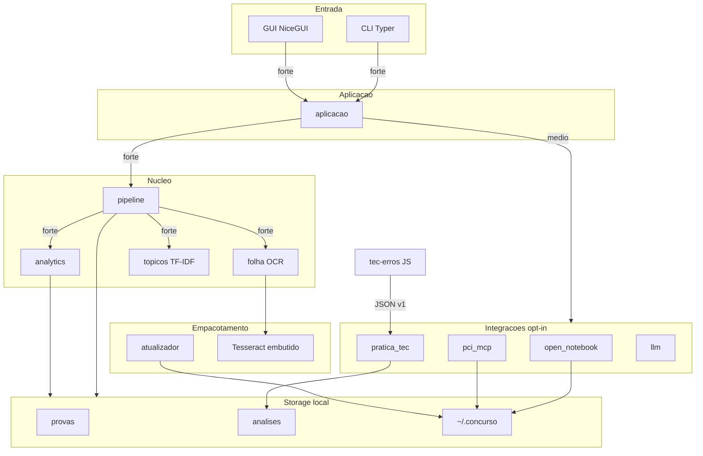

### 3.2 Classes do domínio

Legenda: classes reais de código + entidades de `docs/modelo.md`. Não há `class Concurso` única em `modelo.py` (só enums).

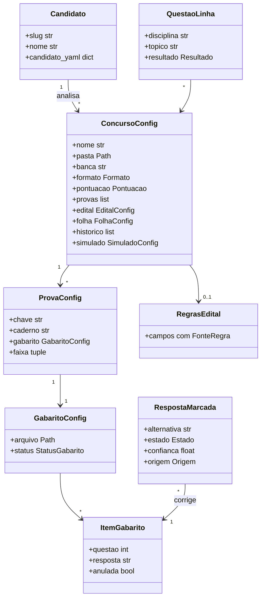

### 3.3 Estados

Legenda: estados desejados do brief vs código. Transições ausentes → gaps G-EST-*.

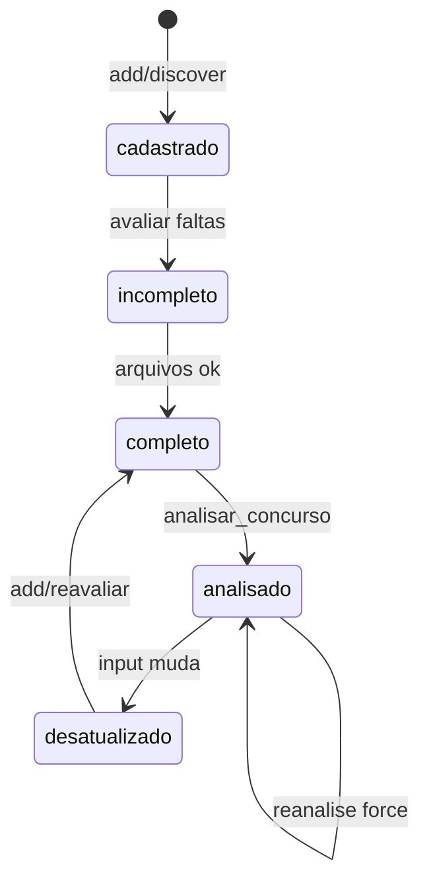

`Situacao` no código (`status.py`): completo / incompleto / desatualizado (inspecionar enums). Prova/Gabarito/Análise/Integração:

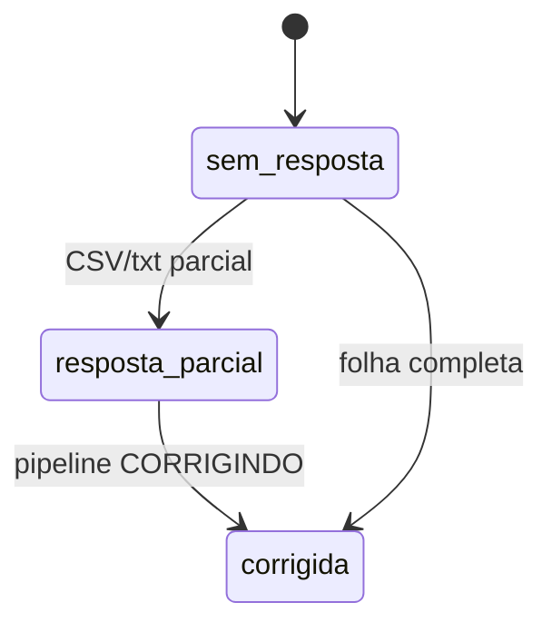

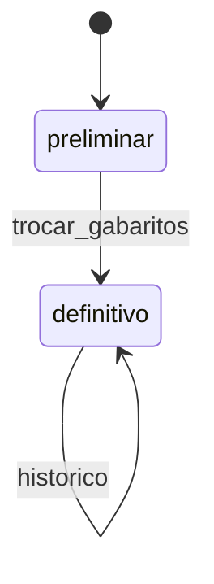

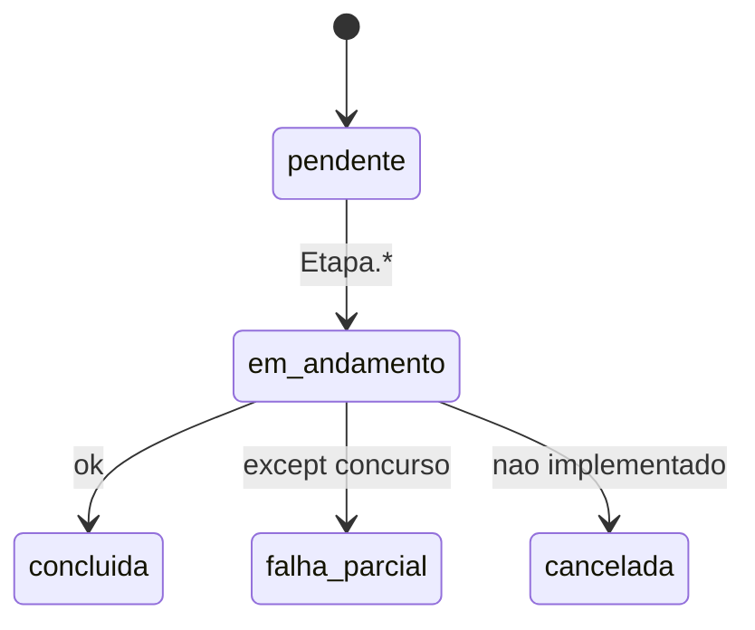

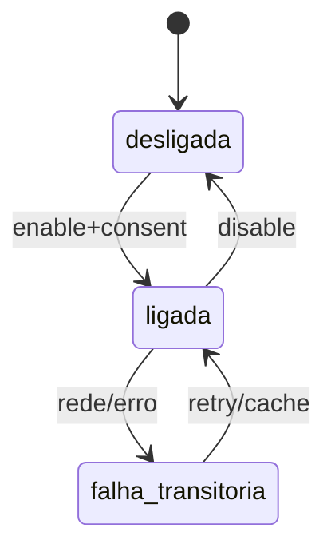

### 3.4 Sequências críticas

#### Análise completa

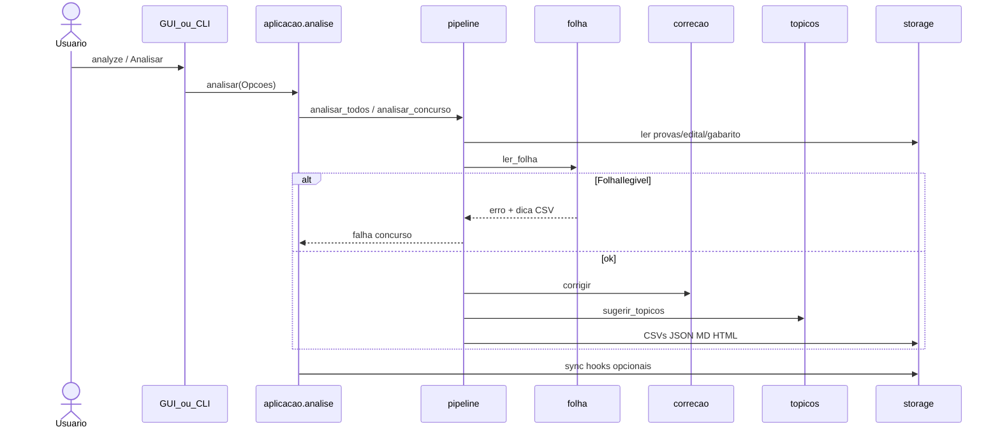

#### Sync open-notebook

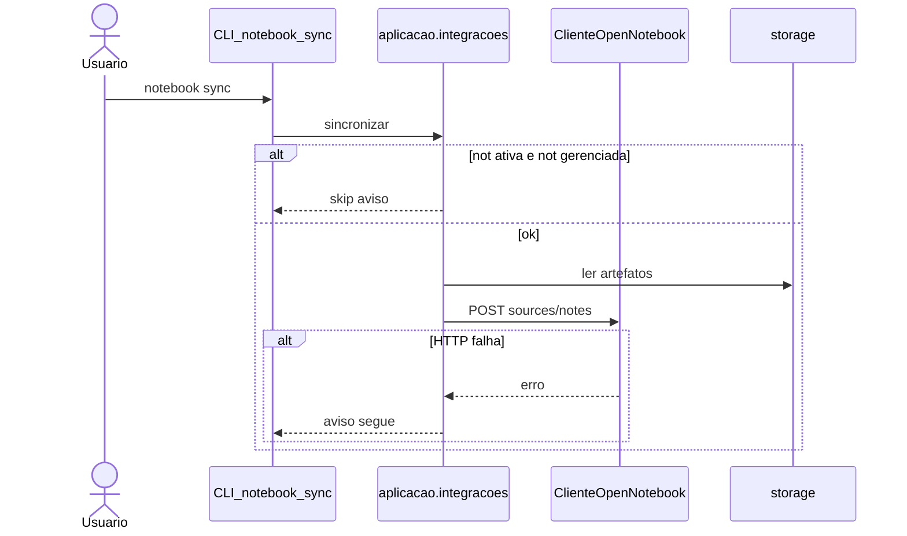

#### Discover PCI

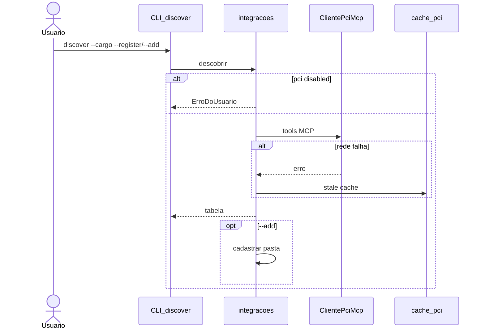

#### Import TEC

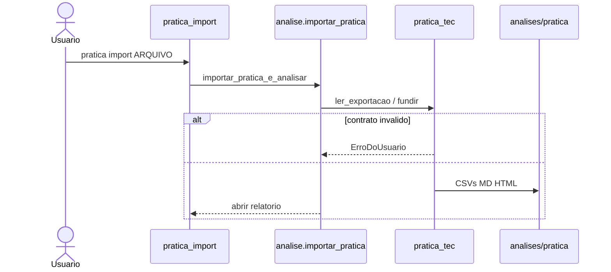

#### Repetir erros TEC

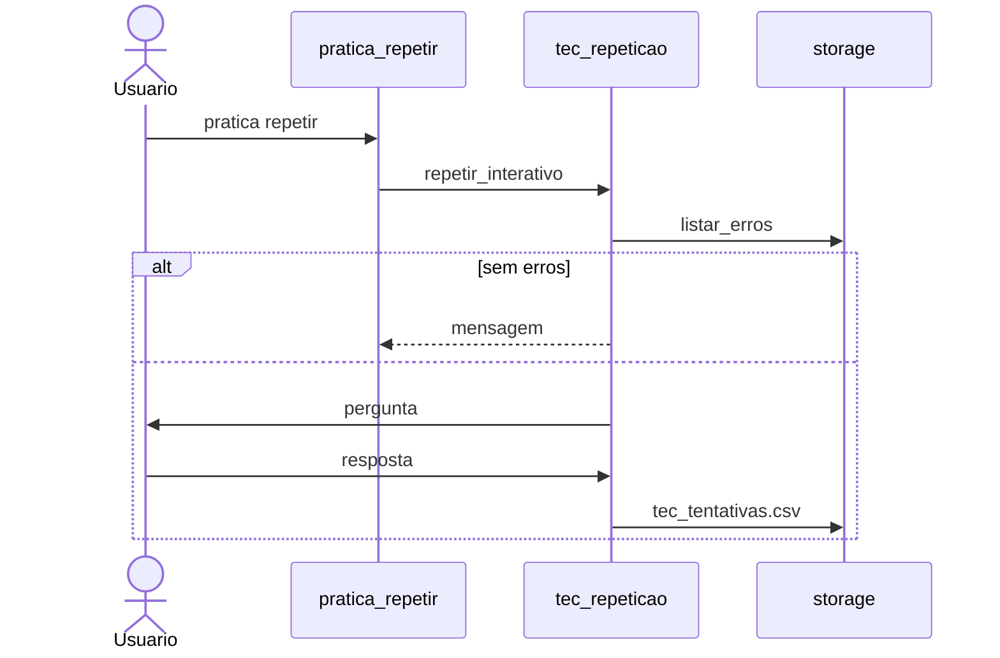

### 3.5 Atividades

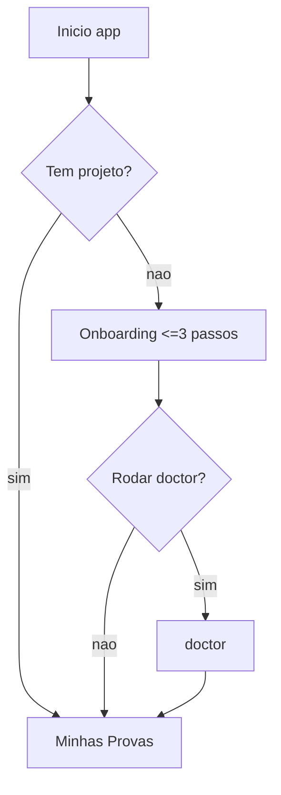

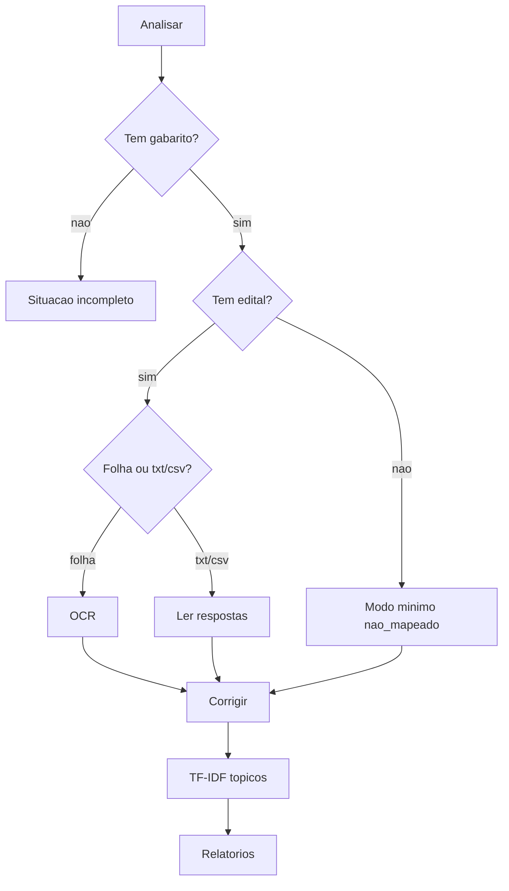

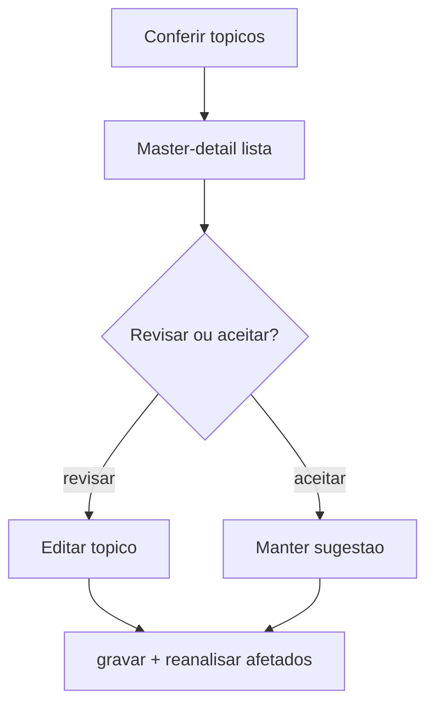

### 3.6 Deployment

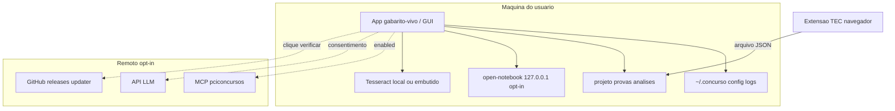

### 3.7 ER storage

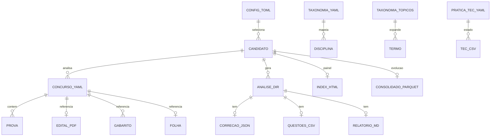

---
## 4. Catálogo de processos

**CC de processo** = `1 + número de pontos de decisão` (não é CC de código radon).

| ID | Processo | Ator | Pré-condições | Passos | Pontos de decisão | Pós-condições | Caminhos de erro | CC | Duração est. |
|---|---|---|---|---|---|---|---|---|---|
| P-001 | Cadastrar concurso | usuário | projeto | 1 abrir `/novo` ou `add` 2 detectar papéis 3 gravar yaml | detectou edital?; PCI? | pasta em `provas/` | arquivo inválido | 3 | 2–10 min |
| P-002 | Importar folha | usuário | concurso cadastrado | 1 fornecer PDF/img/txt/csv 2 OCR ou parse 3 CSV respostas | folha vs txt?; OCR ok? | `respostas_*` | FolhaIlegivel | 3 | 1–5 min |
| P-003 | Analisar prova única | usuário | completo | 1 `analyze CONCURSO` 2 etapas Etapa.* 3 relatório | force?; reuse-csv? | `analises/<c>/<conc>/` | except → falha parcial | 3 | 1–15 min |
| P-004 | Analisar todos `--force` | usuário | ≥1 concurso | 1 loop pastas 2 consolidar 3 hooks | cada completo?; force? | consolidado + index | um falha, outros seguem | 3 | 5–60 min |
| P-005 | Conferir tópicos | usuário | análise com sugestões | 1 `/conferir` 2 editar 3 gravar+reanalisar | aceitar sugestão? | revisão CSV | validação campo | 2 | 5–30 min |
| P-006 | Trocar gabarito def. | usuário/sistema | preliminar + novo arquivo | 1 detectar troca 2 `trocar_gabaritos` 3 hist | há troca? | histórico + reanálise | parse gabarito | 2 | 1–5 min |
| P-007 | Sync open-notebook | usuário | enabled+consent ou gerenciado | 1 sync 2 upload artefatos | rede?; dry-run? | sources/notes | aviso, análise ok | 3 | 1–10 min |
| P-008 | Descobrir PCI | usuário | `pci enable` | 1 discover filtros 2 register 3 add opcional | enabled?; cache? | interesses / pasta | ErroDoUsuario / stale | 3 | 2–10 min |
| P-009 | Importar simulado PCI | usuário | PCI + prova HTML | 1 `pci provas` 2 download assistido 3 import | download ok?; import-all? | pasta simulado | captcha/user | 3 | 5–20 min |
| P-010 | Importar TEC | usuário | export v1/planilha | 1 `pratica import` 2 fundir 3 relatórios | formato?; candidato? | `pratica/` | contrato inválido | 3 | 2–10 min |
| P-011 | Repetir erros TEC | usuário | erros importados | 1 `pratica repetir` 2 responder 3 gravar tentativa | há erros?; assunto? | `tec_tentativas.csv` | vazio | 3 | 5–40 min |
| P-012 | Exportar consolidado | usuário | consolidado existe | 1 `export --format` | csv/parquet/md? | `export/` | sem dados | 2 | <1 min |
| P-013 | Atualizar app | usuário | instalador | 1 verificar 2 confirmar 3 instalar | canal?; assinatura ok? | binário novo | sig falha | 3 | 2–10 min |
| P-014 | Onboarding | usuário novo | sem projeto | 1 perguntas 2 doctor opcional 3 exemplo | doctor?; calibrar? | config+projeto | TTY/`--yes` | 3 | 3–10 min |

---
## 5. Complexidade ciclomática de código

**Escala radon:** A (1–5), B (6–10), C (11–20), D (21–30), E (31–40), F (41+).

**Estado atual (gate):** **0** funções com CC > 15 em `src/concursos/`. Limiar global `cc_maximo = 15` em [`docs/arquitetura/limiares.toml`](arquitetura/limiares.toml); dívida CC vazia.

**Baseline vermelho** (commit `7016502`, 49 funções CC > 15, 1× F): ver [`docs/arquitetura/vermelho-baseline.md`](arquitetura/vermelho-baseline.md). A lista histórica abaixo documenta o ponto de partida; o inventário F/P §2 ainda cita linhas daquele snapshot.

### Funções com CC > 15 (atual)

Nenhuma. O job CI `arquitetura` falha se aparecer alguma fora da dívida (vazia).

### Baseline — Top 20 e lista completa (histórico `7016502` / `d082853`)

Conservado para auditoria do programa. Fonte original: `radon cc` no baseline.

| CC | Classe | Função | Arquivo:linha (baseline) |
|---|---|---|---|
| 45 | F | `explicar_erros_tec` | `aplicacao/tec_estudo.py` |
| 26 | D | `importar_pratica` / `fundir` | `pratica_tec.py` |
| 25 | D | `sugerir_termos` / `_cortes_do_texto` | dicionário / regras |
| … | … | (49 no total; ver vermelho-baseline.md) | … |

### CC média por pacote (aprox. path)

| Pacote | N blocos | CC média | Máx | Blocos CC>10 |
|---|---|---|---|---|
| `_raiz` | 770 | 4.32 | 26 | 61 |
| `cli` | 45 | 4.00 | 14 | 3 |
| `aplicacao` | 304 | 3.83 | 45 | 22 |
| `analytics` | 396 | 3.83 | 25 | 24 |
| `integracoes` | 186 | 3.56 | 22 | 14 |
| `gui` | 298 | 2.96 | 14 | 3 |
| `estudo` | 81 | 2.86 | 14 | 2 |
| `livros` | 79 | 3.04 | 10 | 0 |

### Maintainability Index — alvos do programa

Os 4 arquivos que estavam em **MI 0.00** no baseline estão com MI ≥ 30 (fachada fina + implementação vizinha onde coube). Gate: `mi_minimo = 30` em `limiares.toml` para esses quatro.

### Halstead

Fonte: `uv run radon hal src/concursos` (amostra por arquivo; ver artefato de coleta). Totais por arquivo no output bruto; não agregado global pelo radon nesta versão.

---
## 6. Métricas estruturais

### LOC por camada

Fonte: `uv run radon raw src/concursos -s` → SLOC total **28130**; LOC **34163**.

| Camada | SLOC | Fonte do agrupamento |
|---|---|---|
| CLI | 858 | `cli/` |
| GUI | 4500 | `gui/` |
| aplicacao | 4018 | `aplicacao/` |
| analytics | 5211 | `analytics/` |
| pipeline (núcleo) | 2245 | pipeline/folha/correcao/topicos/… |
| integrações | 1849 | `integracoes/` |
| relatórios | 1459 | relatorio* / exportacao / consolidado |
| estudo | 898 | `estudo/` |
| livros | 857 | `livros/` |
| empacotamento (src) | 402 | atualizador/empacotado |
| demais raiz | 5833 | resto do pacote |
| testes | ~24296 linhas `wc` | `tests/**/*.py` (não radon) |

### Cobertura de testes

Fonte: `uv run pytest --cov=src/concursos --cov-report=term --cov-report=json` (2026-11-19, commit `d082853`).

| Métrica | Valor | Nota |
|---|---|---|
| Cobertura global | ≥ **90.8993%** | piso em `limiares.toml` (max Fase 0 / pós-refactor) |
| Módulos <60% | ≤ 2 | gate `modulos_abaixo_de_60_max` |
| Gate no CI | presente | job `arquitetura` + `verificar_arquitetura.py` |

### Docstrings (`interrogate`)

Fonte: `uv run interrogate src/concursos -v` → **30.8%** (743/2409 cobertos). Abaixo do mínimo default 80%.

### Dead code (`vulture`)

Fonte: `uv run vulture src/concursos docs/arquitetura/vulture-whitelist.py --min-confidence 80` → **0** candidatos. Em confiança 60 restam só os listados na whitelist (notebooks/`analytics`).

Amostra: `contar_questoes`, `validar_schema`, `simular_cenario`, `peculiaridades_do_edital`, … em `analytics/`.

### Dependências externas

Fonte: inspeção [`pyproject.toml`](../pyproject.toml).

| Pacote | Restrição | Opcional | CVE |
|---|---|---|---|
| typer, pandas, numpy, … | ranges `>=` | não | não scaneado (sinalizar) |
| keyring | `llm` extra | sim | — |
| mcp | `pci` extra | sim | — |
| nicegui | `gui` extra | sim | — |
| radon, vulture, interrogate, pydeps, pytest-cov | group `arquitetura` | sim (dev) | — |

### Dependências internas / ciclos

Fonte: AST (todo o corpo, inclusive `TYPE_CHECKING`) + `import-linter`.

- Ciclos do baseline **quebrados**: folha `tipos_topicos` / `pratica.constantes`; sugeridor injetado; `tec_estatisticas` ↛ `pratica_tec`.
- Gate: `scripts/verificar_arquitetura.py` + contratos em `pyproject.toml`. ADRs: `docs/decisoes/adr-ciclos-topicos-tec.md`.

### Acoplamento (top)

| Tipo | Módulo | N |
|---|---|---|
| aferente | `concursos.erros` | (baseline) 53 |
| aferente | `concursos.modelo` | (baseline) 52 |
| eferente pública | `concursos.pipeline` (`__init__`) | ≤ **12** (gate; tipicamente 1–2: `artefatos` + `pipeline.nucleo`) |
| eferente | `pipeline.nucleo` | alto (orquestração; etapas futuras) |

### Superfície de configuração

| Arquivo | Validação | Fonte |
|---|---|---|
| `concurso.yaml` | forte (`validar_dados`) | `concurso_config.py` |
| `[analise]` config.toml | forte | `configuracao.py` |
| `taxonomia.yaml` | forte | `analytics/taxonomia.py` |
| `taxonomia_topicos.yaml` | forte | `dicionario_topicos.py` |
| `[pratica]` | forte | `pratica_tec.py` |
| `[llm]` global | soft/defaults | `llm.py` |
| `[open_notebook]` / `[pci_mcp]` | tipos | integracoes |
| `candidato.yaml` | leve | `candidatos.py` |

Contagem exata de chaves: inspeção `docs/modelo.md` (fonte canônica).

### Superfície de integração

| Integração | Endpoints/tools | Obrigatório? |
|---|---|---|
| open-notebook | `/health`, `/api/notebooks`, `/api/sources`, `/api/notes`, `/api/search`, `/api/embed`, ask/simple | opt-in |
| PCI MCP | `listar_concursos`, `pesquisar_concursos`, `buscar_por_cargo`, `buscar_por_cidade`, `pesquisar_provas` | opt-in |
| TEC JSON | contrato v1 campos + planilha sinônimos | opt-in prática |
| LLM | chat completions / Anthropic messages | opt-in |

### Formatos de arquivo

| Formato | Leitura | Escrita |
|---|---|---|
| PDF | edital/prova/folha | — |
| imagem | folha | depuracao PNG, gráficos |
| txt/csv | respostas, TEC | questao/desempenho CSVs |
| json | TEC, manifesto | correcao, edital_estruturado |
| yaml | configs | confirmações |
| parquet | consolidado | consolidado/export |
| md/html | — | relatórios/painel |
| xlsx | planilha TEC | — |

### Mensagens de erro

Inspeção: `ErroDoUsuario`/`ErroDoAmbiente` + `dica=` espalhados (`aplicacao/integracoes` ~30 hits). Total exato + % com teste: **parcial** (gap G-MET-002). Padrão de tela: `erro:` / `dica:` / `detalhe:`.

### Comandos CLI / telas GUI

| | Total | Help | Teste integração |
|---|---|---|---|
| Comandos Typer (grupos) | ~17 grupos / ~30 actions | Typer `--help` | parcial |
| Rotas GUI | 14 + redirects | n/a | `tests/gui/` parcial |
| Empty states | parcial | — | — |

---
## 7. Gaps do sistema

Cada gap: evidência + severidade + impacto + esforço + **sugestão**.

### 7.1 Documentado mas não implementado

| ID | Descrição | Evidência | Severidade | Impacto | Esforço | Sugestão |
|---|---|---|---|---|---|---|
| G-001 | ~~Cancel cooperativo do pipeline ausente~~ **fechado** | `docs/decisoes/decisoes-ux-gabarito-vivo.md` dívida; GUI “Parar de acompanhar” ≠ cancel | alta | usuário não interrompe análise | M | flag cooperativa nas etapas `Etapa` |
| G-002 | ~~Brief cita `tec import`; CLI real é `pratica`~~ **fechado** | `cli/comandos.py` | média | docs/tutoriais errados | P | alinhar docs e aliases |
| G-003 | ~~Domínio UML “Variante/Análise” sem classe única~~ **fechado** | `modelo.py` só enums | baixa | onboarding eng. | P | documentar mapeamento (este doc) |

### 7.2 Implementado mas não documentado

| ID | Descrição | Evidência | Severidade | Impacto | Esforço | Sugestão |
|---|---|---|---|---|---|---|
| G-004 | ~~Comandos `pratica`/`estudo`/`livros`/`dicionario`/`export` fracos no README~~ **fechado** | README grep | alta | descoberta | P | seção Desenvolvimento |
| G-005 | ~~Tips CLI ainda dizem `concurso-analise`~~ **fechado** | `comandos.py` | média | confusão rebrand | P | trocar para `gabarito-vivo` |
| G-006 | ~~Rotas `/conferir`, `/disciplinas`~~ **fechado** | `gui/app.py` | média | UX poder | P | README + ajuda in-app |

### 7.3 Sem teste

| ID | Descrição | Evidência | Severidade | Impacto | Esforço | Sugestão |
|---|---|---|---|---|---|---|
| G-007 | ~~Sem gate coverage CI~~ **fechado** | job `arquitetura` + piso 90.8867% | — | — | — | `limiares.toml` + `verificar_arquitetura.py` |
| G-008 | ~~`cli/legado.py` pouco testado~~ **fechado** | pairing | baixa | legado | P | teste de aviso deprecação |
| G-009 | ~~`exportacao.py` / `agregacao.py` pairing fraco~~ **fechado** | inspeção tests/ | média | export quebrado | M | testes sintéticos |
| G-010 | ~~Top 10 críticos CC alto sem teste dedicado óbvio~~ **fechado** | `explicar_erros_tec` CC45 | alta | bugs TEC | M | testes unidade caminhos |

### 7.4 Sem fallback

| ID | Descrição | Evidência | Severidade | Impacto | Esforço | Sugestão |
|---|---|---|---|---|---|---|
| G-011 | ~~LLM falha → aviso e segue (OK) ~~ **fechado** (manter; documentado) | `edital_llm` | — | — | — | manter; documentar |
| G-012 | ~~PCI sem cache frio + offline~~ **fechado** | `pci_mcp`/`cache_pci` | média | discover vazio | P | mensagem explícita empty-state |
| G-013 | ~~open-notebook down~~ **fechado** | sync aviso | média | sync silent fail | P | status na GUI Sobre/Estudar |

### 7.5 Sem validação

| ID | Descrição | Evidência | Severidade | Impacto | Esforço | Sugestão |
|---|---|---|---|---|---|---|
| G-014 | ~~`[llm]` soft~~ **fechado** | `llm.py` | média | config inválida silenciosa | M | schema rígido como pci |
| G-015 | ~~`candidato.yaml` leve~~ **fechado** | `candidatos.py` | média | campos PCI inconsistentes | M | validar schema |

### 7.6 Duplicação

| ID | Descrição | Evidência | Severidade | Impacto | Esforço | Sugestão |
|---|---|---|---|---|---|---|
| G-016 | ~~CLI e GUI ambos montam fluxos via `aplicacao/` (bom) mas tips/labels divergem~~ **fechado** | linguagem | média | jargão | P | um mapa |
| G-017 | ~~consolidado fase1 vs analytics consolidado~~ **fechado** | `consolidado.py` × `analytics/consolidado.py` | média | confusão eng | M | doc de fronteira (parcialmente em AGENTS) |

### 7.7 Código morto

| ID | Descrição | Evidência | Severidade | Impacto | Esforço | Sugestão |
|---|---|---|---|---|---|---|
| G-018 | ~~135 candidatos vulture@60~~ **fechado** | vulture | média | ruído | M | whitelist notebooks + limpar real |
| G-019 | ~~`rastro` unused pci~~ **fechado** | vulture@80 | baixa | lint | P | remover ou usar |

### 7.8 Terminologia

| ID | Descrição | Evidência | Severidade | Impacto | Esforço | Sugestão |
|---|---|---|---|---|---|---|
| G-020 | ~~`análise` vs `correção`~~ **fechado** | CLI analyze / correcao.json | média | usuário | P | spec-linguagem |
| G-021 | ~~`tópico` vs `assunto` (TEC)~~ **fechado** | pratica_tec | média | mapeamento | P | tabela sinônimos UI |
| G-022 | ~~`prova` vs `concurso`~~ **fechado** | pastas/provas | média | cadastro | P | glossário in-app |
| G-023 | ~~`gabarito-vivo` vs `concurso-analise` vs `.concurso`~~ **fechado** | produto.py | alta | rebrand | G | plano migração nomes |

### 7.9 Hard-coded

| ID | Descrição | Evidência | Severidade | Impacto | Esforço | Sugestão |
|---|---|---|---|---|---|---|
| G-024 | ~~URL default MCP PCI~~ **fechado** | `pci_mcp` config | baixa | fork | P | já config; documentar |
| G-025 | ~~N_MINIMO_TOPICO / limiares~~ **fechado** | analytics + config | baixa | — | — | limiar já em config.toml parcial |
| G-026 | ~~Tips com comando legado~~ **fechado** | comandos.py | média | ver G-005 | P | — |

### 7.10 Deps

| ID | Descrição | Evidência | Severidade | Impacto | Esforço | Sugestão |
|---|---|---|---|---|---|---|
| G-027 | ~~Ranges largos sem pin exato no pyproject (lock existe)~~ **fechado** | pyproject + uv.lock | baixa | repro | P | confiar no lock; CVE scan CI |
| G-028 | ~~Sem Dependabot/CVE scanner documentado~~ **fechado** | repo | média | segurança | M | workflow audit |

### 7.11 Estados

| ID | Descrição | Evidência | Severidade | Impacto | Esforço | Sugestão |
|---|---|---|---|---|---|---|
| G-029 | ~~Estado análise `cancelada` sem transição~~ **fechado** | pipeline | alta | G-001 | M | implementar ou remover do UX |
| G-030 | ~~Prova `resposta_parcial` implícita~~ **fechado** | respostas CSV | média | status UI | M | expor em `status` |

### 7.12 Riscos estruturais

| ID | Descrição | Evidência | Severidade | Impacto | Esforço | Sugestão |
|---|---|---|---|---|---|---|
| G-031 | ~~`pipeline` SPOF eferente 35~~ **fechado** | fachada ≤12; etapas em `pipeline/etapas/` | — | — | — | ADR fachada + tempo-analyze |
| G-032 | ~~Ciclos topicos/dicionario~~ **fechado** | AST + import-linter | — | — | — | ADR ciclos |
| G-033 | ~~MI 0.00 módulos centrais~~ **fechado** | MI ≥ 30 nos 4 | — | — | — | limiares.toml |
| G-034 | ~~`explicar_erros_tec` CC 45~~ **fechado** | CC ≤ 15 | — | — | — | split em tec_estudo |

### 7.13 UX/UI leva 2

| ID | Descrição | Evidência | Severidade | Impacto | Esforço | Sugestão |
|---|---|---|---|---|---|---|
| G-035 | ~~Cancel real pipeline~~ **fechado** | decisoes-ux | alta | G-001 | M | — |
| G-036 | ~~Undo genérico ausente~~ **fechado** | decisoes-ux / código | média | medo editar | G | undo por tela |
| G-037 | ~~Busca global ausente~~ **fechado** | inspeção GUI | média | navegação | M | busca concursos/tópicos |
| G-038 | ~~Breadcrumb profundo~~ **fechado** | GUI | baixa | orientação | P | componente tema |

### Top 15 gaps priorizados

Todos os G-001–G-038 do §7 estão **fechados** (vermelho→verde + amarelo→verde). A tabela abaixo é histórica do ranking usado nas duas levas.

| Rank | ID | Por quê (histórico) |
|---|---|---|
| 1 | G-031 | SPOF pipeline |
| 2 | G-034 | CC 45 caminho TEC |
| 3 | G-001/G-029 | cancel/estado mentiroso |
| 4 | G-007 | sem coverage gate |
| 5 | G-033 | MI 0 módulos core |
| 6 | G-032 | ciclos import |
| 7 | G-004 | comandos invisíveis README |
| 8 | G-023 | rebrand nomes |
| 9 | G-010 | testes CC altos |
| 10 | G-014 | validação LLM |
| 11 | G-018 | dead code noise |
| 12 | G-005/G-026 | tips legados |
| 13 | G-013 | ON down UX |
| 14 | G-037 | busca global |
| 15 | G-017 | dois consolidados |

---## 8. Recomendações priorizadas

Score implícito `(sev × impacto) / esforço`.

**Feito (vermelho→verde + amarelo→verde):** CC ≤ 15; ciclos AST; fachada `pipeline`; MI dos 4; gate CI + limiares; ADRs; distribuição/`pasta` `gabarito-vivo`; cancel cooperativo; schema `[llm]`/`candidato.yaml`; CVE `pip-audit`; README completo; busca/exclusão/desfazer; vulture whitelist; glossário leigo.

1. **Regenerar inventário F/P completo** — §2.0 contagens atualizadas; linhas F-#### ainda do baseline `7016502`.
2. **Desfazer Salvar nas demais telas** — o padrão de snapshot já está em Conferir tópicos; espelhar em taxonomia/dicionário/preferências.

---
## 9. Apêndices

### A. Comandos de coleta

```sh
uv sync --group arquitetura --extra gui --extra llm --extra pci
uv run python scripts/inventario_funcoes.py > /tmp/inventario_f.md
uv run radon cc src/concursos -s -a
uv run radon mi src/concursos -s
uv run radon raw src/concursos -s
uv run radon hal src/concursos
uv run vulture src/concursos --min-confidence 60
uv run interrogate src/concursos -v
uv run pydeps src/concursos --max-bacon=2 --show-cycles --no-output
uv run pytest --cov=src/concursos --cov-report=term --cov-report=json:/tmp/coverage.json -q
```

Acoplamento: script AST ad-hoc (ver histórico de geração).

### B. Glossário

| Termo | Significado |
|---|---|
| Gabarito Vivo | Nome do produto |
| `concursos` | Pacote Python |
| `concurso-analise` | Nome de distribuição / legado |
| CC | Complexidade ciclomática |
| TF-IDF | Classificação de tópicos |
| PCI | PCI Concursos (MCP) |
| TEC | TEC Concursos (prática) |
| open-notebook | RAG local gerenciado ou remoto |
| `aplicacao/` | Orquestração CLI/GUI |
| Situacao | completo/incompleto/desatualizado |
| FonteRegra | Proveniência de campo do edital |

### C. Mapa arquivos → seções

| Área | Seções |
|---|---|
| `cli/` | §2.1 CLI, P-*, seq |
| `gui/` | §2.1 GUI, atividades |
| `pipeline/` | §3–5, G-031, ADR fachada |
| `integracoes/` | §2 integrações, §6 |
| `analytics/` | §5 MI, G-018 |
| `empacotamento/` | F-PKG, P-013 |
| `tec-erros/` | F-TEC |
| `docs/modelo.md` | domínio ER |
| `docs/decisoes/decisoes-ux-*` | G-035+ |
| `docs/README.md` | índice da pasta docs |

### D. Histórico de geração

| Versão doc | Commit | Data | Como regenerar |
|---|---|---|---|
| 1.0 | `d082853` | 2026-11-19 | Apêndice A + recolar inventário AST neste arquivo |
| 1.1 | pós-`7016502` (vermelho→verde) | 2026-11-19 | `verificar_arquitetura.py` + baseline em `docs/arquitetura/` |
| 1.2 | amarelo→verde | 2026-11-22 | nomes `gabarito-vivo`, cancel, schema, CVE, UX desfazer/busca, gaps §7 fechados |

Regra AGENTS: ao mudar arquitetura, atualizar este documento.

---

*Fim do mapa as-is.*
